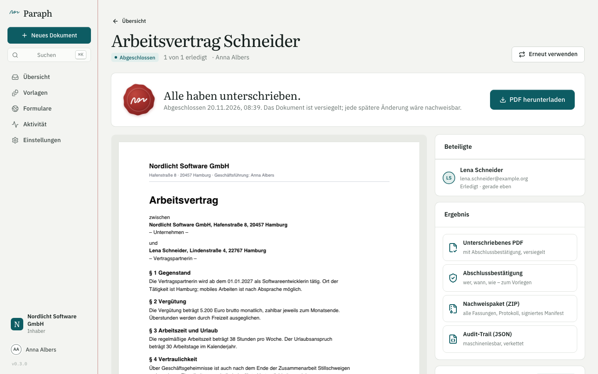

# Paraph

[](https://github.com/PBaumfalk/Paraph/actions/workflows/ci.yml)
[](LICENSE)
[](https://github.com/PBaumfalk/Paraph/pkgs/container/paraph)

**Dokumente elektronisch unterschreiben lassen, auf dem eigenen Server.** Paraph ist eine kostenlose Plattform für elektronische Unterschriften für Unternehmen, Kanzleien, Steuerbüros, Vereine und Verwaltungen, eine selbst betriebene Alternative zu DocuSign. Sie laden einen Arbeitsvertrag, eine Auftragsbestätigung, einen Mitgliedsantrag oder eine Einwilligung hoch, markieren, wo unterschrieben wird, und versenden. Die Empfänger unterschreiben im Browser oder am Smartphone, ohne Konto und ohne App. Am Ende steht ein versiegeltes PDF mit Abschlussbestätigung, dessen Echtheit jeder nachprüfen kann.

Paraph läuft auf **Ihrem eigenen Server**: ohne Abo, ohne Preis pro Dokument, ohne Konto bei einem Anbieter. Dokumente und Protokolle bleiben bei Ihnen; nach außen geht nur, was Sie selbst einrichten, etwa Ihr Mailserver.

*Paraph* kommt von der Paraphe, dem Kürzel am Rand jeder Vertragsseite.

> **English abstract** — Self-hosted e-signature platform, an alternative to DocuSign and DocuSeal. Simple electronic signatures (SES) with a hash-chained audit trail, PAdES platform seal with verified RFC 3161 timestamps, external Merkle anchoring, an evidence package and a public verification page. Templates, bulk sending, public forms, REST API and webhooks. Node 24, Fastify, SQLite, React; ships as a hardened Docker image (amd64/arm64). UI in German and English, documentation in German.



> [!IMPORTANT]
> **Version 0.3.0 ist eine Vorabversion.** Die Technik ist geprüft. Die mitgelieferten Erklärungs- und Formhinweistexte sind aber noch nicht juristisch freigegeben, und der Betrieb mit echtem Mailserver und Let's Encrypt ist noch nicht abgenommen. Was das bedeutet: [Recht](docs/handbuch/07-recht.md) und [Grenzen](docs/handbuch/17-grenzen.md).

## 📖 Handbuch

Die vollständige Anleitung steht im **[Handbuch](docs/handbuch/README.md)**, verständlich für alle, die Dokumente versenden, mit eigenen Teilen für Administration und IT. Sie reicht vom [ersten Vorgang Schritt für Schritt](docs/handbuch/01-paraph-in-fuenf-minuten.md#ihr-erster-vorgang-schritt-für-schritt) über [Unterschreiben lassen](docs/handbuch/02-dokument-unterschreiben-lassen.md), [Vorlagen und Serien](docs/handbuch/04-vorlagen-serien-formulare.md) und das [Prüfen eines Ergebnisses](docs/handbuch/06-dokumente-pruefen.md) bis zu [Installation](docs/handbuch/11-installation.md), [Sicherung](docs/handbuch/13-sicherung-und-updates.md) und [API](docs/handbuch/10-anbindung-api-webhooks.md). Jede Funktion mit Fundstelle steht in der [Funktionsliste](docs/handbuch/funktionsliste.md).

## Installation

Paraph ist eine Server-Anwendung: Sie wird einmal installiert, und alle nutzen sie im Browser. Zum Ausprobieren genügt **Docker Desktop** auf dem eigenen Rechner.

<details>
<summary><strong>🧪 Ausprobieren in einer Minute</strong> (Mac, Windows oder Linux mit Docker Desktop)</summary>

```bash
docker run -d --name paraph -p 8080:8080 -e APP_URL=http://localhost:8080 -v paraph-data:/data ghcr.io/pbaumfalk/paraph:0.3
docker logs paraph        # zeigt den Einrichtungscode
```

Dann <http://localhost:8080/setup> öffnen, den Einrichtungscode eingeben, ein Konto anlegen und ein PDF hochladen, zum Beispiel das [Beispieldokument](docs/handbuch/beispiele/Mandatsvereinbarung-Beispiel.pdf). So gestartet versendet Paraph keine E-Mails; die Links zum Unterschreiben zeigt es Ihnen an ([erster Vorgang](docs/handbuch/01-paraph-in-fuenf-minuten.md#ihr-erster-vorgang-schritt-für-schritt)). Wieder entfernen: `docker rm -f paraph && docker volume rm paraph-data`.

Mit Umwandlung von Word- und ODT-Dateien: `git clone https://github.com/PBaumfalk/Paraph.git && cd Paraph && ./scripts/install.sh --probe`.
</details>

<details>
<summary><strong>🖥️ Auf einem Server</strong> (für die IT: Linux, Docker Compose, eigene Domain)</summary>

```bash
sudo git clone https://github.com/PBaumfalk/Paraph.git /opt/paraph && cd /opt/paraph
sudo ./scripts/install.sh
```

Das Skript fragt Domain, SMTP-Zugang und Zeitstempeldienst ab, erzeugt die Schlüssel, startet Paraph mit automatischem HTTPS (Caddy und Let's Encrypt) und nennt am Ende Einrichtungscode und Wiederherstellungs-Passphrase. Ein erneuter Aufruf ändert an Schlüsseln und Konfiguration nichts. Statt selbst zu bauen, lässt sich das fertige Image `ghcr.io/pbaumfalk/paraph` verwenden (amd64 und arm64).

Reverse Proxy (nginx, Traefik), Firewall, Updates mit Rückweg und Sicherung: [Handbuch, Kapitel 11–15](docs/handbuch/11-installation.md).
</details>

<details>
<summary><strong>🤖 Mit Claude Code installieren lassen</strong></summary>

Öffnen Sie [Claude Code](https://code.claude.com/docs/en/setup) im Paraph-Ordner und fügen Sie den fertigen Auftrag aus [Kapitel 18](docs/handbuch/18-installation-mit-claude-code.md) ein. Claude prüft die Voraussetzungen, installiert, weist den Start nach und nennt Adresse und Einrichtungscode. Zugangsdaten bleiben dabei aus dem Gespräch heraus.
</details>

## Funktionen im Überblick

<table>
<tr><th>Editor</th><th>Signaturseite</th><th>Unterschrift</th></tr>
<tr>
<td></td>
<td></td>
<td></td>
</tr>
</table>

- **Unterschreiben lassen**: PDF, Word oder ODT hochladen, Beteiligte eintragen, Felder setzen, versenden. Beteiligte unterschreiben, geben frei, füllen aus oder erhalten eine Kopie, gleichzeitig oder nacheinander — [Kapitel 2](docs/handbuch/02-dokument-unterschreiben-lassen.md)
- **12 Feldtypen**: Unterschrift, Paraphe, Name, Datum, Text, Zahl, Ankreuzfeld, Auswahl, E-Mail, Berechnung, Anhang, mit Bedingungen und Eingabeprüfung — [Kapitel 2](docs/handbuch/02-dokument-unterschreiben-lassen.md#die-zwölf-feldtypen)
- **Unterschreiben ohne Konto**: geführte Signaturseite für Smartphone und Rechner, gezeichnet, getippt oder als Bild; Zugangsschutz per Einmalcode (E-Mail, optional SMS) oder Zugangscode — [Kapitel 5](docs/handbuch/05-so-unterschreiben-mandanten.md)
- **Nachfassen**: Erinnerungen, Ablauf, Widerruf, neuer Link, Weitergabe an eine Vertretung, Unterschrift vor Ort am Tablet — [Kapitel 3](docs/handbuch/03-vorgaenge-verfolgen.md)
- **Wiederkehrendes**: Vorlagen mit festen Versionen, Massenversand aus CSV oder Excel, öffentliche Formulare für die Website — [Kapitel 4](docs/handbuch/04-vorlagen-serien-formulare.md)
- **Nachweis, den man prüfen kann**: versiegeltes PDF (PAdES), auf Wunsch mit Zeitstempel, Abschlussbestätigung, Nachweispaket mit unabhängigem Prüfskript, manipulationsgesichertes Protokoll — [Kapitel 6](docs/handbuch/06-dokumente-pruefen.md) & [14](docs/handbuch/14-sicherheit-und-nachweis.md)
- **Öffentliche Prüfstelle**: Jeder kann prüfen, ob eine Datei unverändert ist; der Fingerabdruck wird im Browser berechnet, die Datei verlässt den Rechner nicht — [Kapitel 6](docs/handbuch/06-dokumente-pruefen.md)
- **Ehrlich über die Form**: einfache elektronische Signatur; vor dem Versand weist Paraph auf deutsche Formvorschriften hin, etwa bei Kündigung, Bürgschaft oder Vollmacht — [Kapitel 7](docs/handbuch/07-recht.md)
- **Team und Erscheinungsbild**: Rollen, mehrere Organisationen, Zwei-Faktor, Anmeldung über authentik/OIDC, eigenes Logo, eigene Farbe, eigene Domain — [Kapitel 8](docs/handbuch/08-kanzlei-team-erscheinungsbild.md) & [9](docs/handbuch/09-anmeldung-und-sso.md)
- **Anbindung**: REST-API mit Testmodus, Webhooks, Beispiele für n8n und Make, einbettbare Signaturseite — [Kapitel 10](docs/handbuch/10-anbindung-api-webhooks.md)
- **Für den Betrieb gebaut**: gehärteter Container, verschlüsselte automatische Sicherung, Update mit Rückweg, Systemdiagnose, Prometheus-Metriken — [Kapitel 11–15](docs/handbuch/11-installation.md)

| Übersicht | Prüfstelle |
| --- | --- |
|  |  |

## Für Entwickler

Node 24, TypeScript, Fastify, SQLite (better-sqlite3), React 19, pdf.js, pdf-lib, pkijs.

```bash
npm ci
npm run dev:server & npm run dev:web     # Entwicklung
npm run typecheck && npm test            # Typprüfung und Vitest
npm run build && npx playwright test     # Browser-Tests (Mailpit auf 1025/8025)
```

Was welche Prüfung belegt: [Kapitel 16](docs/handbuch/16-tests-und-nachweise.md). Änderungen: [Änderungsprotokoll](CHANGELOG.md).

## Lizenz

[MIT](LICENSE). Mitgeliefert sind das Wurzelzertifikat von [FreeTSA](https://freetsa.org) und die Schriften Literata, IBM Plex und Geist Mono (SIL Open Font License 1.1).

Paraph ist ein technisches Werkzeug und ersetzt keine Rechtsberatung. Ob die elektronische Form im Einzelfall genügt, ist selbst zu prüfen. Das Plattformsiegel belegt, dass ein Dokument seit dem Abschluss unverändert ist; es ist weder ein qualifiziertes Siegel noch eine persönliche Signatur der Unterzeichner.
