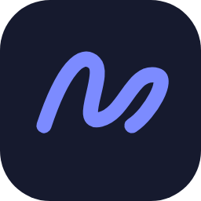
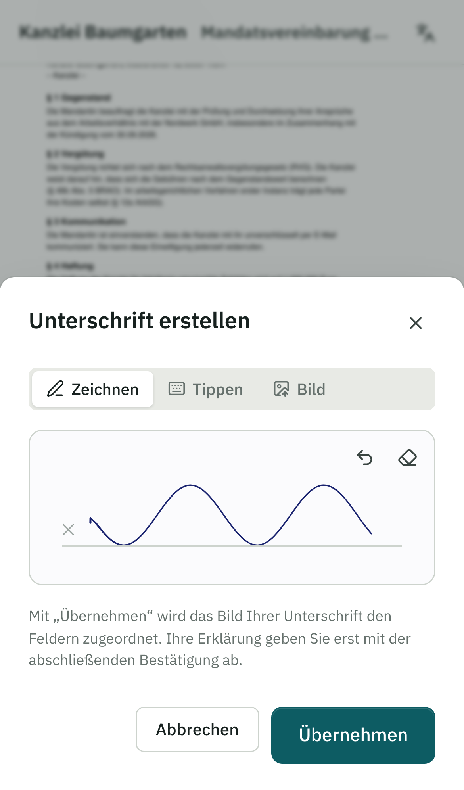
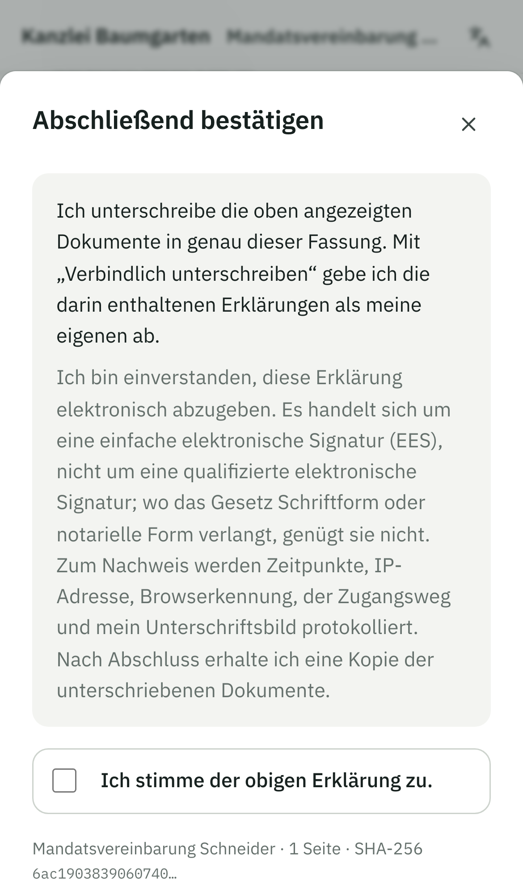
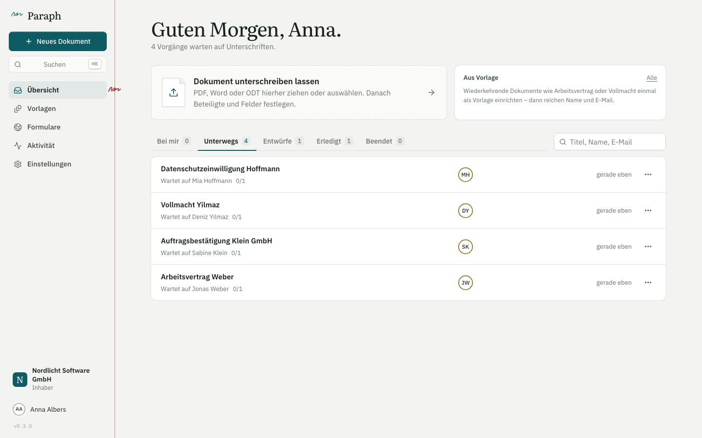

# Paraph

[](https://github.com/PBaumfalk/Paraph/actions/workflows/ci.yml)
[](LICENSE)
[](https://github.com/PBaumfalk/Paraph/pkgs/container/paraph)

**Mandatsvereinbarungen, Vollmachten und Erklärungen elektronisch unterschreiben lassen, auf dem eigenen Server der Kanzlei.**

Paraph ist eine selbst gehostete Plattform für elektronische Unterschriften, gebaut für Anwaltskanzleien. Die ReFa lädt das Dokument hoch, setzt das Unterschriftsfeld und versendet. Die Mandantin unterschreibt am Smartphone, ohne Konto und ohne App. Die Anwältin erhält ein versiegeltes PDF mit Abschlussbestätigung und Nachweispaket, das sich jederzeit prüfen lässt. Es gibt keine Lizenzgrenzen und keinen Preis pro Umschlag. Für Kanzleisoftware, n8n und Make steht eine REST-API bereit.

**[▶ Schnellstart](#schnellstart)** · **[📖 Handbuch](docs/handbuch/README.md)** · **[Ersten Vorgang ausprobieren](docs/handbuch/01-paraph-in-fuenf-minuten.md#ihr-erster-vorgang-schritt-für-schritt)** · **[Installation mit Claude Code](docs/handbuch/18-installation-mit-claude-code.md)**


> [!IMPORTANT]
> **Version 0.2.0 ist eine Vorabversion.** Die Technik ist geprüft (Tests, Docker-Gesamttest, Fremdprüfung der Siegel). Offen sind zwei Punkte. Erstens sind die mitgelieferten Erklärungs- und Formhinweistexte nicht anwaltlich freigegeben. Zweitens ist der Betrieb mit echtem Mailserver und Let's Encrypt noch nicht abgenommen. Prüfen Sie beides vor dem Einsatz mit echten Mandaten: [Recht](docs/handbuch/07-recht.md), [Grenzen](docs/handbuch/17-grenzen.md).

> **English abstract** – Self-hosted e-signature platform for German law firms, an alternative to DocuSign and DocuSeal. Simple electronic signatures (SES) with a hash-chained audit trail, PAdES platform seal with verified RFC 3161 timestamps, external Merkle anchoring, an evidence package and a public verification page. Node 24, Fastify, SQLite, React; ships as a hardened Docker image. UI in German and English, documentation in German.

## Für wen?

| ReFa und Sekretariat | Rechtsanwältin und Rechtsanwalt | IT und Administration |
|---|---|---|
| Dokument hochladen, Mandantin eintragen, Feld setzen, versenden, nachfassen | Ergebnis kontrollieren, unverändert zur Akte nehmen, Echtheit belegen | installieren, Team einrichten, sichern, aktualisieren |
| [Ihr erster Vorgang](docs/handbuch/01-paraph-in-fuenf-minuten.md#ihr-erster-vorgang-schritt-für-schritt) · [Unterschreiben lassen](docs/handbuch/02-dokument-unterschreiben-lassen.md) · [Vorgänge verfolgen](docs/handbuch/03-vorgaenge-verfolgen.md) | [Ergebnis abholen](docs/handbuch/03-vorgaenge-verfolgen.md#das-ergebnis-abholen) · [Dokumente prüfen](docs/handbuch/06-dokumente-pruefen.md) · [Recht und Form](docs/handbuch/07-recht.md) | [Installation](docs/handbuch/11-installation.md) · [mit Claude Code](docs/handbuch/18-installation-mit-claude-code.md) · [Sicherung und Updates](docs/handbuch/13-sicherung-und-updates.md) |

## Schnellstart

Sie brauchen [Docker](https://docs.docker.com/get-started/get-docker/) mit Compose v2, `git` und `openssl`.

<details open>
<summary><strong>Ausprobieren auf dem eigenen Rechner</strong> (Mac oder Linux, etwa 10 Minuten)</summary>

```sh
git clone https://github.com/PBaumfalk/Paraph.git paraph
cd paraph
./scripts/install.sh --probe
```

Das Skript baut Paraph, startet es unter **http://localhost:8080** und zeigt am Ende einen Einrichtungscode. Öffnen Sie `http://localhost:8080/setup`, legen Sie Ihr Konto an und spielen Sie den [ersten Vorgang](docs/handbuch/01-paraph-in-fuenf-minuten.md#ihr-erster-vorgang-schritt-für-schritt) mit dem [Beispieldokument](docs/handbuch/beispiele/Mandatsvereinbarung-Beispiel.pdf) durch. Der Probebetrieb versendet keine E-Mails, die Links geben Sie selbst weiter. Verwenden Sie dabei keine echten Mandantendaten.

Beenden mit `docker compose down`, wieder starten mit `docker compose up -d`.
</details>

<details>
<summary><strong>Auf dem Server der Kanzlei</strong> (Linux, Domain, SMTP-Konto)</summary>

```sh
sudo git clone https://github.com/PBaumfalk/Paraph.git /opt/paraph
cd /opt/paraph
sudo ./scripts/install.sh
```

Das Skript fragt Domain, HTTPS, SMTP und Zeitstempeldienst ab. Es erzeugt die Schlüssel als Docker-Secrets und startet Paraph mit automatischem HTTPS. Am Ende zeigt es den Einrichtungscode für `https://IHRE-DOMAIN/setup` und die Wiederherstellungs-Passphrase. **Übernehmen Sie die Passphrase sofort in einen Passwortmanager.** Einen erneuten Aufruf übersteht das Skript ohne Schaden: Schlüssel und Konfiguration bleiben unverändert.

Statt selbst zu bauen, können Sie das fertige Image `ghcr.io/pbaumfalk/paraph` verwenden (amd64 und arm64, [Kapitel 11](docs/handbuch/11-installation.md#das-fertige-image-von-github-verwenden)).

Prüfen: `sudo docker compose exec paraph paraph doctor`. Updates: `sudo ./scripts/update.sh` (mit `--rollback` zurück). Alles Weitere, auch hinter nginx oder Traefik: [Kapitel 11](docs/handbuch/11-installation.md).
</details>

<details>
<summary><strong>Mit Claude Code installieren lassen</strong></summary>

Öffnen Sie [Claude Code](https://code.claude.com/docs/en/setup) im Paraph-Ordner und fügen Sie den fertigen Auftrag aus [Kapitel 18](docs/handbuch/18-installation-mit-claude-code.md) ein. Claude prüft die Voraussetzungen und führt `install.sh` aus. Danach weist es den Start nach (Container, Health-Check, Diagnose) und nennt Adresse und Einrichtungscode. Zugangsdaten und die Passphrase bleiben dabei aus dem Gespräch heraus.
</details>

## So unterschreibt die Mandantin

Ein Link per E-Mail oder aus der Kanzleisoftware genügt. Die Signaturseite führt Feld für Feld durch das Dokument ([Kapitel 5](docs/handbuch/05-so-unterschreiben-mandanten.md)).

| Einladung öffnen | Unterschreiben | Bestätigen | Fertig |
| --- | --- | --- | --- |
|  |  |  |  |

## Funktionen im Überblick

- **Unterschreiben lassen:** PDF, Word oder ODT hochladen. Beteiligte unterschreiben, geben frei, füllen aus oder erhalten eine Kopie, gleichzeitig oder nacheinander. 12 Feldtypen mit Bedingungen, Formeln und Eingabeprüfung. [Kapitel 2](docs/handbuch/02-dokument-unterschreiben-lassen.md)
- **Zugang schützen:** nur Link, Einmalcode per E-Mail, Zugangscode oder, optional, Code per SMS. [Kapitel 2](docs/handbuch/02-dokument-unterschreiben-lassen.md#identitätsprüfung)
- **Nachfassen:** Erinnerungen, Ablauf, Widerruf, neuer Link, Vertretung, Unterschrift vor Ort am Kanzlei-Tablet. [Kapitel 3](docs/handbuch/03-vorgaenge-verfolgen.md)
- **Wiederkehrendes:** Vorlagen mit festen Versionen, Massenversand aus CSV oder Excel, öffentliche Formulare für die Website. [Kapitel 4](docs/handbuch/04-vorlagen-serien-formulare.md)
- **Ergebnis:** versiegeltes PDF, Abschlussbestätigung, Nachweispaket mit unabhängigem Prüfskript, Audit-Trail als JSON. [Kapitel 3](docs/handbuch/03-vorgaenge-verfolgen.md#das-ergebnis-abholen)
- **Prüfen:** öffentliche Prüfstelle unter `/verify`. Der Fingerabdruck wird im Browser berechnet, die Datei verlässt den Rechner nicht. [Kapitel 6](docs/handbuch/06-dokumente-pruefen.md)
- **Ehrlich über die Form:** einfache elektronische Signatur, Hinweise auf strengere Formvorschriften vor dem Versand, Bestätigung im Protokoll. [Kapitel 7](docs/handbuch/07-recht.md)
- **Kanzlei:** Team mit Rollen, mehrere Organisationen, Zwei-Faktor, optional SSO (OIDC), eigenes Logo, eigene Farbe, eigene Domain. [Kapitel 8](docs/handbuch/08-kanzlei-team-erscheinungsbild.md), [9](docs/handbuch/09-anmeldung-und-sso.md)
- **Anbindung:** REST-API mit Testmodus, Webhooks, Linkübergabe aus der Kanzleisoftware, Beispiele für n8n und Make, einbettbare Signaturseite. [Kapitel 10](docs/handbuch/10-anbindung-api-webhooks.md)
- **Betrieb:** gehärteter Container, verschlüsselte automatische Sicherung, Update mit Rückweg, Systemdiagnose, Prometheus-Metriken. [Kapitel 11 bis 15](docs/handbuch/README.md#teil-c--betrieb)

Jede Funktion mit Rolle, Fundstelle und Kapitel: **[Funktionsliste](docs/handbuch/funktionsliste.md)**.

| Übersicht | Editor | Prüfstelle |
| --- | --- | --- |
|  |  |  |

## Wo die Daten liegen

Dokumente, Unterschriften und Protokolle bleiben auf Ihrem Server, verschlüsselt abgelegt. Nach außen geht nur, was Sie selbst einrichten: E-Mail über Ihren Mailserver, auf Wunsch SMS und S3-Speicher, und an den Zeitstempeldienst nur ein Hashwert. Paraph enthält keine KI-Funktionen und sendet keine Nutzungsdaten. Einzelheiten: [Kapitel 7](docs/handbuch/07-recht.md#wissen-welche-daten-paraph-speichert) und [Kapitel 14](docs/handbuch/14-sicherheit-und-nachweis.md).

## Für Entwickler

Node 24, TypeScript, Fastify, SQLite (better-sqlite3), React 19, pdf.js, pdf-lib, pkijs.

```sh
npm ci
npm run dev:server & npm run dev:web     # Entwicklung
npm run typecheck && npm test            # Typprüfung und Vitest
npm run build && npx playwright test     # Browser-Tests: Desktop, Pixel 7, iPhone 14 (Mailpit auf 1025/8025)
node scripts/docker-e2e.mjs              # Docker-Gesamtprüfung: Update, Rückweg, HTTPS, Katastrophenfall
```

Jeder Push auf `main` läuft durch Typprüfung, Vitest, Playwright und einen Rauchtest des Images. Was welche Prüfung belegt, steht in [Kapitel 16](docs/handbuch/16-tests-und-nachweise.md). Die Bilder in README und Handbuch erzeugt `e2e/screenshots.spec.ts` mit erfundenen Demodaten. Änderungen stehen im [Änderungsprotokoll](CHANGELOG.md).

## Lizenz

[MIT](LICENSE) — © 2026 Patrick Baumfalk.

Mitgeliefert sind das Wurzelzertifikat von [FreeTSA](https://freetsa.org) (`docker/tsa/freetsa-root-ca.pem`) und die Schriften Literata, IBM Plex und Geist Mono (SIL Open Font License 1.1, über Fontsource).

## Haftungsausschluss

Paraph ist ein technisches Werkzeug und ersetzt keine Rechtsberatung. Ob die elektronische Form im Einzelfall genügt, prüfen Sie selbst. Vorlagen, Mustertexte und Formhinweise sind ohne Gewähr. Das Plattformsiegel belegt, dass ein Dokument seit dem Abschluss unverändert ist. Es ist weder ein qualifiziertes Siegel noch eine persönliche Signatur der Unterzeichner.
