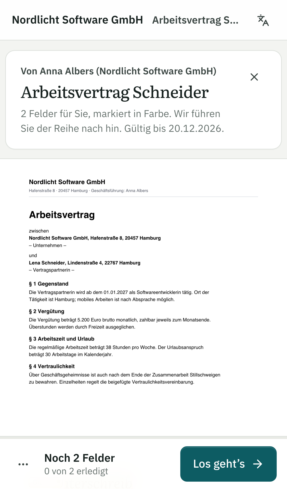
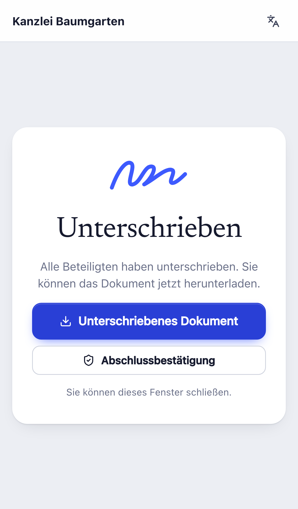
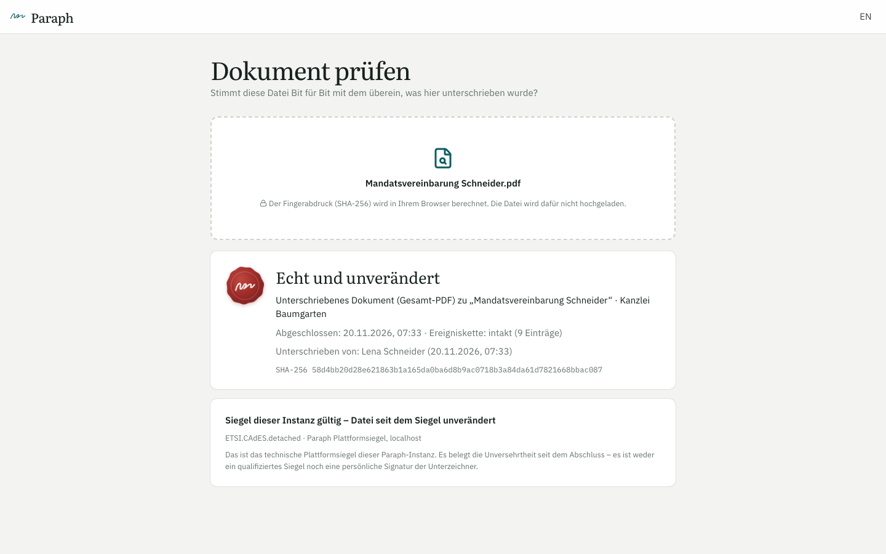
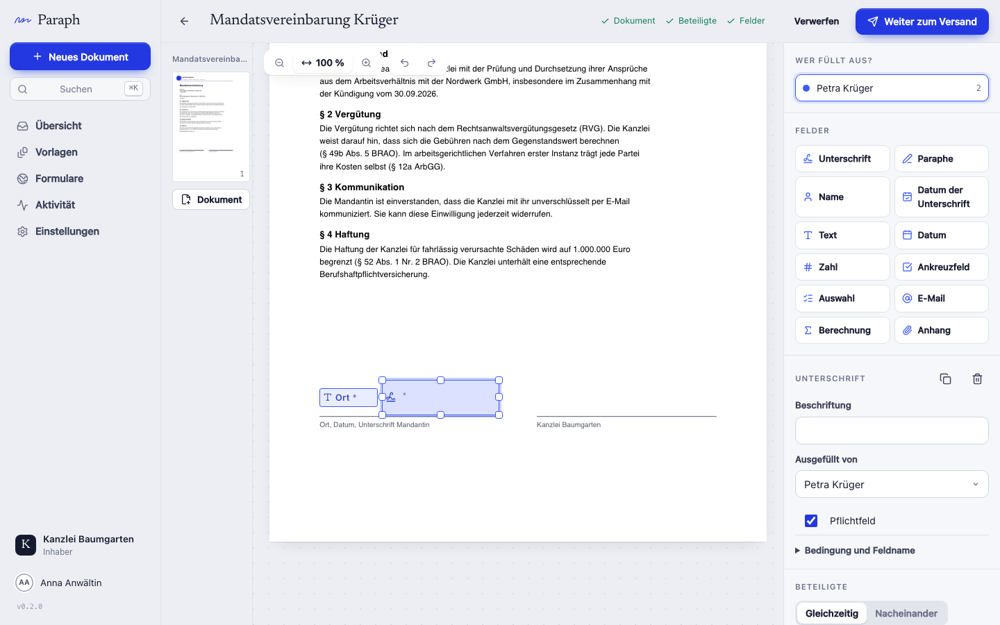

# Paraph

[](https://github.com/PBaumfalk/Paraph/actions/workflows/ci.yml)
[](LICENSE)
[](https://github.com/PBaumfalk/Paraph/pkgs/container/paraph)
[](CHANGELOG.md)

**Dokumente unterschreiben lassen, auf dem eigenen Server.**

Paraph ist eine selbst gehostete Plattform für elektronische Signaturen, gebaut für Kanzleien. Sie laden die Mandatsvereinbarung hoch, setzen die Felder und versenden. Die Mandantin unterschreibt am Smartphone, ohne Konto und ohne App. Am Ende steht ein versiegeltes PDF mit Abschlussbestätigung und einem Protokoll, das sich nicht unbemerkt ändern lässt. Ohne Lizenzgrenzen, ohne Preis pro Umschlag, mit REST-API für Kanzleisoftware, n8n und Make.

Der Name kommt von der Paraphe, dem Kürzel am Rand jeder Vertragsseite.

> **English abstract** – Self-hosted e-signature platform for German law firms, an alternative to DocuSign and DocuSeal. Simple electronic signatures (SES) with a hash-chained audit trail, PAdES platform seal with verified RFC 3161 timestamps, external Merkle anchoring, an evidence package and a public verification page. Node 24, Fastify, SQLite, React; ships as a hardened Docker image. UI in German and English, documentation in German.


> [!IMPORTANT]
> **Stand 0.2.0: noch nicht für den Produktivbetrieb freigegeben.** Technisch ist Paraph abnahmefähig. Offen sind die anwaltliche Freigabe der Erklärungs- und Hinweistexte und der Abnahmelauf gegen echte Gegenstellen (Mailserver, Let's Encrypt). Details: [`docs/STATUS-0.2.0.md`](docs/STATUS-0.2.0.md).

## Was Paraph ausmacht

**Unterschreiben, wo die Mandantin gerade ist.** Ein Link per E-Mail oder aus der Kanzleisoftware genügt. Die Signaturseite führt Feld für Feld durch das Dokument, die Unterschrift wird mit dem Finger gezeichnet, getippt oder als Bild übernommen. Auf Wunsch schützt ein Einmalcode per E-Mail oder SMS oder ein Zugangscode.

| Einladung | Unterschrift | Erklärung | Fertig |
| --- | --- | --- | --- |
|  |  |  |  |

**Ein Nachweis, den man prüfen kann.** Jedes abgeschlossene PDF trägt ein Plattformsiegel nach PAdES, auf Wunsch mit geprüftem RFC-3161-Zeitstempel (FreeTSA ist voreingestellt). Jedes Ereignis steht in einer Hash-Kette, die regelmäßig extern verankert wird. Wer vollen Zugriff auf den Server hat, kann die Historie deshalb nicht unbemerkt neu schreiben. Die Prüfstelle unter `/verify` bestätigt, ob eine Datei Bit für Bit dem entspricht, was unterschrieben wurde. Den Fingerabdruck berechnet der Browser, die Datei verlässt den Rechner nicht.



**Ehrlich über die Form.** Paraph erzeugt einfache elektronische Signaturen und sagt das auch so. Vor dem Versand prüft ein Katalog deutscher Formvorschriften, ob das Dokument eine strengere Form braucht, etwa bei Kündigung, Bürgschaft oder Vollmacht. Wer trotzdem versendet, bestätigt den Hinweis, und die Bestätigung steht im Protokoll.

**Auf Ihrem Server.** Dokumente, Unterschriften und Protokolle bleiben bei Ihnen, verschlüsselt abgelegt. Nach außen geht nur, was Sie einrichten: E-Mail, auf Wunsch SMS und S3, und an den Zeitstempeldienst ein Hashwert.

| Übersicht | Editor |
| --- | --- |
|  |  |

## Funktionen

- **Vorgänge** mit mehreren PDF-, Word- oder ODT-Dokumenten; Beteiligte als Unterzeichner, Freigebende, Ausfüllende, Lesende oder Zeugen, gleichzeitig oder nacheinander
- **12 Feldtypen** von Unterschrift und Paraphe über Datum, Auswahl und Anhang bis zu berechneten Feldern, mit Bedingungen und Prüfmustern
- **Vorlagen** mit unveränderlichen Versionen, **Massenversand** per CSV oder Excel, **öffentliche Formulare**, **Vor-Ort-Signatur** am Kanzleitablet
- **Erinnerungen, Ablauf, Widerruf, Ablehnung, Vertretung**, alles im Protokoll
- **Ergebnis:** versiegeltes PDF, Abschlussbestätigung, Nachweispaket mit unabhängigem Prüfskript, Audit-Trail als JSON
- **Team** mit Rollen, mehrere Organisationen, Zwei-Faktor, Anmeldung über authentik (OIDC), eigenes Logo, eigene Farbe und eigene Domain
- **Anbindung:** REST-API mit Testmodus und Idempotenz, Webhooks nach „Standard Webhooks“, Linkübergabe an j-lawyer, Beispiele für n8n und Make, einbettbare Signaturseite
- **Betrieb:** gehärteter Container, verschlüsselte automatische Sicherung, Update mit Rückweg, Systemdiagnose, Metriken für Prometheus

## Installation

Auf einem Linux-Server mit Docker und Compose v2, einer Domain und einem SMTP-Zugang:

```sh
git clone https://github.com/PBaumfalk/Paraph.git /opt/paraph
cd /opt/paraph
sudo ./scripts/install.sh
```

Das Skript fragt Domain, HTTPS, SMTP und den Zeitstempeldienst ab, erzeugt die Schlüssel als Docker-Secrets, baut das Image und startet. Am Ende zeigt es den Einrichtungscode für `https://IHRE-DOMAIN/setup` und die Wiederherstellungs-Passphrase. **Übernehmen Sie die Passphrase sofort in einen Passwortmanager.**

```sh
sudo ./scripts/update.sh              # Update mit Sicherung vorab
sudo ./scripts/update.sh --rollback   # zurück auf den Stand davor
```

Fertige Images liegen unter `ghcr.io/pbaumfalk/paraph` (`latest` = letzte Freigabe, `main` = Entwicklungsstand). Alles Weitere, auch hinter nginx oder Traefik und ohne Rückfragen: [Handbuch, Kapitel 11](docs/handbuch/11-installation.md).

## Handbuch

Das **[Handbuch](docs/handbuch/README.md)** hat drei Teile:

- **Teil A – Arbeiten mit Paraph:** [Paraph in fünf Minuten](docs/handbuch/01-paraph-in-fuenf-minuten.md), Dokumente unterschreiben lassen, Vorgänge verfolgen, Vorlagen, die Signaturseite aus Sicht der Mandanten, Prüfen, [Recht](docs/handbuch/07-recht.md)
- **Teil B – Einrichten und verwalten:** Team und Erscheinungsbild, Anmeldung und SSO, [Anbindung an j-lawyer, n8n, Make und die API](docs/handbuch/10-anbindung-api-webhooks.md)
- **Teil C – Betrieb:** Installation, Konfiguration, Sicherung, [Sicherheit und Nachweis](docs/handbuch/14-sicherheit-und-nachweis.md), Diagnose, Tests, [Grenzen](docs/handbuch/17-grenzen.md)

## Für Entwickler

Node 24, TypeScript, Fastify, SQLite (better-sqlite3), React 19, pdf.js, pdf-lib, pkijs.

```sh
npm ci
npm run dev:server & npm run dev:web     # Entwicklung
npm run typecheck && npm test            # Typprüfung und Vitest
npm run build && npx playwright test     # Browser-Tests: Desktop, Pixel 7, iPhone 14 (Mailpit auf 1025/8025)
node scripts/docker-e2e.mjs              # Docker-Gesamtprüfung: Update, Rückweg, HTTPS, Katastrophenfall
```

Jeder Push auf `main` läuft durch Typprüfung, Vitest, Playwright und einen Rauchtest des Images. Was welche Prüfung belegt: [Handbuch, Kapitel 16](docs/handbuch/16-tests-und-nachweise.md). Die Bilder in README und Handbuch erzeugt `e2e/screenshots.spec.ts` mit erfundenen Demodaten. Änderungen von Version zu Version: [Änderungsprotokoll](CHANGELOG.md).

## Lizenz

[MIT](LICENSE) — © 2026 Patrick Baumfalk.

Mitgeliefert: das Wurzelzertifikat von [FreeTSA](https://freetsa.org) (`docker/tsa/freetsa-root-ca.pem`) sowie die Schriften Literata, IBM Plex und Geist Mono (SIL Open Font License 1.1, über Fontsource).

## Haftungsausschluss

Paraph ist ein technisches Werkzeug und ersetzt keine Rechtsberatung. Ob die elektronische Form im Einzelfall genügt, ist selbst zu prüfen; Vorlagen, Mustertexte und Formhinweise sind ohne Gewähr. Das Plattformsiegel belegt die Unversehrtheit eines Dokuments seit dem Abschluss. Es ist weder ein qualifiziertes Siegel noch eine persönliche Signatur der Unterzeichner.
