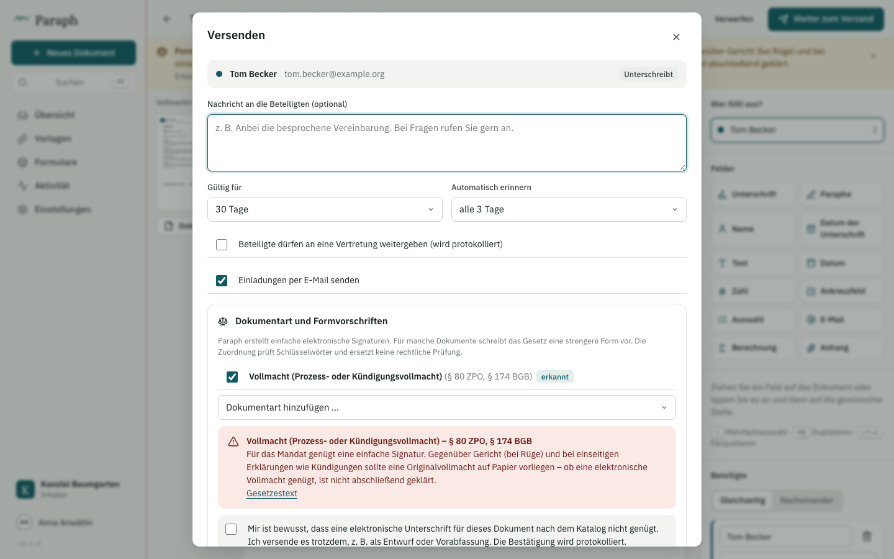
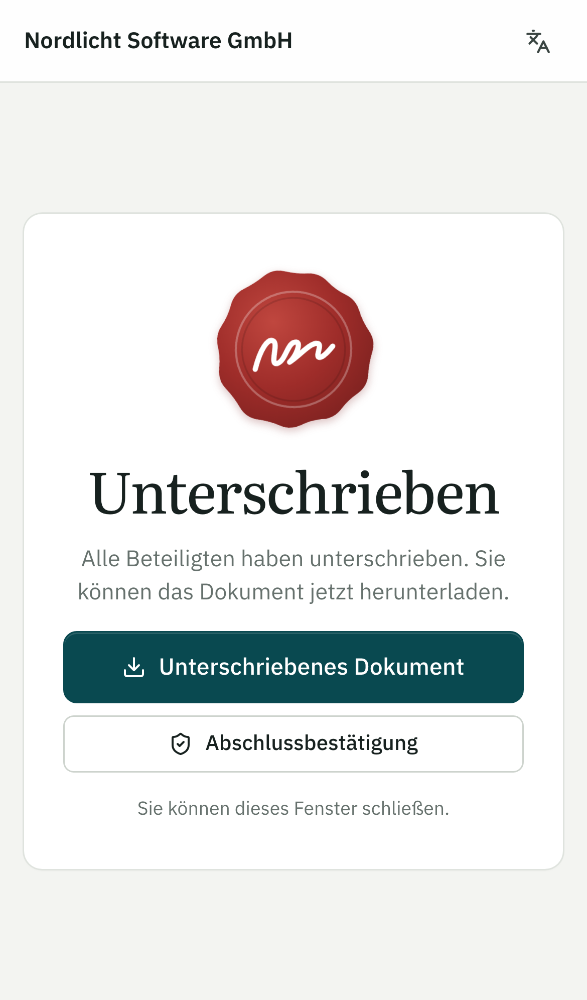
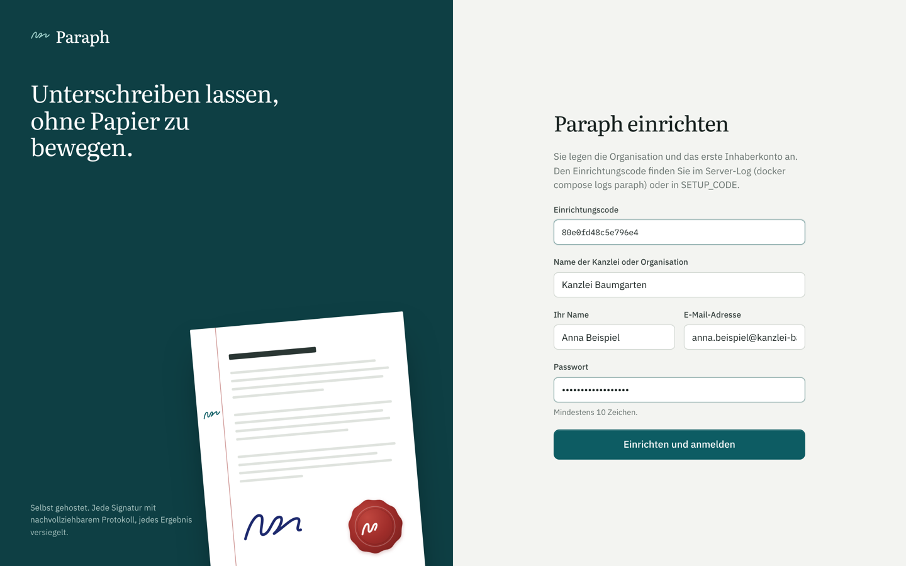
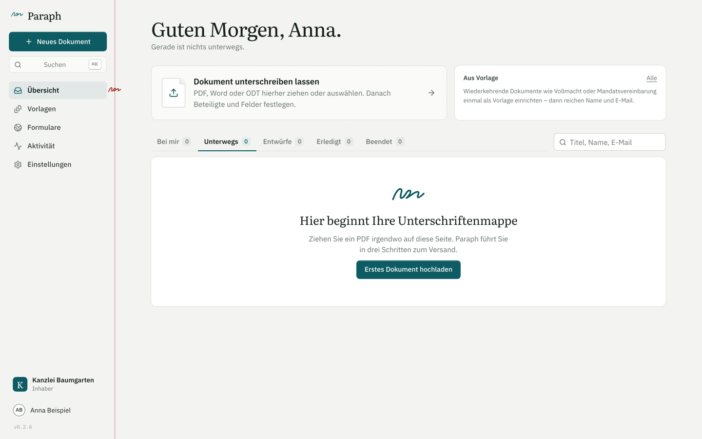
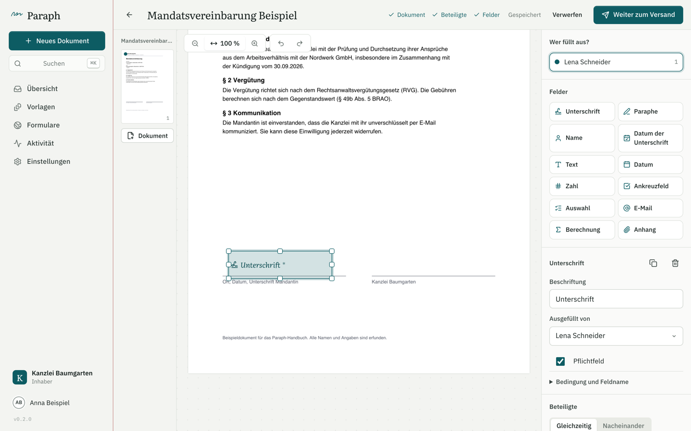
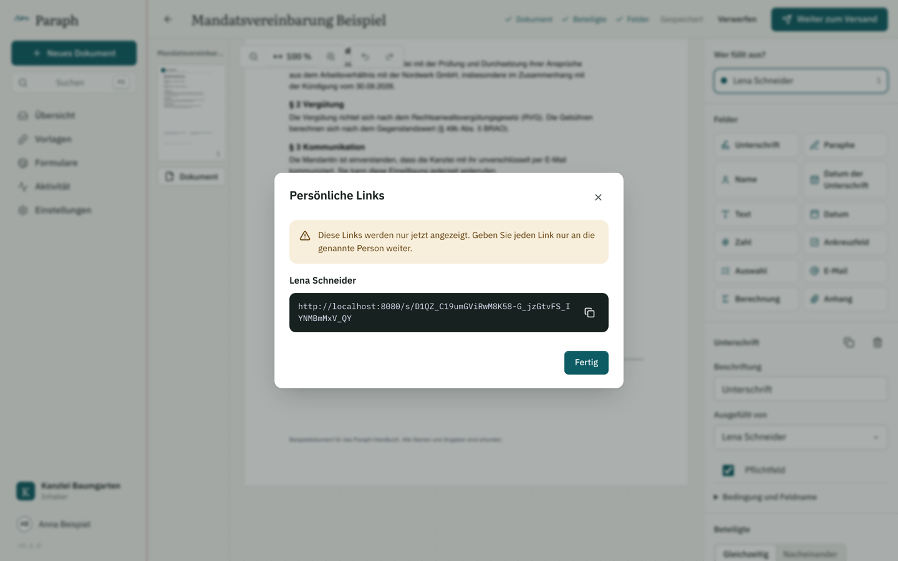
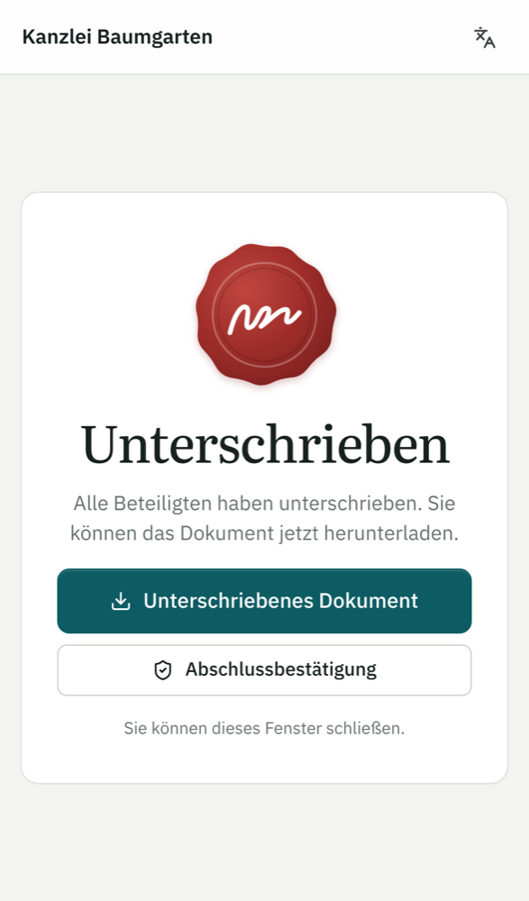
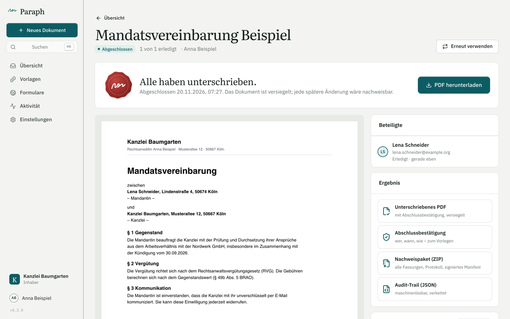

# 1. Paraph in fünf Minuten

Dieses Kapitel zeigt, was Paraph ist und wie ein Dokument von der Kanzlei bis zur fertigen Unterschrift kommt. Es richtet sich an alle, die mit Paraph arbeiten – Anwältinnen, Anwälte und Kanzleimitarbeiter. Technisches Vorwissen brauchen Sie nicht.

## Was Paraph ist

Paraph ist eine Plattform für elektronische Unterschriften, die Ihre Kanzlei selbst betreibt. Sie laden ein Dokument hoch, legen fest, wer unterschreiben soll, und markieren die Stellen dafür. Die Beteiligten erhalten einen persönlichen Link und unterschreiben im Browser, am Rechner oder am Smartphone. Ein Konto oder eine App brauchen sie nicht.

Paraph erzeugt **einfache elektronische Signaturen (EES)**. Für viele Kanzleidokumente genügt das, etwa für Mandatsvereinbarungen oder Empfangsbestätigungen. Für manche Dokumente schreibt das Gesetz eine strengere Form vor. Paraph weist beim Versand darauf hin, entscheidet aber keine Rechtsfragen. Mehr dazu in [Kapitel 7](07-recht.md).

Alle Dokumente und Protokolle bleiben auf dem Server Ihrer Kanzlei.

## Die vier Grundbegriffe

| Begriff | Bedeutung |
|---|---|
| **Vorgang** | Ein Auftrag zur Unterschrift. Er bündelt ein oder mehrere Dokumente, die Beteiligten und die Felder. Solange er nicht versendet ist, ist er ein Entwurf und frei änderbar. Nach dem Versand ist sein Inhalt gesperrt. |
| **Beteiligte** | Die Personen, die etwas tun sollen: unterschreiben, freigeben, Angaben ausfüllen oder nur eine Kopie erhalten. Jede Person bekommt ihren eigenen Link. |
| **Felder** | Markierte Stellen im Dokument, die eine bestimmte Person ausfüllt: Unterschrift, Paraphe, Name, Datum, Ankreuzfeld und weitere. |
| **Siegel und Abschluss** | Wenn alle fertig sind, setzt Paraph die Eingaben in das Dokument ein und versiegelt es. Jede spätere Änderung am PDF wäre nachweisbar. Dazu entstehen eine Abschlussbestätigung und ein Nachweispaket. |

Ein Vorgang hat immer einen Status. Die Übersicht sortiert die Vorgänge danach in Reiter:

| Status in der Oberfläche | Bedeutung | Reiter |
|---|---|---|
| „Entwurf“ | noch nicht versendet, änderbar | „Entwürfe“ |
| „Unterwegs“ | versendet, Beteiligte sind dran | „Unterwegs“ (und „Bei mir“, wenn Sie selbst an der Reihe sind) |
| „Abgeschlossen“ | alle fertig, Dokument versiegelt | „Erledigt“ |
| „Abgelehnt“ | eine Person hat abgelehnt, der Vorgang ist beendet | „Beendet“ |
| „Widerrufen“ | von der Kanzlei zurückgezogen | „Beendet“ |
| „Abgelaufen“ | Gültigkeit überschritten, Links ungültig | „Beendet“ |

## Ein Durchlauf in Bildern

Das Beispiel: Eine Mandantin soll eine Vollmacht unterschreiben.

**1. Dokument hochladen.** Ziehen Sie das PDF, die Word- oder ODT-Datei auf die Übersicht oder klicken Sie auf „Neues Dokument“. Paraph öffnet sofort den Editor.

**2. Beteiligte und Felder festlegen.** Rechts im Editor tragen Sie unter „Beteiligte“ Name und E-Mail-Adresse der Mandantin ein. Dann ziehen Sie aus „Felder“ ein Unterschriftsfeld an die richtige Stelle im Dokument. Paraph speichert dabei laufend.

**3. Versenden.** Klicken Sie auf „Weiter zum Versand“. Im Dialog „Versenden“ schreiben Sie bei Bedarf eine Nachricht, wählen Gültigkeit und Erinnerung und bestätigen gegebenenfalls einen Formhinweis. „Jetzt versenden“ schickt die Einladung per E-Mail.

**4. Die Mandantin unterschreibt.** Sie öffnet den Link, liest das Dokument, füllt die Felder aus und unterschreibt – gezeichnet, getippt oder als Bild. Zum Schluss bestätigt sie eine kurze Erklärung.

**5. Ergebnis abholen.** Sobald alle unterschrieben haben, zeigt der Vorgang das Siegel und „Alle haben unterschrieben.“ Mit „PDF herunterladen“ erhalten Sie das versiegelte Dokument. Darunter liegen Abschlussbestätigung, Nachweispaket und Audit-Trail.

Die Beteiligten erhalten eine Abschluss-E-Mail mit Downloadlink und dem Prüfwert des Dokuments. Sie als Absender werden ebenfalls benachrichtigt.

## Ihr erster Vorgang Schritt für Schritt

Spielen Sie einen Vorgang einmal selbst durch, am besten im Probebetrieb ([Kapitel 18](18-installation-mit-claude-code.md#probebetrieb-auf-dem-eigenen-rechner)) oder in einer Testorganisation. Sie brauchen dafür nur das Beispieldokument [`Mandatsvereinbarung-Beispiel.pdf`](beispiele/Mandatsvereinbarung-Beispiel.pdf). Alle Namen darin sind erfunden. Sie spielen nacheinander drei Personen:

| Wer | Schritte | Rolle in Paraph |
|---|---|---|
| ReFa oder Sekretariat | 1 bis 4: Dokument vorbereiten und versenden | „Mitglied“, „Administration“ oder „Inhaber“ |
| Mandantin (hier: Lena Schneider) | 5: unterschreiben | kein Konto, nur der persönliche Link |
| Anwältin oder Anwalt | 6 und 7: Ergebnis kontrollieren und zur Akte nehmen | jede Rolle, auch „Nur lesen“ |

**0. Erstmals anmelden.** Auf einer neuen Installation öffnen Sie `<Adresse>/setup` und füllen „Einrichtungscode“, „Name der Kanzlei oder Organisation“, „Ihr Name“, „E-Mail-Adresse“ und „Passwort“ (mindestens 10 Zeichen) aus. „Einrichten und anmelden“ legt die Organisation an. Sie sind dann Inhaber. Später melden sich alle unter `<Adresse>/login` an.

*Schritt 0: Einrichtung mit erfundenen Daten.*

**1. Dokument hochladen.** Klicken Sie auf der Übersicht auf „Dokument unterschreiben lassen“ und wählen Sie `Mandatsvereinbarung-Beispiel.pdf`. Der Editor öffnet sich, der Titel lautet „Mandatsvereinbarung Beispiel“.

*Schritt 1: So sieht die Übersicht vor dem ersten Vorgang aus.*

**2. Mandantin eintragen.** Rechts unten unter „Beteiligte“ steht schon ein leerer Eintrag. Tragen Sie „Lena Schneider“ und `lena.schneider@example.org` ein. Rolle „Unterschreibt“ und Identitätsprüfung „Nur Link“ bleiben, wie sie sind. Oben erscheint der Haken bei „Beteiligte“.

**3. Unterschriftsfeld setzen.** Unter „Wer füllt aus?“ ist Lena Schneider gewählt. Tippen Sie unter „Felder“ auf „Unterschrift“ und dann auf die Linie über „Ort, Datum, Unterschrift Mandantin“. Das Feld erscheint in der Farbe der Mandantin, rechts stehen seine Eigenschaften mit „Pflichtfeld“. Oben stehen jetzt drei Haken und „Gespeichert“.

*Schritt 3: Das Unterschriftsfeld liegt auf der Linie; rechts die Eigenschaften.*

**4. Versenden.** Klicken Sie auf „Weiter zum Versand“. Im Dialog „Versenden“ steht unter „Dokumentart und Formvorschriften“ „Mandatsvertrag, Auftrag, Schweigepflichtentbindung“ mit „erkannt“ und der Hinweis, dass eine einfache elektronische Signatur genügt.

- Ist ein Mailserver eingerichtet, lassen Sie „Einladungen per E-Mail senden“ angehakt und klicken auf „Jetzt versenden“. Die Mandantin erhält die Einladung per E-Mail.
- Ohne Mailserver (etwa im Probebetrieb) ist der Haken nicht gesetzt, und darunter steht „Auf diesem Server ist kein E-Mail-Versand eingerichtet.“ Klicken Sie auf „Starten und Links anzeigen“. Unter „Persönliche Links“ erscheint der Link für Lena Schneider. Kopieren Sie ihn mit dem Symbol daneben und schließen Sie mit „Fertig“. Der Link wird nur dieses eine Mal angezeigt.

*Schritt 4: Ohne E-Mail-Versand übergeben Sie den Link selbst.*

Der Vorgang steht jetzt in der Übersicht unter „Unterwegs“.

**5. Als Mandantin unterschreiben.** Öffnen Sie den Link, am besten auf dem Smartphone oder in einem privaten Browserfenster. Tippen Sie auf „Los geht’s“, zeichnen Sie die Unterschrift mit Finger oder Maus und tippen Sie auf „Übernehmen“. Zum Schluss erscheint „Abschließend bestätigen“: Setzen Sie den Haken bei „Ich stimme der obigen Erklärung zu.“ und tippen Sie auf „Verbindlich unterschreiben“. Die Seite zeigt „Unterschrieben“ und bietet das „Unterschriebene Dokument“ zum Herunterladen an. Was Mandanten dabei genau sehen, steht in [Kapitel 5](05-so-unterschreiben-mandanten.md).

*Schritt 5: Ansicht der Mandantin nach dem Unterschreiben.*

**6. Ergebnis kontrollieren.** Öffnen Sie den Vorgang aus der Übersicht (Reiter „Erledigt“). Er trägt den Status „Abgeschlossen“, das Siegel und „Alle haben unterschrieben.“ Prüfen Sie:

- unter „Beteiligte“: Lena Schneider mit „Erledigt“,
- im Dokument: die Unterschrift sitzt auf der richtigen Linie,
- unter „Ergebnis“: „Unterschriebenes PDF“, „Abschlussbestätigung“, „Nachweispaket (ZIP)“ und „Audit-Trail (JSON)“.

*Schritt 6: Der abgeschlossene Vorgang aus Sicht der Kanzlei.*

**7. Zur Akte nehmen und prüfen.** Klicken Sie auf „PDF herunterladen“. Die Datei heißt „Mandatsvereinbarung Beispiel – unterschrieben.pdf“. Sie enthält das Dokument mit eingesetzter Unterschrift und, ab Werk, die Abschlussbestätigung als weitere Seiten. Legen Sie die Datei **unverändert** in die Akte; jedes erneute Speichern ändert den Fingerabdruck. Zur Kontrolle ziehen Sie sie in die Prüfstelle („Dokument prüfen“ unter `<Adresse>/verify`). Das Ergebnis lautet „Echt und unverändert“ ([Kapitel 6](06-dokumente-pruefen.md)).

*Schritt 7: Ausschnitt aus dem unterschriebenen PDF. Unter der Unterschrift stehen Kennung, Name und Zeitpunkt.*

Damit haben Sie den ganzen Weg einmal gesehen. Für echte Vorgänge geht es in [Kapitel 2](02-dokument-unterschreiben-lassen.md) weiter: mehrere Beteiligte, weitere Feldtypen, Zugangsschutz per Code.

## Wo Sie was finden

Die Seitenleiste links ist immer gleich aufgebaut:

| Eintrag | Inhalt |
|---|---|
| „Neues Dokument“ | Datei auswählen und einen Vorgang starten |
| „Suchen“ (⌘K bzw. Strg+K) | Vorgänge, Vorlagen und Aktionen finden |
| „Übersicht“ | alle Vorgänge nach Status; die Zahl am Eintrag zeigt, wie viele auf Sie warten |
| „Vorlagen“ | wiederkehrende Dokumente mit festen Rollen und Feldern |
| „Formulare“ | öffentliche Formulare, z. B. für die Website |
| „Aktivität“ | Protokoll der Organisation (nur Inhaber und Administration) |
| „Einstellungen“ | Profil, Organisation, Team, Erscheinungsbild und mehr |

Unten in der Seitenleiste stehen Ihre Organisation mit Ihrer Rolle und Ihr Name. Gehören Sie mehreren Organisationen an, wechseln Sie mit einem Klick auf den Organisationsnamen („Organisation wechseln“). Über Ihren Namen erreichen Sie „Profil und Sicherheit“, wechseln die Sprache (Deutsch/English) und melden sich ab.

> **Gut zu wissen:** Wer die Rolle „Nur lesen“ hat, sieht Vorgänge und Vorlagen, kann aber nichts anlegen oder versenden. Die Schaltfläche „Neues Dokument“ fehlt dann.

## Wegweiser durch das Handbuch

**Teil A – Arbeiten mit Paraph**

- [Kapitel 2](02-dokument-unterschreiben-lassen.md): ein Dokument vorbereiten und versenden – Beteiligte, Felder, Zugangsschutz, Formhinweise
- [Kapitel 3](03-vorgaenge-verfolgen.md): Vorgänge im Blick behalten, erinnern, widerrufen, Ergebnis herunterladen
- [Kapitel 4](04-vorlagen-serien-formulare.md): Vorlagen, Massenversand, öffentliche Formulare, Unterschrift vor Ort
- [Kapitel 5](05-so-unterschreiben-mandanten.md): was Ihre Mandanten beim Unterschreiben sehen
- [Kapitel 6](06-dokumente-pruefen.md): ein unterschriebenes Dokument prüfen
- [Kapitel 7](07-recht.md): was die einfache elektronische Signatur leistet und was nicht

**Teil B – Einrichten und verwalten** (für die Kanzlei-Administration)

- [Kapitel 8](08-kanzlei-team-erscheinungsbild.md): Kanzlei, Team, Rollen, Erscheinungsbild
- [Kapitel 9](09-anmeldung-und-sso.md): Anmeldung, Zwei-Faktor, SSO
- [Kapitel 10](10-anbindung-api-webhooks.md): Anbindung an Kanzleisoftware, API und Webhooks

**Teil C – Betrieb** (für die IT)

- [Kapitel 11](11-installation.md) bis [Kapitel 17](17-grenzen.md): Installation, Konfiguration, Sicherung, Sicherheit, Diagnose, Tests und Grenzen
- [Glossar](glossar.md): Begriffe von A bis Z

---

[Inhalt](README.md) · [2. Ein Dokument unterschreiben lassen](02-dokument-unterschreiben-lassen.md) →
