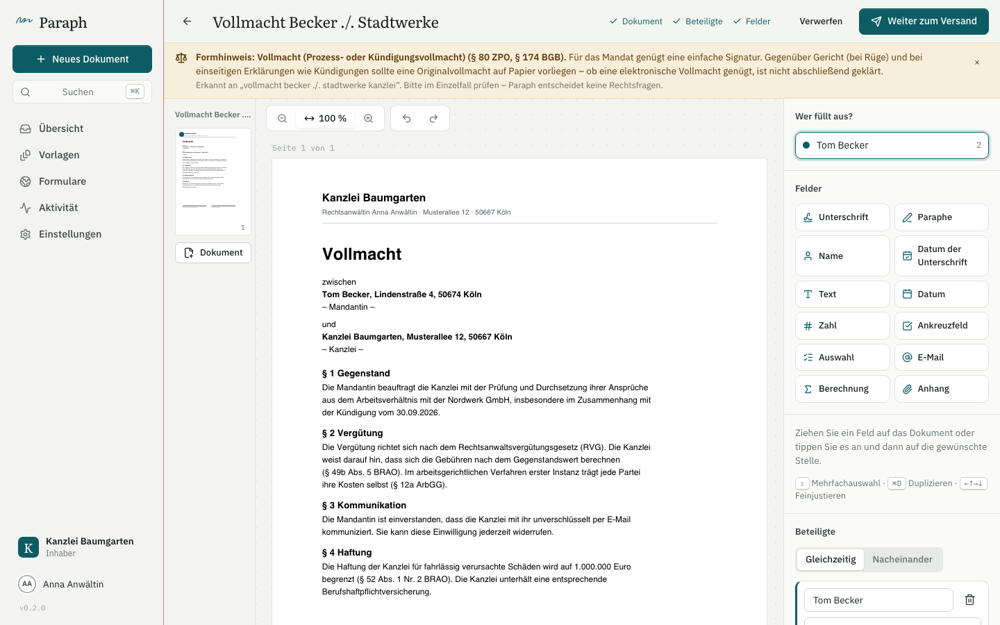
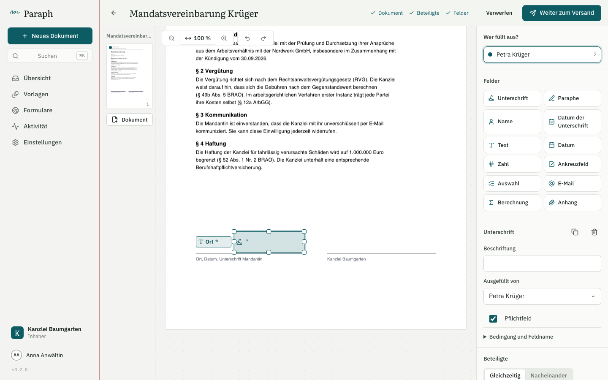
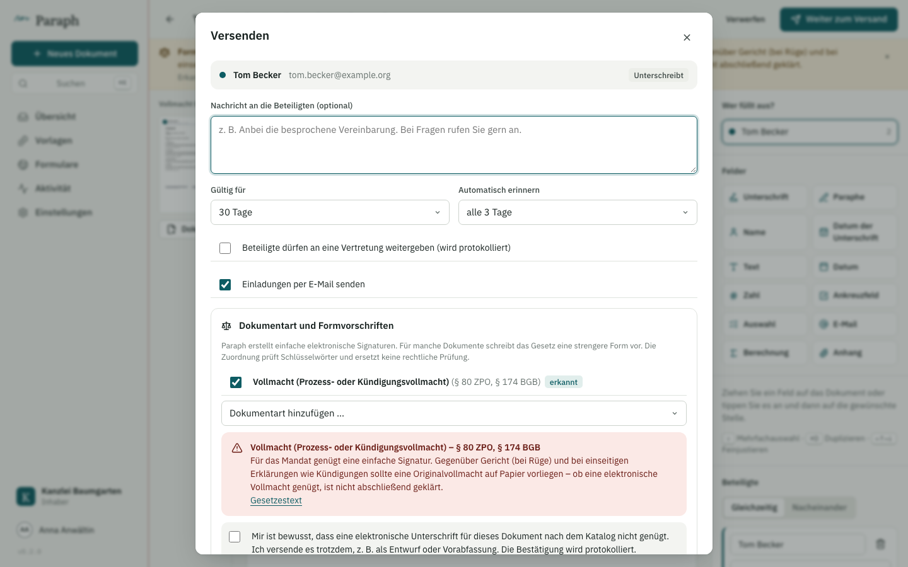

# 2. Ein Dokument unterschreiben lassen

Dieses Kapitel führt Schritt für Schritt vom hochgeladenen Dokument bis zum Versand: Beteiligte festlegen, Felder setzen, Zugang schützen, Formhinweise beachten. Es richtet sich an alle, die Vorgänge anlegen. Dafür brauchen Sie die Rolle „Mitglied“, „Administration“ oder „Inhaber“; mit „Nur lesen“ geht es nicht.

## Ein Dokument hochladen

Sie haben drei Wege:

- Datei aus dem Finder oder Explorer irgendwo auf die Paraph-Seite ziehen und loslassen,
- in der Seitenleiste auf „Neues Dokument“ klicken,
- auf der Übersicht auf „Dokument unterschreiben lassen“ klicken.

Paraph legt einen Entwurf an und öffnet den Editor. Den Titel übernimmt Paraph aus dem Dateinamen; Sie können ihn oben im Editor ändern. Mehrere Dateien auf einmal werden ein gemeinsamer Vorgang.

| Was | Regel |
|---|---|
| Dateiarten | PDF, Word (DOCX, DOC), ODT, RTF |
| Umwandlung | Word-, ODT- und RTF-Dateien wandelt Paraph in PDF um. Ist der Umwandlungsdienst nicht eingerichtet, meldet Paraph das; laden Sie dann ein PDF hoch. |
| Dokumente je Vorgang | höchstens 20 |
| Größe und Umfang | Voreinstellung: 25 MB je Datei, 500 Seiten. Ihre IT kann das ändern. |
| Geschützte PDFs | Verschlüsselte oder passwortgeschützte PDFs lehnt Paraph ab. Laden Sie eine ungeschützte Fassung hoch. |

Beim Hochladen bereinigt Paraph jedes PDF: Aktive Inhalte werden entfernt, vorhandene PDF-Formularfelder werden fester Bestandteil der Seite. Unterschrieben wird immer diese bereinigte, **maßgebliche Fassung**. Die Signaturseite zeigt genau sie. Das Original bewahrt Paraph zusätzlich auf.

Weitere Dokumente fügen Sie im Editor links unter den Seitenvorschauen mit „Dokument“ hinzu. Hat ein Vorgang mehr als ein Dokument, erscheint dort für jedes eine Schaltfläche zum Entfernen.

## Den Editor kennenlernen

| Bereich | Inhalt |
|---|---|
| Obere Leiste | Pfeil zurück zur Übersicht, Titel, Fortschritt („Dokument“, „Beteiligte“, „Felder“), Speicherstand, „Verwerfen“ und „Weiter zum Versand“ |
| Links | Seitenvorschauen und „Dokument“ zum Hinzufügen |
| Mitte | das Dokument mit Zoom („Seitenbreite“, vergrößern, verkleinern), „Rückgängig“ und „Wiederholen“ |
| Rechts | „Wer füllt aus?“, „Felder“, die Eigenschaften des gewählten Feldes und ganz unten „Beteiligte“ |

Paraph speichert jede Änderung nach kurzer Zeit selbst. Oben steht dann „Gespeichert“. Erscheint „Nicht gespeichert“, ist etwas schiefgegangen; die Fehlermeldung nennt den Grund.

„Verwerfen“ löscht den Entwurf nach einer Rückfrage mit allen Dokumenten und Feldern.

## Beteiligte festlegen

Die Beteiligten stehen rechts unten im Abschnitt „Beteiligte“.

1. Klicken Sie auf „Person hinzufügen“.
2. Tragen Sie Name und E-Mail-Adresse ein. Ab zwei Buchstaben schlägt Paraph Personen vor, die Ihre Organisation schon einmal angeschrieben hat.
3. Wählen Sie die Rolle (erstes Auswahlfeld) und die Identitätsprüfung (zweites Auswahlfeld).
4. Wiederholen Sie das für alle Personen. Höchstens 30 Personen sind möglich.

Eine Person wird erst gespeichert, wenn Name und eine gültige E-Mail-Adresse eingetragen sind. Entfernen Sie eine Person mit dem Papierkorb, verschwinden auch ihre Felder.

### Rollen

| Rolle | Aufgabe | Felder |
|---|---|---|
| „Unterschreibt“ | unterschreibt das Dokument | braucht mindestens ein Unterschriftsfeld |
| „Gibt frei“ | gibt das Dokument frei, ohne zu unterschreiben | darf Felder haben, muss nicht; keine Unterschrift oder Paraphe |
| „Füllt aus“ | trägt nur Angaben ein | braucht mindestens ein Feld; keine Unterschrift oder Paraphe |
| „Erhält Kopie“ | liest mit | keine Felder, kein eigener Schritt; erhält nach Abschluss das Ergebnis |
| „Zeuge“ | unterschreibt als Zeuge | braucht ein Unterschriftsfeld |

Vor dem Abschluss bestätigt jede handelnde Person eine kurze, feste Erklärung. Paraph protokolliert Fassung und Prüfwert dieses Textes.

> **Gut zu wissen:** Für welche Person ein Zeuge unterschreibt, lässt sich in der Oberfläche nicht festlegen, nur über die API ([Kapitel 10](10-anbindung-api-webhooks.md)).

### Identitätsprüfung

| Auswahl | Was die Person tun muss |
|---|---|
| „Nur Link“ | nichts weiter; der persönliche Link genügt |
| „Code per E-Mail“ | einen sechsstelligen Einmalcode eingeben, den Paraph an ihre Adresse schickt (10 Minuten gültig) |
| „Code per SMS“ | einen sechsstelligen Code aus einer SMS eingeben. Nur sichtbar, wenn Ihre Instanz einen SMS-Dienst hat. Tragen Sie die Mobilnummer ein, z. B. `+49 170 …`. |
| „Zugangscode“ | einen Code eingeben, den Sie festlegen (mindestens 6 Zeichen) und ihr auf anderem Weg mitteilen, etwa am Telefon. Paraph speichert ihn nur verschlüsselt; zum Ändern geben Sie ihn neu ein. |

Nach fünf falschen Codes in 15 Minuten sperrt Paraph die Eingabe für diese Person für 15 Minuten. Fehlversuche und Sperre stehen im Protokoll.

Ein Code per E-Mail oder SMS belegt nur, dass die Person Zugriff auf das Postfach oder die Nummer hat. Er ist kein amtlicher Identitätsnachweis.

### Reihenfolge

Oben im Abschnitt „Beteiligte“ wählen Sie:

- **„Gleichzeitig“:** Alle handelnden Personen erhalten ihren Link sofort.
- **„Nacheinander“:** Die Personen sind in der angezeigten Reihenfolge dran. Die nächste erhält ihren Link erst, wenn die vorherige fertig ist. Die Nummern vor den Namen zeigen die Reihenfolge; mit den Pfeilen verschieben Sie eine Person nach oben oder unten.

In der Oberfläche hat bei „Nacheinander“ jede Person ihren eigenen Schritt. Mehrere Personen in einem gemeinsamen Schritt lassen sich nur über die API anlegen.

## Felder setzen

1. Wählen Sie unter „Wer füllt aus?“ die Person. Jede Person hat eine eigene Farbe; die Zahl rechts zeigt, wie viele Felder sie schon hat.
2. Ziehen Sie unter „Felder“ den gewünschten Feldtyp auf das Dokument. Oder tippen Sie den Typ an und dann auf die Stelle im Dokument. `esc` bricht ab.
3. Verschieben Sie das Feld mit der Maus und ändern Sie die Größe an den Anfasspunkten.

Unterschrift und Paraphe stehen nur zur Auswahl, wenn die gewählte Person „Unterschreibt“ oder „Zeuge“ ist.

### Die zwölf Feldtypen

| Feldtyp | Wofür |
|---|---|
| „Unterschrift“ | Unterschrift, gezeichnet, getippt oder als Bild |
| „Paraphe“ | Kürzel, etwa am Rand jeder Seite |
| „Name“ | Name der Person; Prüfmuster möglich |
| „Datum der Unterschrift“ | wird beim Unterschreiben automatisch mit dem Datum gefüllt |
| „Text“ | freier Text; Prüfmuster möglich |
| „Datum“ | ein Datum, das die Person einträgt |
| „Zahl“ | eine Zahl, optional mit Minimum und Maximum |
| „Ankreuzfeld“ | ein Kästchen zum Ankreuzen |
| „Auswahl“ | Auswahl aus festen Optionen |
| „E-Mail“ | E-Mail-Adresse mit Formatprüfung |
| „Berechnung“ | Wert, den Paraph aus anderen Feldern errechnet |
| „Anhang“ | Datei, die die Person hochlädt, z. B. eine Ausweiskopie |

### Tastenkürzel im Editor

| Taste | Wirkung |
|---|---|
| ⇧ + Klick | mehrere Felder auswählen |
| ⌘D / Strg+D | Feld duplizieren |
| ⌘C, ⌘V | Felder kopieren und einfügen |
| Pfeiltasten | Feld fein verschieben |
| Entf oder ⌫ | Feld löschen |
| ⌘Z, ⇧⌘Z | rückgängig, wiederholen |

Haben Sie mehrere Felder ausgewählt, können Sie sie gemeinsam duplizieren, löschen oder über „Zuordnen an“ einer anderen Person geben.

### Erkannte Felder übernehmen

Bei einem neuen Dokument sucht Paraph nach typischen Stellen: Unterstrichlinien, Beschriftungen wie „Unterschrift“ oder „Datum“ und Kästchen im Text. Findet es welche, erscheint unter den Feldtypen die Schaltfläche „{n} erkannte Felder übernehmen“. Die Felder gehen an die Person, die unter „Wer füllt aus?“ gewählt ist. Unterschrifts- und Paraphenfelder übernimmt Paraph nur für Personen, die unterschreiben.

Die Erkennung arbeitet mit festen Regeln, ohne KI. Prüfen Sie Zuordnung und Position jedes übernommenen Feldes.

## Feldeigenschaften einstellen

Klicken Sie ein Feld an. Rechts erscheinen seine Eigenschaften:

| Eigenschaft | Wirkung |
|---|---|
| „Beschriftung“ | Text, den die Person am Feld sieht |
| „Ausgefüllt von“ | Person, der das Feld gehört |
| „Pflichtfeld“ (beim Ankreuzfeld „Muss angekreuzt werden“) | Die Person kann erst abschließen, wenn das Feld ausgefüllt ist. Neue Felder sind Pflichtfelder, Ankreuzfelder nicht. |
| „Auf allen Seiten wiederholen“ | nur bei der Paraphe: setzt sie an dieselbe Stelle auf jeder Seite |
| „Vorbelegung“ | Wert, der schon eingetragen ist (bei Name, Text, E-Mail, Zahl, Datum, Auswahl) |
| „Nicht änderbar (fester Text im Dokument)“ | erscheint bei einer Vorbelegung; die Person kann den Wert dann nicht ändern |
| „Optionen (eine pro Zeile)“ | Auswahlmöglichkeiten beim Feld „Auswahl“ |
| „Prüfung“ | Prüfmuster bei Name und Text (siehe unten) |
| „Minimum“, „Maximum“ | Grenzen beim Feld „Zahl“ |
| „Formel“ | Rechenvorschrift beim Feld „Berechnung“ |
| „Datumsformat“ | `31.12.2026`, `2026-12-31` oder `12/31/2026` |
| „Bedingung und Feldname“ | aufklappbar: Bedingung und interner Feldname (siehe unten) |

### Felder nur unter einer Bedingung zeigen

Unter „Bedingung und Feldname“ → „Nur anzeigen, wenn …“ wählen Sie ein anderes Feld und eine Bedingung:

- „angekreuzt ist“, „nicht angekreuzt ist“,
- „gleich ist“, „ungleich ist“ (mit Vergleichswert),
- „ausgefüllt ist“, „leer ist“.

Beispiel: Das Feld „Abweichende Anschrift“ erscheint nur, wenn das Ankreuzfeld „Anschrift hat sich geändert“ angekreuzt ist. Ein ausgeblendetes Feld muss niemand ausfüllen, auch wenn es ein Pflichtfeld ist. Bedingungen dürfen aufeinander aufbauen: Ein Feld ist nur aktiv, wenn auch das steuernde Feld aktiv ist. Browser und Server werten die Bedingungen gleich aus; maßgeblich ist der Server.

Der **Feldname** (z. B. `text_1`) ist die interne Bezeichnung. Sie brauchen ihn für Formeln, für den Massenversand und für die API. Vergeben Sie sprechende Namen wie `stundensatz`.

### Mit Formeln rechnen

Ein Feld „Berechnung“ rechnet mit anderen Feldern. Felder stehen in geschweiften Klammern, ihre Feldnamen stehen unter dem Eingabefeld zum Anklicken bereit.

| Erlaubt | Beispiel |
|---|---|
| Grundrechenarten und Klammern | `({stunden} + 2) * {satz}` |
| Vergleiche `>`, `<`, `>=`, `<=`, `==`, `!=` (Ergebnis 1 oder 0) | `{betrag} > 1000` |
| `sum(…)`, `min(…)`, `max(…)`, `abs(x)` | `sum({posten_1}, {posten_2})` |
| `round(x, n)` | `round({stunden} * {satz} * 1.19, 2)` |
| `if(bedingung, a, b)` | `if({betrag} > 1000, 50, 0)` |

Leere Felder zählen als 0, Teilen durch 0 ergibt 0. Zahlen im deutschen Format wie `1.234,56` erkennt Paraph. Eine Formel darf höchstens 500 Zeichen haben und auf andere Formeln verweisen. Das Ergebnis zeigt Paraph mit zwei Nachkommastellen an.

### Eingaben prüfen lassen

Bei „Name“ und „Text“ wählen Sie unter „Prüfung“:

| Auswahl | Prüft |
|---|---|
| „IBAN“ | gültige IBAN mit Prüfziffer; deutsche IBAN genau 22 Zeichen |
| „Postleitzahl (DE)“ | fünf Ziffern |
| „Telefonnummer“ | Ziffern, Leerzeichen und übliche Zeichen wie `+`, `/`, `-` |
| „E-Mail-Adresse“ | Format einer E-Mail-Adresse |
| „Ganze Zahl“ | nur ganze Zahlen |
| „Eigenes Muster (Regex)“ | einen regulären Ausdruck, z. B. `^[A-Z]{2}-\d{4}$` |

Eigene Muster lehnt Paraph ab, wenn sie länger als 200 Zeichen sind oder Konstruktionen enthalten, die den Server lange beschäftigen könnten. Mindest- und Höchstlänge sowie eigene Fehlermeldungen lassen sich nur über die API festlegen.

## Formhinweise beachten

Paraph durchsucht den Text des Dokuments nach Schlüsselwörtern. Deutet etwas auf ein Dokument hin, für das das Gesetz eine strengere Form verlangt (etwa Papierform), erscheint oben im Editor ein „Formhinweis“ mit Norm und Erläuterung. Darunter steht, an welchem Text Paraph das erkannt hat.

Paraph entscheidet keine Rechtsfragen. Die Erkennung ist ein Anlass zur Prüfung, kein Urteil. Welche Dokumentarten der Katalog kennt und was sie bedeuten, steht in [Kapitel 7](07-recht.md).

## Versenden

Klicken Sie auf „Weiter zum Versand“. Paraph speichert zuerst und öffnet dann den Dialog „Versenden“.

1. **Prüfen, ob alles bereit ist.** Fehlt etwas, steht oben „Noch nicht bereit:“ mit einer Liste, etwa „… hat noch kein Unterschriftsfeld.“ Gehen Sie mit „Zurück zum Dokument“ zurück und ergänzen Sie es.
2. **Nachricht schreiben.** „Nachricht an die Beteiligten (optional)“ erscheint in der Einladungs-E-Mail.
3. **Gültigkeit wählen.** „Gültig für“ 3, 7, 14, 30, 60 oder 90 Tage; vorgewählt sind 30. Die Frist läuft ab dem Versand. Danach endet der Vorgang als „Abgelaufen“.
4. **Erinnerung wählen.** „Automatisch erinnern“: „Nie“ oder alle 1, 2, 3, 5 oder 7 Tage. Vorgewählt ist der Standard Ihrer Organisation (ab Werk 3 Tage).
5. **Vertretung erlauben.** Mit „Beteiligte dürfen an eine Vertretung weitergeben (wird protokolliert)“ kann eine Person den Vorgang an jemand anderen weitergeben. Mehr dazu in [Kapitel 5](05-so-unterschreiben-mandanten.md).
6. **Zustellweg wählen.** „Einladungen per E-Mail senden“ ist angehakt. Nehmen Sie den Haken heraus, wenn Sie die Links selbst übergeben wollen (siehe unten).
7. **Dokumentart prüfen** (siehe nächster Abschnitt).
8. Klicken Sie auf „Jetzt versenden“ bzw. „Starten und Links anzeigen“.

Danach ist der Vorgang „Unterwegs“ und lässt sich nicht mehr ändern. Paraph zeigt die Vorgangsseite ([Kapitel 3](03-vorgaenge-verfolgen.md)).

### Dokumentart und Formvorschriften

Im Kasten „Dokumentart und Formvorschriften“ stehen die erkannten Dokumentarten mit dem Zusatz „erkannt“. Sie können eine Art abwählen oder über „Dokumentart hinzufügen …“ eine weitere wählen.

- Genügt für alle gewählten Arten nach dem Katalog eine einfache elektronische Signatur, steht dort: „Für die gewählte Dokumentart genügt nach dem Katalog eine einfache elektronische Signatur.“
- Verlangt eine gewählte Art eine strengere Form, zeigt Paraph den Hinweis mit Norm und einem Link „Gesetzestext“. Sie müssen dann ein Bestätigungshäkchen setzen, bevor „Jetzt versenden“ möglich ist. Bei Papierform oder notarieller Form lautet es: „Mir ist bewusst, dass eine elektronische Unterschrift für dieses Dokument nach dem Katalog nicht genügt. Ich versende es trotzdem, z. B. als Entwurf oder Vorabfassung.“

Die Bestätigung steht mit Ihrem Namen im Audit-Trail des Vorgangs.

> **Wichtig:** Die Zuordnung beruht auf Schlüsselwörtern und ersetzt keine rechtliche Prüfung. Wählen Sie die Dokumentart selbst richtig aus, auch wenn Paraph nichts erkannt hat.

### Links selbst übergeben

Nehmen Sie den Haken bei „Einladungen per E-Mail senden“ heraus, wenn die Einladung nicht von Paraph kommen soll – etwa weil Sie den Link aus Ihrer Kanzleisoftware oder persönlich weitergeben.

1. Klicken Sie auf „Starten und Links anzeigen“.
2. Paraph zeigt unter „Persönliche Links“ je Person einen Link. Kopieren Sie ihn mit dem Symbol daneben.
3. Geben Sie jeden Link nur an die genannte Person weiter. Paraph zeigt die Links nur dieses eine Mal.

Ohne E-Mail-Einladung verschickt Paraph auch keine automatischen Erinnerungen.

Bei „Nacheinander“ zeigt Paraph nur die Links der Personen, die gerade an der Reihe sind. Die Späteren erhalten keine E-Mail, wenn sie dran sind. Stellen Sie ihnen dann auf der Vorgangsseite über „Link selbst weitergeben“ einen Link aus ([Kapitel 3](03-vorgaenge-verfolgen.md#einen-neuen-link-ausstellen)).

---

← [1. Paraph in fünf Minuten](01-paraph-in-fuenf-minuten.md) · [Inhalt](README.md) · [3. Vorgänge verfolgen](03-vorgaenge-verfolgen.md) →
