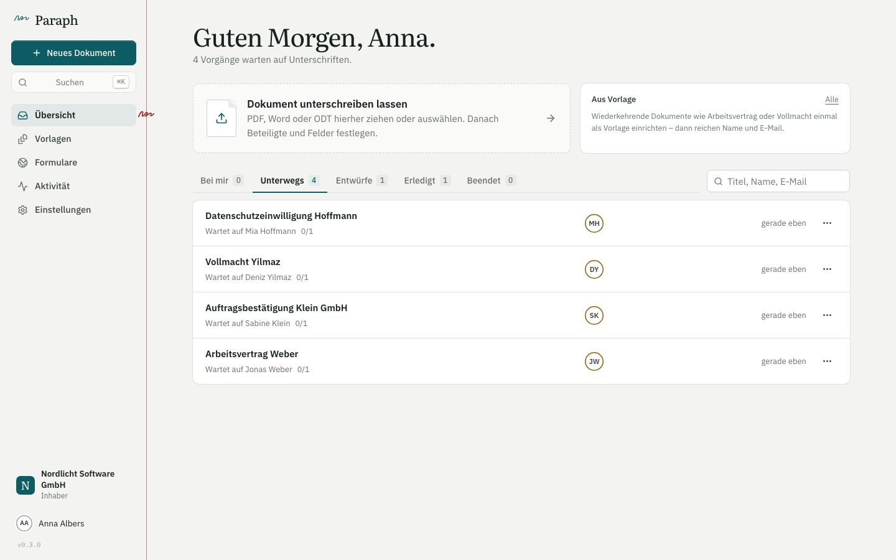
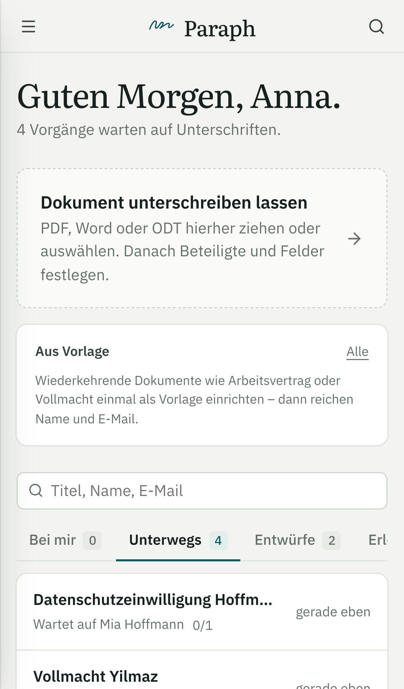
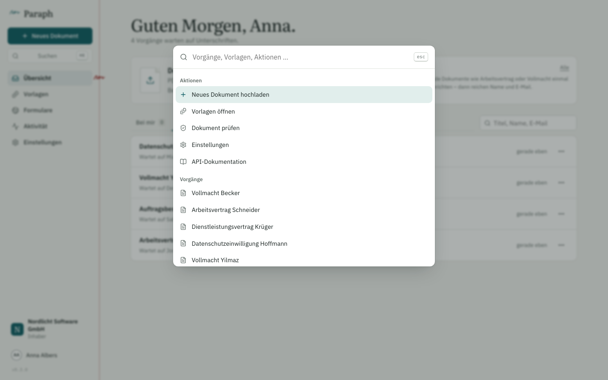
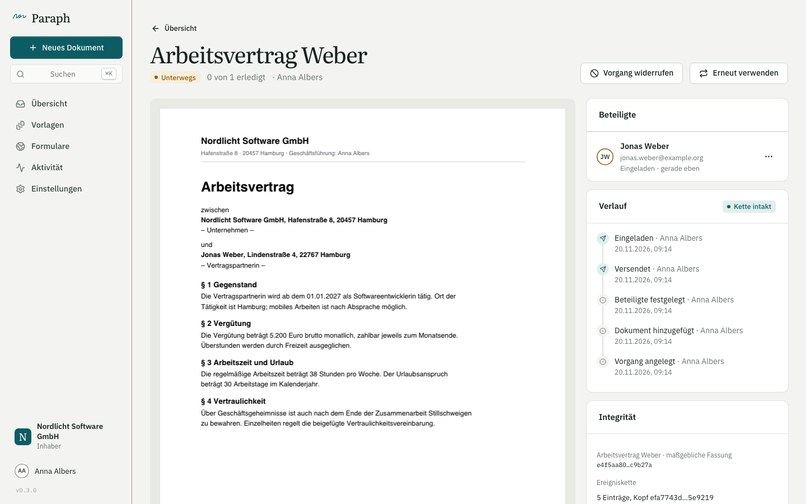
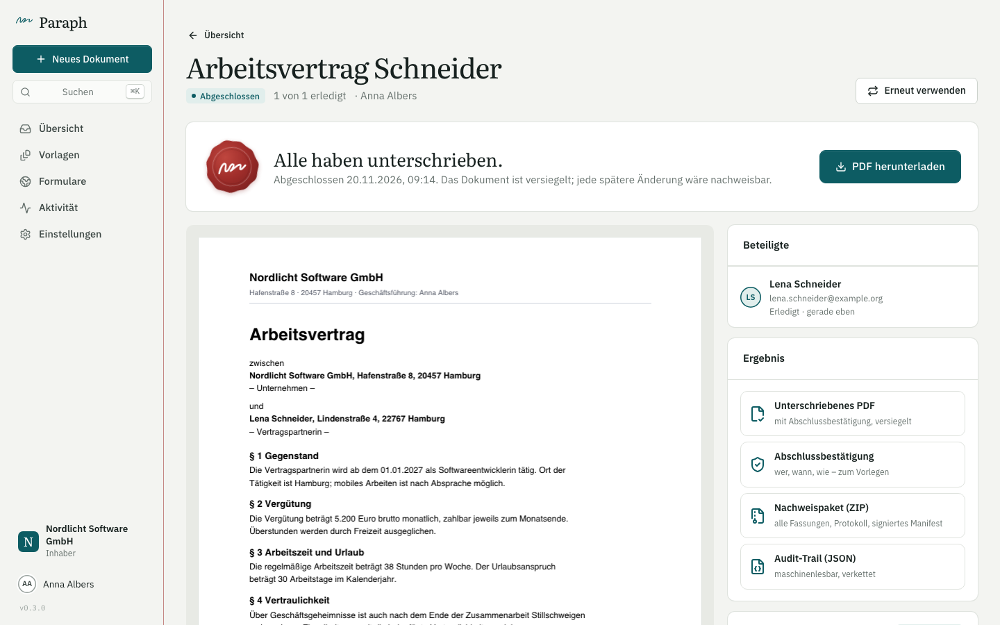
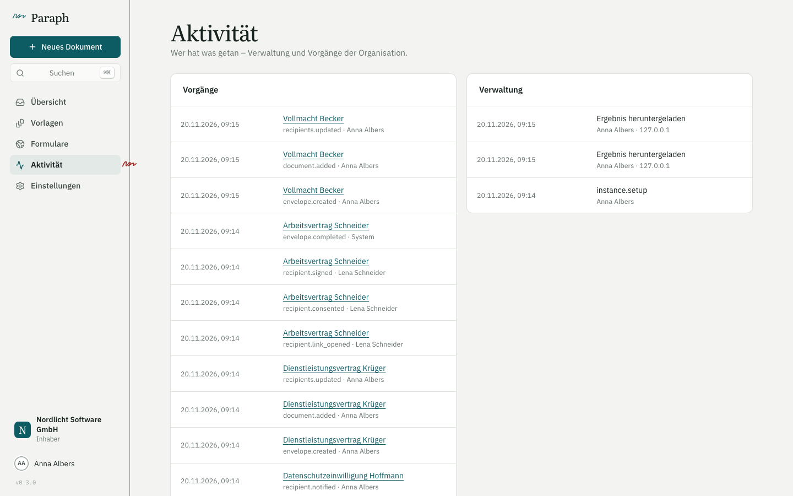

# 3. Vorgänge verfolgen

Dieses Kapitel zeigt, wie Sie versendete Vorgänge im Blick behalten, nachfassen, zurückziehen und das Ergebnis abholen. Es richtet sich an alle, die Vorgänge versenden oder betreuen.

## Die Übersicht lesen

Die „Übersicht“ ist die Startseite. Oben grüßt Paraph und nennt, wie viele Vorgänge auf Unterschriften warten. Darunter sortieren fünf Reiter die Vorgänge; die Zahl am Reiter zeigt, wie viele es sind.

| Reiter | Inhalt |
|---|---|
| „Bei mir“ | Vorgänge, in denen Sie selbst als Beteiligte mit Ihrer E-Mail-Adresse gerade an der Reihe sind. Dieselbe Zahl steht in der Seitenleiste an „Übersicht“. |
| „Unterwegs“ | alle versendeten, noch offenen Vorgänge |
| „Entwürfe“ | noch nicht versendete Vorgänge; ein Klick öffnet den Editor |
| „Erledigt“ | abgeschlossene, versiegelte Vorgänge |
| „Beendet“ | abgelehnte, widerrufene und abgelaufene Vorgänge |

Jede Zeile zeigt den Titel, bei laufenden Vorgängen „Wartet auf …“ mit den Namen, den Fortschritt (z. B. `1/2`), eine Kennung aus Ihrer Fachsoftware, etwa Kanzlei-, Personal- oder CRM-Software (falls über die API gesetzt) und wann sich zuletzt etwas geändert hat. Die Kreise rechts stehen für die Beteiligten in ihrer Reihenfolge. Über das Menü „…“ öffnen Sie den Vorgang; bei erledigten Vorgängen laden Sie dort direkt das PDF herunter.

Die Übersicht aktualisiert sich von selbst, sobald jemand öffnet, unterschreibt oder ablehnt.

Welche Vorgänge Sie sehen, hängt von Ihrer Rolle und einer Einstellung der Organisation ab: Mitglieder sehen entweder nur ihre eigenen Vorgänge oder alle der Organisation, ändern aber nur eigene. Inhaber, Administration und „Nur lesen“ sehen alle. Details in [Kapitel 8](08-organisation-team-erscheinungsbild.md).

> **Gut zu wissen:** Die Übersicht lädt die 200 zuletzt geänderten Vorgänge. Ältere finden Sie über die Suche.

Auf dem Smartphone öffnen Sie die Seitenleiste über das Menüsymbol oben links.

## Vorgänge suchen

Über der Liste steht ein Suchfeld („Titel, Name, E-Mail“). Es durchsucht Titel sowie Namen und E-Mail-Adressen der Beteiligten.

Schneller geht es mit der Befehlspalette: ⌘K (Mac) bzw. Strg+K (Windows) oder „Suchen“ in der Seitenleiste.

Die Palette zeigt drei Gruppen:

- „Aktionen“: „Neues Dokument hochladen“, „Vorlagen öffnen“, „Dokument prüfen“, „Einstellungen“, „API-Dokumentation“,
- „Vorlage verwenden“: passende veröffentlichte Vorlagen,
- „Vorgänge“: passende Vorgänge.

Mit den Pfeiltasten wählen, mit Enter öffnen, mit `esc` schließen.

## Die Vorgangsseite verstehen

Ein Klick auf einen Vorgang öffnet seine Seite.

Oben stehen Titel, Status, Fortschritt („0 von 1 erledigt“), gegebenenfalls die Kennung aus der Fachsoftware und wer den Vorgang angelegt hat. Rechts davon „Vorgang widerrufen“ (nur bei laufenden Vorgängen) und „Erneut verwenden“.

Links sehen Sie das Dokument mit den Feldern in den Farben der Beteiligten. Erledigte Felder tragen einen Haken. Bei mehreren Dokumenten wechseln Sie über die Reiter darüber.

Rechts stehen drei Abschnitte:

**„Beteiligte“** – jede Person mit ihrem Stand:

| Anzeige | Bedeutung |
|---|---|
| „Eingeladen“ | Link ist verschickt bzw. ausgestellt |
| „Hat geöffnet“ | Person hat den Link geöffnet |
| „Erledigt“ | Person ist fertig |
| „Wartet auf Vorgänger“ | bei „Nacheinander“: noch nicht an der Reihe |
| „Wartet“ | Person mit „Erhält Kopie“; sie erhält das Ergebnis nach Abschluss |
| „Abgelehnt“ | Person hat abgelehnt |
| „Weitergegeben“ | Person hat an eine Vertretung weitergegeben; die Vertretung steht mit dem Zusatz „(Vertretung)“ darunter |
| „Widerrufen“ | Vorgang wurde widerrufen, bevor die Person fertig war |

Konnte eine Einladung oder Erinnerung nicht zugestellt werden, steht bei der Person „E-Mail nicht zugestellt“ mit dem Grund. „Versand wird wiederholt“ heißt, dass Paraph es noch einmal versucht. Bei einem endgültigen Fehler erhalten Sie zusätzlich eine E-Mail. Prüfen Sie dann die Adresse und erinnern Sie erneut oder geben Sie den Link selbst weiter.

**„Verlauf“** – die letzten 40 Ereignisse aus dem Audit-Trail mit Zeit, handelnder Person und, wo vorhanden, IP-Adresse und Prüfmethode: „Versendet“, „Eingeladen“, „Geöffnet“, „Code gesendet“, „Identität bestätigt“, „Erklärung abgegeben“, „Unterschrieben“ und so weiter. Rechts oben zeigt „Kette intakt“, dass die Ereigniskette unverändert ist. „Kette beschädigt“ wäre ein ernstes Warnsignal; wenden Sie sich dann an Ihre IT.

**„Integrität“** – die Prüfwerte (SHA-256) der maßgeblichen Fassungen, nach Abschluss auch des unterschriebenen PDFs, die Art des Siegels, die Zahl der Ereignisse und die Signaturstufe „Einfache elektronische Signatur (EES)“.

Solange ein Vorgang unterwegs ist, aktualisiert sich die Seite alle 15 Sekunden.

## Nachfassen, Link ausstellen, vor Ort unterschreiben

Bei jeder Person, die gerade an der Reihe ist, öffnet das Menü „…“ drei Aktionen. Sie stehen nur zur Verfügung, wenn Sie den Vorgang ändern dürfen.

### Eine Person erinnern

„Erinnern“ verschickt sofort eine Erinnerungs-E-Mail mit einem **neuen Link**. Der unmittelbar vorherige Link bleibt gültig, damit die erste E-Mail weiter funktioniert. Alle älteren Links verfallen. Je Person sind also höchstens zwei Links gültig.

Automatische Erinnerungen verschickt Paraph im Abstand, den Sie beim Versand gewählt haben, nur bei Vorgängen mit E-Mail-Einladung.

### Einen neuen Link ausstellen

„Link selbst weitergeben“ stellt einen neuen Link aus, den Sie selbst übergeben, etwa per Fachsoftware oder am Telefon.

Bei Vorgängen ohne E-Mail-Einladung steht bei jeder Person, die an der Reihe ist und noch auf Ihren Link wartet, der Hinweis „Ohne E-Mail-Einladung: wartet auf Ihren Link.“ mit „Link selbst weitergeben“ direkt daneben. Kommt jemand später an die Reihe (bei „Nacheinander“ oder nach einer Vertretung), erhalten Sie dazu eine E-Mail.

1. Klicken Sie auf „Link selbst weitergeben“ und bestätigen Sie mit „Link ausstellen“.
2. Kopieren Sie den Link aus dem Fenster „Link für …“. Er wird nicht erneut angezeigt.

Alle bisherigen Links dieser Person werden sofort ungültig, eine bereits geöffnete Sitzung endet. Nutzen Sie das auch, wenn ein Link in falsche Hände geraten sein könnte.

### Vor Ort unterschreiben lassen

Ist die Person persönlich bei Ihnen, wählen Sie „Vor Ort unterschreiben“. Die Person unterschreibt dann an Ihrem Gerät. Einzelheiten in [Kapitel 4](04-vorlagen-serien-formulare.md#vor-ort-unterschreiben-lassen).

## Einen Vorgang widerrufen

Wollen Sie einen laufenden Vorgang zurückziehen, etwa weil sich der Inhalt geändert hat:

1. Klicken Sie auf „Vorgang widerrufen“.
2. Tragen Sie unter „Grund (wird mitgeteilt)“ einen Grund ein.
3. Bestätigen Sie mit „Vorgang widerrufen“.

Alle offenen Links und Sitzungen werden sofort ungültig. Wer schon eingeladen war, erhält eine kurze E-Mail mit dem Grund. Bereits geleistete Unterschriften bleiben im Protokoll. Ein widerrufener Vorgang lässt sich nicht wieder aufnehmen; legen Sie mit „Erneut verwenden“ eine Kopie an.

## Wenn ein Vorgang abläuft oder abgelehnt wird

**Ablauf.** Jeder Vorgang hat ein Ablaufdatum (beim Versand gewählt, siehe [Kapitel 2](02-dokument-unterschreiben-lassen.md#versenden)). Paraph prüft alle fünf Minuten. Ist das Datum überschritten, wird der Vorgang „Abgelaufen“; offene Links und Sitzungen enden. Die Vorgangsseite zeigt „Abgelaufen am …“.

**Ablehnung.** Jede handelnde Person kann mit Begründung ablehnen. Der ganze Vorgang endet dann als „Abgelehnt“. Sie und die übrigen Beteiligten werden benachrichtigt. Die Vorgangsseite zeigt, wer abgelehnt hat, und die Begründung.

In beiden Fällen ist kein Abschluss mehr möglich. Mit „Erneut verwenden“ beginnen Sie neu.

## Einen Vorgang erneut verwenden

„Erneut verwenden“ legt eine bearbeitbare Kopie als Entwurf an und öffnet sie im Editor. Das geht bei jedem Vorgang, auch bei abgeschlossenen.

Übernommen werden Titel, Dokumente, Nachricht, Reihenfolge, Erinnerungsabstand, Vertretungserlaubnis, Dokumentarten, Beteiligte und Felder. Nicht übernommen werden:

- Eingaben und Unterschriften (außer Vorbelegungen, die als „Nicht änderbar“ markiert sind),
- Personen, die an eine Vertretung weitergegeben haben (die Vertretung selbst wird übernommen),
- Zugangscodes: Wo ein Zugangscode verlangt war, steht in der Kopie „Code per E-Mail“. Setzen Sie bei Bedarf einen neuen Zugangscode.

## Das Ergebnis abholen

Wenn die letzte Person fertig ist, setzt Paraph alle Eingaben und Unterschriften in das Dokument ein, prüft, dass alles genau dem unterschriebenen Stand entspricht, und versiegelt das PDF. Die Vorgangsseite zeigt dann das Siegel und „Alle haben unterschrieben.“

Unter „Ergebnis“ liegen:

| Datei | Inhalt | Wofür |
|---|---|---|
| „Unterschriebenes PDF“ | das versiegelte Dokument mit allen Eingaben; ab Werk mit angehängter Abschlussbestätigung | Ablage, Weitergabe |
| einzelne Dokumente | bei mehreren Dokumenten jedes einzeln | Ablage je Dokument |
| „Abschlussbestätigung“ | wer, wann, wie: Beteiligte, Zeitpunkte, Prüfmethoden und Prüfwerte | zum Vorlegen |
| „Nachweispaket (ZIP)“ | alle Fassungen, Audit-Trail, Unterschriftsbilder, Anhänge, signiertes Manifest, Prüfanleitung und Prüfskript | Beweissicherung |
| „Audit-Trail (JSON)“ | alle Ereignisse als verkettete Liste, maschinenlesbar | technische Prüfung |

Die Beteiligten und Personen mit „Erhält Kopie“ erhalten eine Abschluss-E-Mail mit persönlichem Downloadlink und dem SHA-256-Prüfwert des unterschriebenen Dokuments. Ob das PDF zusätzlich angehängt wird und ob die Abschlussbestätigung an das PDF angehängt wird, legt die Administration fest ([Kapitel 8](08-organisation-team-erscheinungsbild.md)). Sie selbst erhalten ebenfalls eine Nachricht.

Wie Sie oder Dritte ein Ergebnis später prüfen, steht in [Kapitel 6](06-dokumente-pruefen.md).

> **Wichtig:** Hat Ihre Organisation eine Aufbewahrungsfrist eingestellt, löscht Paraph nach deren Ablauf die Dokumente und Eingaben beendeter Vorgänge. Erhalten bleiben Titel, Beteiligte, Zeitpunkte, Prüfwerte und der Audit-Trail. Legen Sie das Ergebnis deshalb rechtzeitig in Ihrer eigenen Ablage ab.

## Die Aktivität ansehen

Inhaber und Administration sehen in der Seitenleiste „Aktivität“. Die Seite zeigt zwei Spalten:

- „Vorgänge“: die letzten 200 Ereignisse aus allen Vorgängen der Organisation, mit Link zum Vorgang. Der Ereignistyp steht hier in technischer Schreibweise, z. B. `recipient.signed`.
- „Verwaltung“: die letzten 200 Verwaltungsereignisse, etwa „Person eingeladen“, „Rolle geändert“, „API-Schlüssel erstellt“, „Vorlage veröffentlicht“, „Ergebnis heruntergeladen“, jeweils mit Person und IP-Adresse.

Anmeldungen und Änderungen an Passwort oder Zwei-Faktor protokolliert Paraph ebenfalls, aber ohne Zuordnung zu einer Organisation; sie erscheinen derzeit nicht in dieser Ansicht. Die Aktivität dient der Verwaltung. Nachweis gegenüber Dritten ist der Audit-Trail des einzelnen Vorgangs.

## Testvorgänge erkennen

Vorgänge im Testmodus entstehen nur über die API mit einem Testschlüssel, etwa wenn Ihre IT eine Anbindung an die Fachsoftware ausprobiert ([Kapitel 10](10-anbindung-api-webhooks.md)). Für Ihre Organisation gilt:

- Testvorgänge erscheinen nicht in der Übersicht, nicht in den Zählern und nicht in der Aktivität.
- Öffnen Sie einen Testvorgang über einen direkten Link, trägt er neben dem Status die Marke „TEST“.
- Testvorgänge versenden keine E-Mails und erinnern nicht automatisch.
- Das Ergebnis trägt das Wasserzeichen „TEST – NICHT GÜLTIG“, die Abschlussbestätigung den Hinweis „TESTMODUS – kein rechtsverbindlicher Vorgang“. Die Signaturseite und die Prüfstelle weisen ebenfalls darauf hin.

---

← [2. Ein Dokument unterschreiben lassen](02-dokument-unterschreiben-lassen.md) · [Inhalt](README.md) · [4. Vorlagen, Serien und Formulare](04-vorlagen-serien-formulare.md) →
