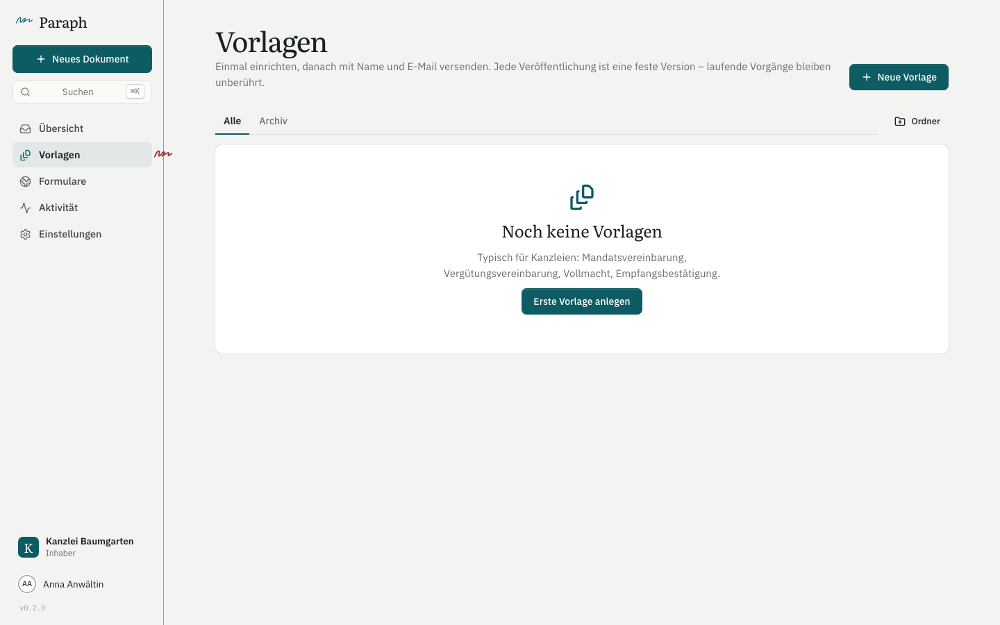
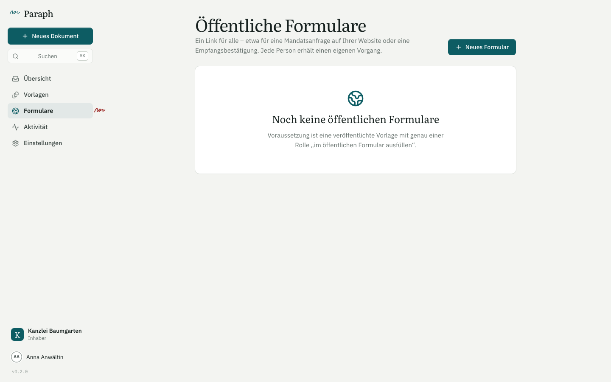

# 4. Vorlagen, Serien und Formulare

Dieses Kapitel zeigt, wie Sie wiederkehrende Dokumente einmal einrichten und danach mit wenigen Angaben versenden – einzeln, als Serie aus einer Tabelle oder über ein öffentliches Formular. Am Ende steht die Unterschrift vor Ort in der Kanzlei. Es richtet sich an alle, die regelmäßig dieselben Dokumente unterschreiben lassen, etwa Vollmachten oder Mandatsvereinbarungen.

## Was eine Vorlage ist

Eine Vorlage enthält Dokumente, Felder und Einstellungen wie ein Vorgang. Statt konkreter Personen hat sie **Rollen**, etwa „Mandant“ oder „Kanzlei“. Beim Verwenden tragen Sie nur noch Name und E-Mail je Rolle ein.

Bearbeitet wird immer ein Entwurf der Vorlage. Erst **„Veröffentlichen“** macht daraus eine feste, nummerierte Version (`v1`, `v2` …). Versionen lassen sich nicht mehr ändern. Jeder Vorgang merkt sich die Version, aus der er entstanden ist. Spätere Änderungen an der Vorlage wirken nicht auf bereits angelegte Vorgänge.

Alle mit der Rolle „Mitglied“ und höher können Vorlagen anlegen. Mitglieder ändern nur ihre eigenen Vorlagen; Inhaber und Administration alle.

## Eine Vorlage anlegen

1. Öffnen Sie „Vorlagen“ und klicken Sie auf „Neue Vorlage“.
2. Geben Sie einen Namen ein. Die Schaltflächen darunter schlagen typische Namen vor: „Mandatsvereinbarung“, „Vergütungsvereinbarung“, „Vollmacht“, „Empfangsbestätigung“, „Schweigepflichtentbindung“. Wählen Sie einen davon, legt Paraph gleich eine passende Rolle an (z. B. „Mandant“ mit „Code per E-Mail“) und einen Titel wie `Vollmacht – {{Vollmachtgeber.name}}`.
3. Wählen Sie optional einen „Ordner“ und unter „Sichtbar für“ „Ganze Organisation“ oder „Nur mich“.
4. Klicken Sie auf „Anlegen und Dokument hochladen“ und wählen Sie die Datei (PDF, Word oder ODT).

Die vorgeschlagenen Namen sind nur Startpunkte. Paraph liefert keine Mustertexte; Inhalt und Wirksamkeit Ihrer Vorlagen prüfen Sie selbst.

## Rollen und Felder einrichten

Der Vorlagen-Editor sieht aus wie der Editor eines Vorgangs ([Kapitel 2](02-dokument-unterschreiben-lassen.md#den-editor-kennenlernen)). Felder setzen Sie genauso. Rechts unten gibt es zwei Reiter: „Rollen“ und „Einstellungen“.

### Reiter „Rollen“

- „Gleichzeitig“ oder „Nacheinander“ wie beim Vorgang; bei „Nacheinander“ ändern Sie die Reihenfolge mit den Pfeilen.
- Je Rolle: Rollenname, Art („Unterschreibt“, „Gibt frei“, „Füllt aus“, „Zeuge“, „Erhält Kopie“) und Identitätsprüfung („Nur Link“, „Code per E-Mail“, „Code per SMS“). Einen Zugangscode können Sie in Vorlagen nicht festlegen.
- „Feste Person (z. B. Anwältin, die immer gegenzeichnet)“: Hinterlegen Sie Name und E-Mail. Beim Verwenden muss dann niemand diese Rolle ausfüllen.
- „Wird im öffentlichen Formular von Besuchern ausgefüllt“: markiert die Rolle für ein öffentliches Formular (siehe unten). Nur eine Rolle kann so markiert sein.
- „Rolle hinzufügen“ legt eine weitere Rolle an. Die letzte Rolle lässt sich nicht löschen.

### Reiter „Einstellungen“

| Einstellung | Wirkung |
|---|---|
| „Titel des Vorgangs“ | Titel der entstehenden Vorgänge. Platzhalter: `{{Rolle.name}}`, `{{Rolle.email}}` und `{{Feldname}}` für vorbelegte Felder, z. B. `Vollmacht – {{Mandant.name}}` |
| „Nachricht“ | Text der Einladungs-E-Mail; dieselben Platzhalter |
| „Gültig (Tage)“ | 1 bis 365, ab Werk 30 |
| „Erinnern alle … Tage“ | 0 (nie) bis 30, ab Werk 3 |
| „Vertretung erlauben“ | Beteiligte dürfen an eine Vertretung weitergeben |
| „Dokumentart (Formhinweise)“ | Dokumentarten aus dem Katalog; Paraph verlangt dann beim Verwenden gegebenenfalls eine Bestätigung ([Kapitel 2](02-dokument-unterschreiben-lassen.md#dokumentart-und-formvorschriften)) |

Paraph speichert den Entwurf laufend.

## Eine Vorlage veröffentlichen

1. Klicken Sie oben rechts auf „Veröffentlichen“.
2. Beschreiben Sie unter „Was hat sich geändert? (optional)“ kurz die Änderung.
3. Bestätigen Sie mit „Veröffentlichen“.

Paraph lehnt die Veröffentlichung ab, wenn die Vorlage kein Dokument hat, eine unterschreibende Rolle kein Unterschriftsfeld hat oder sich seit der letzten Version nichts geändert hat.

Neue Vorgänge verwenden ab sofort die neue Version. Über „Versionen“ in der oberen Leiste sehen Sie alle Versionen mit Datum und Änderungsnotiz. Auf der Vorlagenseite zeigt jede Karte die aktuelle Version, „Änderungen offen“, wenn der Entwurf neuer ist, und wie oft die Vorlage verwendet wurde.

## Vorlagen ordnen

Auf der Seite „Vorlagen“:

- „Ordner“ legt einen neuen Ordner an. Die Ordner erscheinen als Reiter. Über das Menü „…“ einer Vorlage verschieben Sie sie in einen Ordner.
- „Duplizieren“ legt eine Kopie mit dem Zusatz „(Kopie)“ an. Die Kopie ist zunächst nur für Sie sichtbar und noch nicht veröffentlicht.
- „Archivieren“ blendet eine Vorlage aus. Im Reiter „Archiv“ holen Sie sie mit „Wiederherstellen“ zurück.

Private Vorlagen (Schloss-Symbol) sieht nur ihre Erstellerin. Scheidet sie aus der Organisation aus, werden ihre privaten Vorlagen für die Organisation sichtbar.

## Eine Vorlage verwenden

Sie starten auf drei Wegen: „Verwenden“ auf der Vorlagenkarte, „Aus Vorlage“ auf der Übersicht oder über die Befehlspalette (⌘K) unter „Vorlage verwenden“.

1. Tragen Sie für jede Rolle ohne feste Person Name und E-Mail ein. Rollen mit fester Person nennt Paraph unter „Außerdem: …“.
2. Unter „Vorbelegen“ bietet Paraph Felder an, die in der Vorlage eine Vorbelegung haben oder nach Aktenzeichen, Betrag, Honorar oder Stundensatz klingen. Tragen Sie die Werte ein. Vorbelegte Werte können die Beteiligten standardmäßig nicht ändern.
3. Lassen Sie „Einladungen per E-Mail senden“ angehakt oder nehmen Sie den Haken heraus, um die Links selbst weiterzugeben ([Kapitel 2](02-dokument-unterschreiben-lassen.md#links-selbst-übergeben)).
4. Klicken Sie auf „Versenden“ bzw. „Starten und Links anzeigen“.

Verlangt eine Dokumentart der Vorlage eine Bestätigung, zeigt Paraph nach dem ersten Klick den Formhinweis. Setzen Sie das Häkchen „Ich habe den Formhinweis gelesen und versende trotzdem. Die Bestätigung wird protokolliert.“ und klicken Sie erneut.

Der Vorgang wird sofort versendet; einen Entwurf gibt es dabei nicht. Gültigkeit, Erinnerung und Reihenfolge kommen aus der Vorlage.

## Viele Vorgänge auf einmal versenden

Der Massenversand erzeugt aus einer veröffentlichten Vorlage und einer Tabelle viele Vorgänge – etwa eine Datenschutz-Einwilligung an alle Mandanten einer Sammelklage. Jede Zeile der Tabelle wird ein eigener Vorgang.

1. Öffnen Sie auf der Vorlagenkarte das Menü „…“ und wählen Sie „Massenversand“.
2. Klicken Sie auf „Spaltenvorlage herunterladen“. Sie erhalten eine CSV-Datei mit den richtigen Spaltenköpfen.
3. Füllen Sie die Datei in Excel, LibreOffice oder einem Texteditor aus, eine Zeile je Vorgang.
4. Klicken Sie auf „Datei auswählen“ und wählen Sie die Datei.
5. Klicken Sie auf „Datei prüfen“. Paraph prüft im Probelauf jede Zeile und meldet „Probelauf: … von … Zeilen sind in Ordnung.“ Fehlerhafte Zeilen stehen mit Grund in der Tabelle darunter.
6. Korrigieren Sie bei Bedarf die Datei und prüfen Sie erneut.
7. Klicken Sie auf „{n} Vorgänge jetzt versenden“. Erst dieser Schritt verschickt etwas, und nur die fehlerfreien Zeilen.

| Spalte | Inhalt |
|---|---|
| `<rolle>.name`, `<rolle>.email` | Name und E-Mail je Rolle ohne feste Person, z. B. `mandant.name`, `mandant.email`. `<rolle>` ist der interne Schlüssel der Rolle; die Spaltenvorlage enthält ihn bereits. |
| Feldname, z. B. `aktenzeichen` | Wert zum Vorbelegen dieses Feldes. Möglich für alle Felder außer Unterschrift, Paraphe, Datum der Unterschrift, Berechnung und Anhang. |

Regeln:

- Dateiformat CSV (Komma oder Semikolon; Paraph erkennt das Trennzeichen) oder Excel (XLSX), höchstens 5 MB.
- Höchstens 500 Zeilen je Durchgang. Größere Serien teilen Sie auf.
- Die Zeilennummern in der Ergebnistabelle zählen wie in der Tabellenkalkulation; Zeile 1 ist die Kopfzeile.
- Alle Vorgänge werden per E-Mail eingeladen und verwenden die aktuelle Version der Vorlage.
- Hat die Vorlage Dokumentarten mit Formhinweis, setzen Sie vor dem Versand das Häkchen „Formhinweise der Vorlage sind mir bekannt (falls vorhanden; wird protokolliert)“. Sonst scheitern die Zeilen.

> **Wichtig:** Prüfen Sie vor dem Versand das Ergebnis des Probelaufs. Ein versendeter Vorgang lässt sich nur noch einzeln widerrufen.

## Ein öffentliches Formular einrichten

Ein öffentliches Formular macht eine Vorlage unter einem festen Link für jedermann zugänglich, etwa für eine Mandatsanfrage auf Ihrer Website oder eine Empfangsbestätigung. Jede Person, die das Formular ausfüllt, erhält einen eigenen Vorgang.

### Die Vorlage vorbereiten

Die Vorlage braucht:

- genau eine Rolle mit „Wird im öffentlichen Formular von Besuchern ausgefüllt“; diese Rolle muss als Erste an der Reihe sein,
- für alle anderen Rollen eine „Feste Person“ mit Name und E-Mail, etwa die Anwältin, die gegenzeichnet,
- eine veröffentlichte Version.

### Das Formular anlegen

1. Öffnen Sie „Formulare“ und klicken Sie auf „Neues Formular“.
2. Wählen Sie die „Vorlage“ und geben Sie einen „Titel auf der Seite“ ein.
3. Lassen Sie „E-Mail-Adresse per Code bestätigen lassen (empfohlen)“ angehakt.
4. Begrenzen Sie optional unter „Höchstens … Einsendungen (optional)“ die Zahl der Einsendungen.
5. Klicken Sie auf „Anlegen“.

Die Liste zeigt jedes Formular mit Vorlage, Zahl der Einsendungen, ob ein Code verlangt wird, und den Link. „Link“ kopiert ihn. Mit dem Schalter deaktivieren Sie ein Formular vorübergehend; der Papierkorb löscht es.

### Was Besucher erleben

Die Besucherin gibt Namen und E-Mail-Adresse an. Ist die Bestätigung eingeschaltet, erhält sie einen sechsstelligen Code per E-Mail und gibt ihn ein. Danach füllt sie das Dokument aus und unterschreibt wie in [Kapitel 5](05-so-unterschreiben-mandanten.md) beschrieben. Die entstehenden Vorgänge gehören der Person, die das Formular angelegt hat, und erscheinen in ihrer Übersicht.

> **Wichtig:** Ohne E-Mail-Bestätigung kann jede Person unter beliebigem Namen unterschreiben. Das Protokoll weist dann nur IP-Adresse und Zeitpunkt aus.

Ist die Höchstzahl erreicht oder das Formular deaktiviert, nimmt es keine Einsendungen mehr an.

Vorgänge aus einem Formular laufen ohne Einladungs-E-Mails. Auch die gegenzeichnende Rolle der Kanzlei erhält keine Einladung, wenn sie an der Reihe ist. Behalten Sie diese Vorgänge deshalb unter „Unterwegs“ im Blick und unterschreiben Sie über „Link selbst weitergeben“ oder „Vor Ort unterschreiben“ ([Kapitel 3](03-vorgaenge-verfolgen.md#nachfassen-link-ausstellen-vor-ort-unterschreiben)). Die Abschluss-E-Mails verschickt Paraph wie gewohnt.

## Vor Ort unterschreiben lassen

Ist die Mandantin in der Kanzlei, kann sie an Ihrem Rechner oder Tablet unterschreiben, ohne E-Mail und ohne Code.

1. Öffnen Sie den laufenden Vorgang.
2. Öffnen Sie bei der Person das Menü „…“ und wählen Sie „Vor Ort unterschreiben“.
3. Prüfen Sie die Identität der Person persönlich, etwa anhand des Ausweises, und bestätigen Sie mit „Starten“.
4. Übergeben Sie das Gerät. Die Person unterschreibt auf der gewohnten Signaturseite.
5. Ist sie fertig, nehmen Sie das Gerät zurück und tippen auf „Gerät zurückgeben“. Paraph zeigt wieder die Vorgangsseite.

Die Sitzung gilt als von Ihnen bestätigt. Ihr Name steht im Audit-Trail. Die Funktion steht nur angemeldeten Personen in der Oberfläche zur Verfügung, nicht über die API, und nur für Personen, die gerade an der Reihe sind.

---

← [3. Vorgänge verfolgen](03-vorgaenge-verfolgen.md) · [Inhalt](README.md) · [5. So unterschreiben Ihre Mandanten](05-so-unterschreiben-mandanten.md) →
