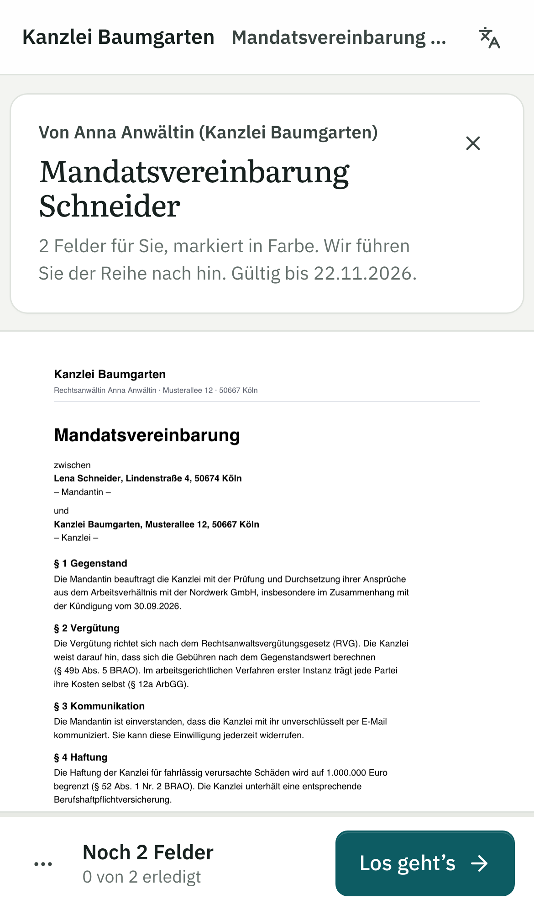
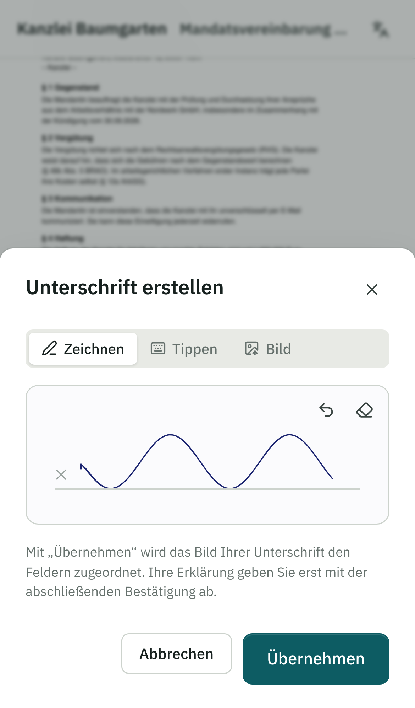
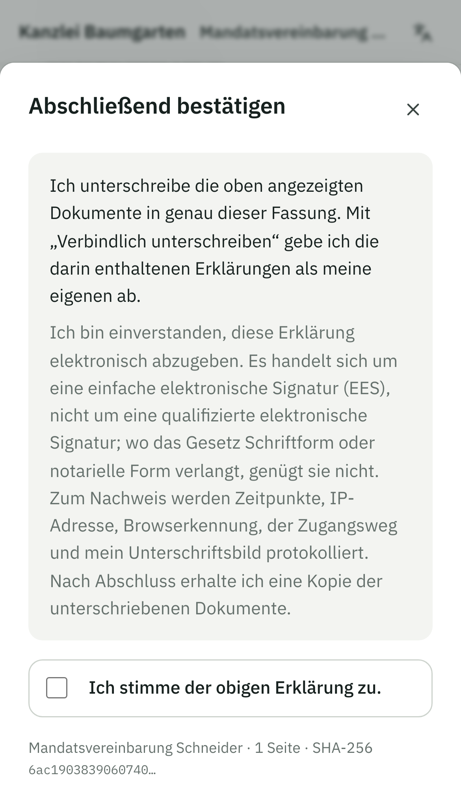
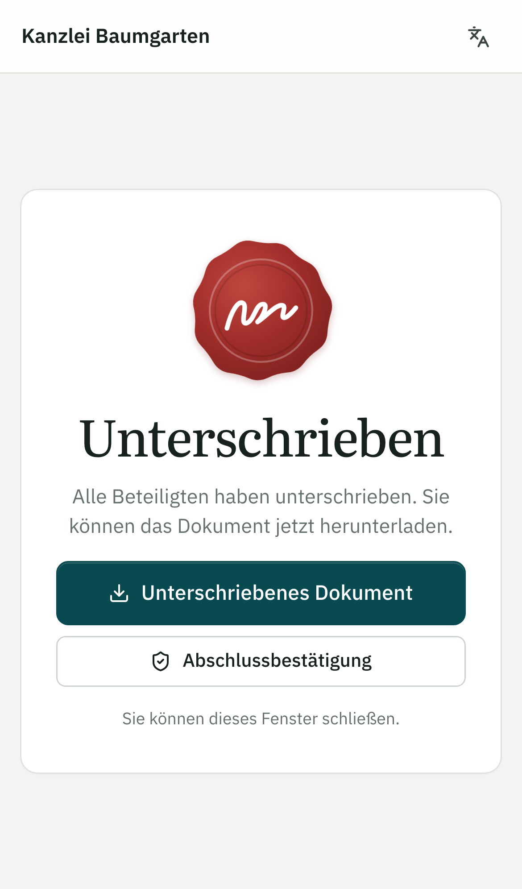

# 5. So unterschreiben Ihre Mandanten

Dieses Kapitel zeigt die Signaturseite so, wie Ihre Mandantin oder ein anderer Beteiligter sie sieht: von der Einladung bis zum Herunterladen des unterschriebenen Dokuments. Es richtet sich an alle in der Kanzlei, die Mandanten durch eine Unterschrift begleiten oder Rückfragen beantworten. Am Ende steht ein kurzer Text, den Sie Mandanten vorab schicken können.

Die Signaturseite braucht kein Konto, keine App und keine Installation. Sie läuft in jedem aktuellen Browser, auf dem Smartphone ebenso wie am Rechner. Die Bilder in diesem Kapitel stammen von einem iPhone.

## Die Einladung öffnen

Wenn die Kanzlei „Einladungen per E-Mail senden“ gewählt hat, erhält jede beteiligte Person eine E-Mail mit dem Betreff „{Absender} bittet Sie um Ihre Unterschrift: {Titel}“. Die E-Mail enthält die Nachricht der Kanzlei, das Ablaufdatum und die Schaltfläche „Dokument ansehen und unterschreiben“. Sie weist darauf hin, dass der Link persönlich ist und nicht weitergeleitet werden soll.

Hat die Kanzlei die Links selbst übergeben (etwa aus der Kanzleisoftware), kommt der Link auf diesem Weg an. Für die Mandantin ändert sich sonst nichts.

Gut zu wissen für Rückfragen:

- **Jede Erinnerung enthält einen neuen Link.** Der Link aus der unmittelbar vorherigen E-Mail funktioniert weiter, ältere nicht mehr. Im Zweifel gilt: den Link aus der neuesten E-Mail nehmen.
- **Ein geöffneter Link gilt im Browser acht Stunden.** Danach meldet die Seite „Sitzung abgelaufen“. Die Mandantin öffnet den Link aus der E-Mail einfach erneut.
- **Unterschreiben andere vorher**, zeigt die Seite „Noch nicht an der Reihe“. Die Mandantin erhält eine E-Mail, sobald sie dran ist.

## Den Zugang bestätigen

Hat die Kanzlei für diese Person einen Zugangsschutz gewählt, erscheint vor dem Dokument die Seite „Kurz bestätigen, dass Sie es sind“. Das Dokument wird erst danach geladen.

| Zugangsschutz | Was die Mandantin tut |
|---|---|
| Nur Link | nichts; das Dokument öffnet sich sofort |
| E-Mail-Code | tippt auf „Code senden“, erhält einen sechsstelligen Code per E-Mail und gibt ihn ein |
| SMS-Code | tippt auf „Code senden“, erhält den Code per SMS an die hinterlegte Mobilnummer und gibt ihn ein |
| Zugangscode | gibt den Code ein, den die Kanzlei ihr auf anderem Weg mitgeteilt hat (z. B. telefonisch) |

Ein Einmalcode gilt zehn Minuten. Über „Neuen Code senden“ lässt sich ein neuer anfordern, höchstens fünf pro Stunde. Nach fünf falschen Eingaben in 15 Minuten sperrt Paraph die Prüfung für diese Person für 15 Minuten. Die SMS nennt nur den Namen der Kanzlei, nicht den Titel des Dokuments.

Die Seite sagt der Mandantin offen: „Der Code belegt den Zugriff auf Ihr Postfach bzw. Ihre Nummer. Er ist kein amtlicher Identitätsnachweis.“

## Das Dokument durchgehen

Oben steht das Logo oder der Name der Kanzlei, daneben der Titel und eine Schaltfläche zum Wechsel zwischen Deutsch und Englisch. Darunter erscheint ein Kasten mit Absender („Von …“), Titel, der Nachricht der Kanzlei, der Zahl der Felder und dem Ablaufdatum („Gültig bis …“). Die Mandantin kann ihn schließen und über „…“ → „Nachricht anzeigen“ wieder öffnen.

Unterschreiben mehrere Personen nacheinander, zeigt eine Zeile die Reihenfolge; die eigene Station heißt „Sie“, erledigte Stationen tragen einen Haken.

Das Dokument erscheint vollständig, Seite für Seite. Die Felder der Mandantin sind farbig markiert. Felder anderer Personen sind zu sehen, aber nicht bearbeitbar; hat jemand bereits unterschrieben, steht dort „✓ {Name}“.

Unten am Bildschirm sitzt eine Leiste mit dem Fortschritt („Noch 2 Felder“, „0 von 2 erledigt“) und der Hauptschaltfläche:

1. „Los geht’s“ springt zum ersten offenen Feld.
2. „Nächstes Feld“ führt danach jeweils zum nächsten offenen Pflichtfeld.
3. Sind alle Pflichtfelder erledigt, steht dort „Alles ausgefüllt“ und die Schaltfläche heißt „Abschließen“.

Unter dem letzten Blatt steht die „Dokumentfassung“ als Kurzform des SHA-256-Fingerabdrucks und der Hinweis „einfache elektronische Signatur“.

## Felder ausfüllen

Am **Smartphone** öffnet ein Tipp auf ein Feld ein eigenes Eingabefenster mit großem Eingabefeld und der Schaltfläche „Weiter“. Am **Rechner** tippt die Mandantin direkt im Dokument; die Eingabetaste springt zum nächsten Feld.

| Feld | Was passiert |
|---|---|
| Unterschrift („Unterschreiben“) | öffnet den Dialog „Unterschrift erstellen“ (siehe unten) |
| Paraphe („Paraphe“) | öffnet den Dialog „Paraphe erstellen“, vorbelegt mit den Initialen |
| Name, E-Mail | sind mit den Angaben aus der Einladung vorbelegt und änderbar |
| Text, Zahl | freie Eingabe; die Kanzlei kann ein Prüfmuster vorgeben (z. B. IBAN, PLZ) |
| Datum | Datumsauswahl des Geräts |
| Auswahl | Liste der vorgegebenen Möglichkeiten |
| Kontrollkästchen | wird nur durch eigenes Antippen gesetzt, nie automatisch |
| Anhang | Datei auswählen: PDF, PNG oder JPEG, höchstens 10 MB |
| Datum der Unterzeichnung, Formel | füllt Paraph selbst aus |
| vorbelegt und schreibgeschützt | nur zur Ansicht |

Felder können von anderen abhängen und erscheinen dann erst, wenn zum Beispiel ein Kästchen angekreuzt ist. Optionale Felder sind als „Optional“ gekennzeichnet. Fehlt eine Pflichtangabe oder passt eine Eingabe nicht zum Prüfmuster, markiert die Seite das Feld und nennt den Fehler.

Texteingaben speichert Paraph zwischendurch. Unterbricht die Mandantin und öffnet den Link später erneut, sind sie noch da. Die Unterschrift setzt sie nach einer Unterbrechung neu.

## Die Unterschrift erstellen

Der Dialog bietet drei Wege:

| Reiter | So geht es |
|---|---|
| „Zeichnen“ | mit Finger, Stift oder Maus im Feld unterschreiben; letzten Strich entfernen oder alles leeren ist möglich |
| „Tippen“ | den vorbelegten Namen übernehmen oder ändern (höchstens 60 Zeichen) und eine von vier Schreibschriften wählen |
| „Bild“ | ein Foto oder einen Scan der Unterschrift wählen, PNG oder JPG bis 5 MB; ein weißer Hintergrund wird durchsichtig |

Mit „Übernehmen“ setzt Paraph die Unterschrift in das Feld und zugleich in alle weiteren Unterschriftsfelder derselben Person (bei Paraphen entsprechend). Der Dialog sagt dazu: „Mit „Übernehmen“ wird das Bild Ihrer Unterschrift den Feldern zugeordnet. Ihre Erklärung geben Sie erst mit der abschließenden Bestätigung ab.“

Ist eine gezeichnete Unterschrift sehr kurz, bittet Paraph darum, deutlicher zu unterschreiben. Ein leeres Feld wird nicht angenommen. In der Abschlussbestätigung steht später, ob die Unterschrift gezeichnet, getippt oder als Bild hochgeladen wurde.

## Abschließend bestätigen

„Abschließen“ öffnet das Fenster „Abschließend bestätigen“. Fehlt noch etwas, listet es die offenen Felder und führt mit „Zum nächsten offenen Feld“ dorthin. Sonst zeigt es die Erklärung. Für Unterzeichnende lautet sie (Version `2026-10-2`):

> Ich unterschreibe die oben angezeigten Dokumente in genau dieser Fassung. Mit „Verbindlich unterschreiben“ gebe ich die darin enthaltenen Erklärungen als meine eigenen ab.
>
> Ich bin einverstanden, diese Erklärung elektronisch abzugeben. Es handelt sich um eine einfache elektronische Signatur (EES), nicht um eine qualifizierte elektronische Signatur; wo das Gesetz Schriftform oder notarielle Form verlangt, genügt sie nicht. Zum Nachweis werden Zeitpunkte, IP-Adresse, Browserkennung, der Zugangsweg und mein Unterschriftsbild protokolliert. Nach Abschluss erhalte ich eine Kopie der unterschriebenen Dokumente.

Hat die Kanzlei einen Link auf ihre Datenschutzhinweise hinterlegt, steht darunter „Hinweise zum Datenschutz ({Kanzlei})“. Den Link richten Sie unter Einstellungen → Organisation ein ([Kapitel 8](08-kanzlei-team-erscheinungsbild.md)).

Die Mandantin setzt den Haken bei „Ich stimme der obigen Erklärung zu.“ und tippt dann auf die Schaltfläche. Darunter stehen zur Kontrolle Name, Seitenzahl und Fingerabdruck (SHA-256) jedes Dokuments.

Text und Schaltfläche hängen von der Rolle ab:

| Rolle | Schaltfläche | Kern der Erklärung |
|---|---|---|
| Unterzeichner | „Verbindlich unterschreiben“ | Unterschrift unter genau diese Fassung (siehe oben) |
| Zeuge | „Als Zeuge unterschreiben“ | Bestätigung der Unterzeichnung als Zeuge |
| Freigabe | „Freigeben“ | Freigabe genau dieser Fassung |
| Ausfüllende Person | „Angaben übermitteln“ | Bestätigung, dass die eigenen Angaben richtig sind |

Paraph prüft beim Abschluss, dass die angezeigte Fassung genau der maßgeblichen Fassung entspricht, und protokolliert Zeitpunkt, IP-Adresse, Browserkennung, Zugangsweg, Version und Fingerabdruck der Erklärung. Bricht die Verbindung kurz ab, sendet die Seite den Abschluss selbständig erneut, ohne doppelt zu unterschreiben.

> **Wichtig:** Die Erklärungstexte sind anwaltlich noch nicht freigegeben (Freigabeliste F-02, F-03, F-13; siehe [Kapitel 7](07-recht.md#stand-der-anwaltlichen-freigabe)).

## Nach dem Unterschreiben

Die Seite zeigt „Unterschrieben“ (bei Freigabe „Freigegeben“, beim Ausfüllen „Übermittelt“).

- **Andere sind noch offen:** „Vielen Dank. Sobald alle Beteiligten fertig sind, erhalten Sie das unterschriebene Dokument per E-Mail.“
- **Alle sind fertig:** Paraph versiegelt das Ergebnis. War die Mandantin die letzte Person und lässt die Seite offen, erscheint nach wenigen Sekunden das Siegel mit den Schaltflächen „Unterschriebenes Dokument“ und „Abschlussbestätigung“ zum Herunterladen.

Beim Abschluss erhält jede Person, die unterschrieben, freigegeben oder ausgefüllt hat, und jede Person mit einer Kopie die E-Mail „Abgeschlossen: {Titel}“. Sie enthält:

- einen neuen, persönlichen Link „Dokument herunterladen“ (für das fertige Dokument und die Abschlussbestätigung),
- den Prüfwert (SHA-256) des unterschriebenen Dokuments und den Hinweis, die E-Mail aufzubewahren,
- je nach Einstellung der Kanzlei das fertige PDF als Anhang.

Der Link aus der Einladung funktioniert nach dem Abschluss nicht mehr. Zum Herunterladen dient der Link aus der Abschluss-E-Mail. Wie man den Prüfwert nutzt, steht in [Kapitel 6](06-dokumente-pruefen.md).

## Die Unterzeichnung ablehnen

Über „…“ → „Ablehnen“ öffnet sich „Unterzeichnung ablehnen“. Eine Begründung ist freiwillig und wird übermittelt. Der Dialog sagt deutlich: „Der Vorgang wird damit für alle Beteiligten beendet. Der Absender wird informiert.“

Nach der Ablehnung sind alle Links des Vorgangs ungültig. Die Kanzlei und die übrigen Beteiligten, die bereits eingeladen waren, erhalten eine E-Mail. Soll das Dokument später doch unterschrieben werden, legt die Kanzlei einen neuen Vorgang an ([Kapitel 3](03-vorgaenge-verfolgen.md)).

## An eine Vertretung weitergeben

Diese Möglichkeit erscheint nur, wenn die Kanzlei beim Versand Vertretung erlaubt hat. Über „…“ → „An Vertretung weitergeben“ gibt die Mandantin Name und E-Mail-Adresse der Vertretung an, optional einen Grund.

- Die Vertretung erhält einen eigenen Link und übernimmt die Felder der Mandantin; eine bereits gesetzte Unterschrift wird nicht übernommen.
- Der Link der Mandantin wird ungültig. Die Weitergabe steht im Audit-Trail und in der Abschlussbestätigung („Vertretung für …“).
- War ein SMS-Code oder Zugangscode verlangt, bestätigt die Vertretung ihren Zugang mit einem E-Mail-Code.
- Hat die Kanzlei die Links selbst übergeben statt per E-Mail einzuladen, erhält auch die Vertretung keine E-Mail. Die Kanzlei stellt ihr dann auf der Vorgangsseite über „Link selbst weitergeben“ einen Link aus.

> **Gut zu wissen:** Nach dem Weitergeben zeigt die Signaturseite der Mandantin derzeit die Meldung „Abgelehnt – Sie haben die Unterzeichnung abgelehnt“. Der Vorgang läuft trotzdem weiter; abgelehnt ist nichts. Darauf sollten Sie bei Rückfragen hinweisen.

## Wenn etwas nicht klappt

| Meldung auf der Seite | Bedeutung | Was hilft |
|---|---|---|
| „Link ungültig“ | Link falsch kopiert oder durch einen neueren ersetzt (z. B. nach einer Erinnerung) | Link aus der neuesten E-Mail verwenden |
| „Link nicht mehr gültig“ | Link ist nicht mehr aktiv, etwa nach Weitergabe an eine Vertretung | Kanzlei fragen |
| „Sitzung abgelaufen“ | Seite war länger als acht Stunden offen | Link aus der E-Mail erneut öffnen |
| „Noch nicht an der Reihe“ | andere unterschreiben vorher | auf die E-Mail warten |
| „Abgelaufen“ | Gültigkeit überschritten | Kanzlei fragen; sie legt einen neuen Vorgang an |
| „Zurückgezogen“ | Kanzlei hat den Vorgang widerrufen | nichts zu tun |
| „Beendet“ | eine andere Person hat abgelehnt | nichts zu tun |
| „Zu viele Fehlversuche …“ | fünf falsche Codes in 15 Minuten | 15 Minuten warten |
| „Die Erklärung wurde aktualisiert. Bitte Seite neu laden.“ | der Erklärungstext hat eine neue Version | Seite neu laden und erneut bestätigen |
| „Die angezeigte Dokumentfassung stimmt nicht mit der maßgeblichen Fassung überein …“ | angezeigte und maßgebliche Fassung weichen ab | Seite neu laden |

Kommt keine E-Mail an, prüft die Mandantin zuerst den Spam-Ordner. Die Kanzlei kann auf der Vorgangsseite erinnern oder einen neuen Link ausstellen ([Kapitel 3](03-vorgaenge-verfolgen.md)).

## Besondere Situationen

- **Vor Ort in der Kanzlei:** Unterschreibt die Mandantin am Gerät der Kanzlei, startet ein Mitglied die Vor-Ort-Sitzung ([Kapitel 4](04-vorlagen-serien-formulare.md)). Die Mandantin sieht dieselbe Signaturseite, ohne Code. Am Ende erscheint „Gerät zurückgeben“. Die Abschlussbestätigung vermerkt, wer die Sitzung begleitet hat.
- **Eingebettet in ein Portal:** Bindet die Kanzlei die Signaturseite in eine eigene Webseite ein ([Kapitel 10](10-anbindung-api-webhooks.md)), sieht die Mandantin dieselben Schritte innerhalb dieser Seite.
- **Öffentliches Formular:** Die Mandantin gibt zuerst Namen und E-Mail-Adresse an und bestätigt die Adresse in der Regel mit einem Code. Danach folgt derselbe Ablauf ([Kapitel 4](04-vorlagen-serien-formulare.md)).
- **Testmodus:** Ein roter Streifen „Testmodus – nicht rechtsverbindlich“ steht über der Seite. E-Mails gehen nicht hinaus; einen Einmalcode zeigt die Seite direkt an („Testmodus: Der Code lautet …“). Das fertige PDF trägt das Wasserzeichen „TEST – NICHT GÜLTIG“.

## Was Sie Mandanten vorab sagen können

Viele Rückfragen entfallen, wenn Mandanten vorher wissen, was kommt. Bewährt haben sich diese Punkte:

- Absender der E-Mail und ungefährer Zeitpunkt; bei Zugangscode: dass der Code getrennt kommt (z. B. telefonisch).
- Kein Konto, keine App nötig; Smartphone oder Rechner genügen.
- Die Unterschrift lässt sich mit dem Finger zeichnen, tippen oder als Bild hochladen.
- Die Unterschrift gilt erst mit „Verbindlich unterschreiben“ am Ende.
- Die Abschluss-E-Mail mit dem Prüfwert aufbewahren.

Ein Textvorschlag, den Sie anpassen können:

> Sie erhalten in Kürze eine E-Mail von {Kanzlei} mit dem Betreff „… bittet Sie um Ihre Unterschrift“. Über die Schaltfläche in der E-Mail öffnen Sie das Dokument im Browser, auf dem Smartphone oder am Rechner; ein Konto brauchen Sie nicht. Zur Sicherheit erhalten Sie gegebenenfalls einen Bestätigungscode. Die farbig markierten Felder füllen Sie der Reihe nach aus, Ihre Unterschrift können Sie mit dem Finger zeichnen. Erst mit „Verbindlich unterschreiben“ geben Sie Ihre Erklärung ab. Nach Abschluss erhalten Sie eine E-Mail mit dem fertigen Dokument; bitte bewahren Sie diese E-Mail auf.

Ob eine elektronische Unterschrift für das jeweilige Dokument überhaupt genügt, klären Sie vor dem Versand ([Kapitel 7](07-recht.md)).

---

← [4. Vorlagen, Serien und Formulare](04-vorlagen-serien-formulare.md) · [Inhalt](README.md) · [6. Dokumente prüfen](06-dokumente-pruefen.md) →
