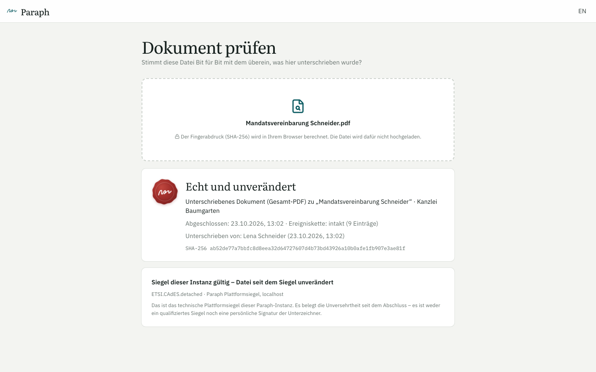
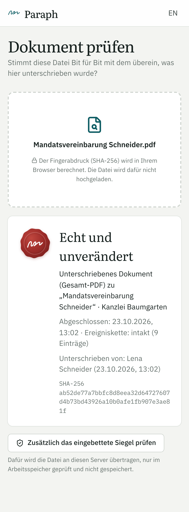

# 6. Dokumente prüfen

Dieses Kapitel erklärt, wie Sie und andere feststellen, ob ein Dokument genau dem entspricht, was mit Paraph unterschrieben wurde. Es richtet sich an die Kanzlei, an Mandanten und an Dritte, denen ein Dokument vorgelegt wird, etwa die Gegenseite oder ein Gericht. Die ersten Abschnitte kommen ohne Technik aus; die Prüfung mit Kommandozeilenwerkzeugen steht weiter unten.

## Wissen, welche Dateien es gibt

Nach dem Abschluss eines Vorgangs erzeugt Paraph mehrere Dateien. Von jeder speichert es den SHA-256-Fingerabdruck in einem Register. Dieses Register fragt die Prüfstelle ab.

| Datei | Inhalt | Wer sie erhält |
|---|---|---|
| Unterschriebenes Dokument (Gesamt-PDF) | alle Dokumente mit eingesetzten Unterschriften und Feldwerten, versiegelt; je nach Einstellung mit angehängter Abschlussbestätigung | Kanzlei und alle Beteiligten |
| Unterschriebenes Einzeldokument | bei mehreren Dokumenten: jedes einzeln, versiegelt | Kanzlei (im Nachweispaket) |
| Abschlussbestätigung | Beteiligte, Zeitpunkte, Zugangsnachweise, Fingerabdrücke, Auszug aus dem Ereignisprotokoll; versiegelt | Kanzlei und alle Beteiligten |
| Audit-Trail | alle Ereignisse des Vorgangs als JSON-Datei, als Hash-Kette | Kanzlei |
| Nachweispaket | ZIP mit allem oben, den Fassungen vor der Unterschrift, den Unterschriftsbildern, einem signierten Inhaltsverzeichnis und einem Prüfskript | Kanzlei |
| Maßgebliche Fassung vor der Unterschrift | das bereinigte PDF, das den Beteiligten angezeigt wurde | Kanzlei (im Nachweispaket) |
| Ursprünglich hochgeladene Datei | die Datei, wie sie hochgeladen wurde (PDF, Word oder ODT) | Kanzlei (im Nachweispaket) |

Wo die Kanzlei diese Dateien herunterlädt, beschreibt [Kapitel 3](03-vorgaenge-verfolgen.md). Bei einem einzelnen Dokument sind Gesamt-PDF und Einzeldokument dieselbe Datei.

## Eine Datei in der Prüfstelle prüfen



Die Prüfstelle liegt unter `https://<Ihre Paraph-Adresse>/verify`. Sie ist öffentlich und braucht keine Anmeldung. Die Abschlussbestätigung und die Abschluss-E-Mail nennen die genaue Adresse.

1. Öffnen Sie die Prüfstelle.
2. Ziehen Sie die Datei in das Feld „Datei hierher ziehen oder auswählen“ oder tippen Sie darauf und wählen Sie sie aus.
3. Lesen Sie das Ergebnis.

Der Browser berechnet den Fingerabdruck (SHA-256) der Datei selbst und schickt nur diesen Wert an den Server. Die Datei verlässt das Gerät dabei nicht. Die Prüfstelle funktioniert auch auf dem Smartphone.



## Das Ergebnis lesen

**„Echt und unverändert“** heißt: Die Datei stimmt Bit für Bit mit einer Datei überein, die diese Paraph-Instanz beim Abschluss eines Vorgangs registriert hat. Das Ergebnis nennt:

- welche Datei es ist, z. B. „Unterschriebenes Dokument (Gesamt-PDF) zu „{Titel}““, und die Organisation,
- „Abgeschlossen“ mit Datum und Uhrzeit,
- „Ereigniskette: intakt ({n} Einträge)“ oder „BESCHÄDIGT“,
- „Unterschrieben von“ mit Namen und Zeitpunkten,
- den vollständigen SHA-256-Wert.

Achten Sie auf die Art der Datei. Auch die „Ursprünglich hochgeladene Datei“ und die „Maßgebliche Fassung vor der Unterschrift“ werden als „Echt und unverändert“ erkannt. Das belegt dann nur, dass genau diese Datei im Vorgang verwendet wurde, nicht dass sie Unterschriften trägt.

Bei einem Testvorgang erscheint zusätzlich „Testvorgang – nicht rechtsverbindlich.“

**„Nicht gefunden“** heißt: Die Datei stimmt mit keinem hier gesicherten Dokument überein. Mögliche Gründe:

- Die Datei wurde verändert. Schon erneutes Speichern, Drucken in PDF oder das Einfügen eines Kommentars ergibt einen anderen Fingerabdruck.
- Die Datei stammt von einer anderen Paraph-Instanz oder aus einem anderen Programm.
- Der Vorgang ist noch nicht abgeschlossen; registriert wird erst beim Abschluss.

„Nicht gefunden“ beweist also nicht, dass der Inhalt gefälscht ist. Es heißt nur, dass diese Datei nicht die registrierte ist.

Löscht die Kanzlei Inhalte nach Ablauf ihrer Aufbewahrungsfrist, bleiben die Fingerabdrücke im Register. Die Prüfstelle erkennt eine aufbewahrte Datei also auch danach.

## Das eingebettete Siegel prüfen

Bei PDF-Dateien bietet die Prüfstelle nach dem Ergebnis die Schaltfläche „Zusätzlich das eingebettete Siegel prüfen“. Dafür wird die Datei an den Server übertragen, nur im Arbeitsspeicher geprüft und nicht gespeichert.

Die Siegelprüfung arbeitet unabhängig vom Register: Sie prüft die PAdES-Signatur in der Datei selbst. Für jedes Siegel nennt sie ein Urteil:

| Urteil | Bedeutung |
|---|---|
| „Siegel dieser Instanz gültig – Datei seit dem Siegel unverändert“ | Siegel rechnerisch gültig, Zertifikat dieser Instanz, Datei seither unverändert |
| „Signatur nicht von dieser Instanz – Herkunft unbekannt“ | rechnerisch korrekt, aber mit einem fremden Zertifikat erstellt |
| „Datei wurde nach dem Siegel verändert“ | nach dem Siegel wurden Daten angehängt oder geändert |
| „Siegel gültig, Zeitstempel jedoch ungültig“ | der eingebettete Zeitstempel ist ungültig oder stammt nicht von einem eingerichteten vertrauenswürdigen Anbieter |
| „Siegel ungültig“ | die Signatur selbst ist ungültig |

Zum Zeitstempel kann zusätzlich stehen: „Zeitstempel rechnerisch geprüft. Ob der Zeitstempeldienst vertrauenswürdig ist, wurde hier nicht geprüft (kein Vertrauensanker eingerichtet).“ Dann hat der Betrieb keinen Vertrauensanker für den Zeitstempeldienst hinterlegt ([Kapitel 14](14-sicherheit-und-nachweis.md)).

Ein gültiges Siegel ist das technische Plattformsiegel dieser Paraph-Instanz. Die Prüfstelle sagt dazu selbst: Es belegt die Unversehrtheit seit dem Abschluss, es ist weder ein qualifiziertes Siegel noch eine persönliche Signatur der Unterzeichner.

## Mit dem Prüfwert aus der Abschluss-E-Mail vergleichen

Jede beteiligte Person erhält beim Abschluss eine E-Mail mit dem „Prüfwert (SHA-256) des unterschriebenen Dokuments“. Dieser Wert liegt damit auch außerhalb des Kanzleiservers vor.

So vergleichen Sie eine Datei mit dem Prüfwert:

1. Prüfen Sie die Datei in der Prüfstelle. Der SHA-256-Wert steht unter dem Ergebnis.
2. Vergleichen Sie ihn Zeichen für Zeichen mit dem Wert aus der E-Mail.

Ohne Prüfstelle berechnen Sie den Wert auf macOS oder Linux im Terminal:

```sh
shasum -a 256 "Vertrag – unterschrieben.pdf"
```

Stimmen beide Werte überein, ist es genau die Datei, die beim Abschluss erzeugt wurde. Der Prüfwert bezieht sich auf das Gesamt-PDF, also die Datei hinter „Unterschriebenes Dokument“.

## Die Abschlussbestätigung lesen

Die Abschlussbestätigung ist ein eigenes, versiegeltes PDF. Standardmäßig hängt Paraph sie zusätzlich an das unterschriebene Dokument an (Einstellung „Abschlussbestätigung an das fertige PDF anhängen“, [Kapitel 8](08-kanzlei-team-erscheinungsbild.md)). Sie enthält:

- Vorgangs-ID, Organisation, Absender, Zeitpunkte von Erstellung, Versand und Abschluss,
- die Signaturstufe mit dem Hinweis, dass die EES die Schriftform nicht ersetzt,
- je Dokument Name, Seitenzahl, SHA-256 der maßgeblichen Fassung und der hochgeladenen Datei,
- je beteiligter Person: Name, Rolle, E-Mail, Zugangsnachweis (z. B. „E-Mail-Code – Zugriff auf das E-Mail-Postfach zum Zeitpunkt der Prüfung (kein Identitätsnachweis)“), Zeitpunkte, IP-Adresse, Gerät, Version und Fingerabdruck der Erklärung, Unterschriftsbild mit Art (gezeichnet, getippt, als Bild hochgeladen), gegebenenfalls Vertretung oder Vor-Ort-Begleitung,
- Formhinweise mit der Bestätigung vor dem Versand, falls vorhanden,
- einen Auszug aus dem Ereignisprotokoll,
- Anzahl der Einträge und Kettenkopf des Ereignisprotokolls, Angaben zum Siegelzertifikat mit Fingerabdruck und die Adresse der Prüfstelle.

Alle Zeitangaben stehen in der Zeitzone der Organisation und zusätzlich in UTC.

## Das Nachweispaket prüfen

Das Nachweispaket ist eine ZIP-Datei. Es lässt sich ohne Paraph und ohne Zugang zum Kanzleiserver prüfen. Inhalt:

| Pfad | Inhalt |
|---|---|
| `01_signiert/` | die unterschriebenen, versiegelten PDFs je Dokument |
| `02_abschlussbestaetigung.pdf` | die versiegelte Abschlussbestätigung |
| `03_audit-trail.json` | alle Ereignisse mit Hash-Kette, Beteiligten und Fingerabdrücken |
| `04_massgebliche_fassung/` | die Fassungen, die angezeigt und unterschrieben wurden |
| `05_hochgeladen/` | die ursprünglich hochgeladenen Dateien |
| `06_unterschriften/` | die Unterschriftsbilder als PNG |
| `07_anhaenge/` | Anhänge der Beteiligten, falls vorhanden |
| `08_verankerung.json` | externe Verankerungen der Ereigniskette, falls vorhanden |
| `siegelzertifikat.pem` | das Zertifikat des Plattformsiegels |
| `manifest.json`, `manifest.json.p7s` | Fingerabdrücke aller Dateien, mit dem Plattformsiegel signiert |
| `pruefen/verify-audit.py` | Prüfskript für die Ereigniskette |
| `PRUEFANLEITUNG.txt` | diese Prüfschritte in Kurzform |

Entpacken Sie das Paket und führen Sie im entpackten Ordner diese Schritte aus. Sie brauchen Python 3 und OpenSSL.

1. **Unversehrtheit der Dateien.** Die SHA-256-Werte aller Dateien stehen in `manifest.json`. Einzeln prüfen mit `shasum -a 256 <Datei>`.
2. **Echtheit des Manifests.** Die Signatur des Manifests gegen das Siegelzertifikat prüfen:

   ```sh
   openssl cms -verify -binary -inform DER -in manifest.json.p7s -content manifest.json -CAfile siegelzertifikat.pem -purpose any -out /dev/null
   ```

   Erwartet: `CMS Verification successful`.
3. **Ereigniskette.** Das Prüfskript nutzt nur die Python-Standardbibliothek:

   ```sh
   python3 pruefen/verify-audit.py 03_audit-trail.json
   ```

   Es rechnet jeden Eintrag nach und meldet zum Beispiel `OK: 23 Einträge lückenlos verkettet, Kettenkopf …`. Ist ein Eintrag verändert, eingefügt oder entfernt, meldet es `FEHLER` mit der Nummer des Eintrags.
4. **Verankerung.** Liegt `08_verankerung.json` im Paket, prüft dasselbe Skript, dass der Kettenkopf per Merkle-Prüfpfad in einem Anker enthalten ist. Es legt die Zeitstempel als `anker-N.tsr` ab und gibt den passenden Befehl aus:

   ```sh
   openssl ts -verify -digest <Ankerhash> -in anker-1.tsr -token_in -CAfile <Zertifikat des Zeitstempeldienstes>
   ```

   Das Zertifikat des Zeitstempeldienstes beschaffen Sie unabhängig vom Paket beim Anbieter. Für FreeTSA, die Vorgabe der Installation, liegt das Wurzelzertifikat im Paraph-Quellcode unter `docker/tsa/freetsa-root-ca.pem`. Fehlt `08_verankerung.json`, wurde der Vorgang vor der ersten Verankerung abgeschlossen; das Skript weist darauf hin. Steht im Ergebnis „ohne externen Zeitstempel – nur interne Bestätigung“, war kein Zeitstempeldienst eingerichtet.
5. **PDF-Siegel.** Siehe den nächsten Abschnitt.

Was Verankerung und Zeitstempel technisch leisten und wo ihre Grenzen liegen, erklärt [Kapitel 14](14-sicherheit-und-nachweis.md).

## Das Siegel mit PDF-Programmen prüfen

Die PDFs in `01_signiert/` und die Abschlussbestätigung tragen eine PAdES-Signatur (`ETSI.CAdES.detached`). Mit Zeitstempeldienst ist es PAdES-B-T. Ohne Zeitstempeldienst, oder wenn er beim Abschluss nicht erreichbar war, ist es PAdES-B-B; die Zeit stammt dann aus der Serveruhr.

**Adobe Acrobat und Reader** zeigen das Siegel an, melden aber zunächst einen unbekannten Aussteller. Das ist zu erwarten: Das Zertifikat der Instanz ist standardmäßig selbst signiert. Wer es bewusst als vertrauenswürdig hinterlegt, sieht das Siegel danach als gültig. Vergleichen Sie vorher den Fingerabdruck des Zertifikats mit dem Wert in der Abschlussbestätigung. Das Zertifikat liegt im Nachweispaket (`siegelzertifikat.pem`); die Kanzlei lädt es außerdem unter Einstellungen → Siegel und Signaturstufen über „Zertifikat herunterladen“ herunter.

**pdfsig** (Poppler) prüft auf der Kommandozeile:

```sh
pdfsig "Vertrag – unterschrieben.pdf"
```

Erwartet sind „Signature is Valid“ und „Total document signed“. „Certificate issuer is unknown“ ist beim selbst signierten Zertifikat normal.

**pyHanko** prüft auch die Vertrauenskette, wenn Sie das Siegelzertifikat und bei Zeitstempeln das Wurzelzertifikat des Zeitstempeldienstes mit `--trust` übergeben:

```sh
pyhanko sign validate --pretty-print --trust siegelzertifikat.pem "Vertrag – unterschrieben.pdf"
```

Paraph bringt einen Prüfcontainer mit, der pyHanko, Poppler, qpdf und OpenSSL enthält (`docker/verify`, siehe [Kapitel 16](16-tests-und-nachweise.md)).

## Wissen, was die Prüfung belegt und was nicht

| Prüfung | belegt | belegt nicht |
|---|---|---|
| Prüfstelle „Echt und unverändert“ | die Datei ist genau die registrierte Datei dieser Instanz | wer unterschrieben hat |
| Prüfwert aus der Abschluss-E-Mail | die Datei ist genau die beim Abschluss erzeugte, unabhängig vom Server | wer unterschrieben hat |
| Plattformsiegel gültig | das PDF stammt von dieser Instanz und ist seit dem Siegel unverändert | die Identität der Unterzeichner; das Siegel ist kein qualifiziertes oder fortgeschrittenes Siegel |
| Zeitstempel gültig und vertrauenswürdig | das PDF bzw. der Stand der Ereigniskette existierte spätestens zu diesem Zeitpunkt | ohne qualifizierten Dienst keine gesetzliche Vermutung für die Zeitangabe |
| Ereigniskette intakt | kein Eintrag wurde nachträglich verändert, eingefügt oder entfernt | Schutz gegen jemanden, der mit vollem Serverzugriff die ganze Kette neu berechnet, ohne externe Verankerung |

Der Zugangsnachweis in der Abschlussbestätigung belegt den Besitz des Links, den Zugriff auf Postfach oder Mobilnummer oder die Kenntnis eines Zugangscodes. Er ist kein Identitätsnachweis.

## Was Sie einem Gericht vorlegen

Paraph liefert Material, mit dem sich der Ablauf einer Unterzeichnung nachvollziehen lässt. Bewährt hat sich:

1. **Die Originaldateien, nicht Ausdrucke oder neu gespeicherte Fassungen.** Jedes erneute Speichern ändert den Fingerabdruck und kann das Siegel ungültig machen. Legen Sie das Gesamt-PDF so vor, wie Paraph es erzeugt hat.
2. **Die Abschlussbestätigung.** Sie fasst Beteiligte, Zugangswege, Zeitpunkte und Fingerabdrücke auf wenigen Seiten zusammen und ist oft bereits an das PDF angehängt.
3. **Das Nachweispaket, vollständig und unverändert,** wenn die Echtheit bestritten wird. Es enthält die Prüfanleitung und das Prüfskript, sodass ein Sachverständiger ohne Paraph prüfen kann.
4. **Gegebenenfalls die Abschluss-E-Mail** einer beteiligten Person mit dem Prüfwert, als Zeugnis außerhalb des Kanzleiservers.

Zur rechtlichen Einordnung, ohne Freigabe: Nach der Vorprüfung in `docs/recht/formhinweise-analyse.md` (Teil D) gilt § 371a ZPO nur für die qualifizierte elektronische Signatur. Eine EES unterliegt der freien Beweiswürdigung; Audit-Trail, Hash-Kette, Zeitstempel und Zugangsweg sind Indizien, kein Anscheinsbeweis. Diese Einordnung ist anwaltlich nicht freigegeben (Freigabeliste F-14). Einzelheiten und Grenzen stehen in [Kapitel 7](07-recht.md#beweiswert-einordnen).

> **Wichtig:** Ein Paraph-PDF ist kein Schriftsatz. Für die Einreichung bei Gericht gilt der elektronische Rechtsverkehr; siehe [Kapitel 7](07-recht.md#behörden-und-gerichte).

## Intern prüfen (für die Kanzlei)

Die Vorgangsseite zeigt im Bereich Integrität, ob die Ereigniskette eines Vorgangs intakt ist ([Kapitel 3](03-vorgaenge-verfolgen.md)). Der Betrieb prüft alle Ketten samt Verankerung mit dem Befehl `paraph verify-audit` im Container ([Kapitel 15](15-diagnose-und-fehlersuche.md)).

---

← [5. So unterschreiben Ihre Mandanten](05-so-unterschreiben-mandanten.md) · [Inhalt](README.md) · [7. Recht: Signaturstufen, Formvorschriften, Datenschutz](07-recht.md) →
