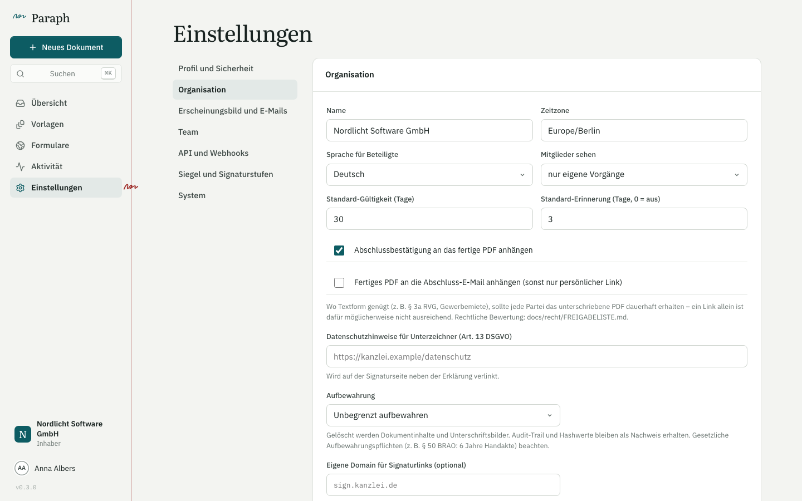
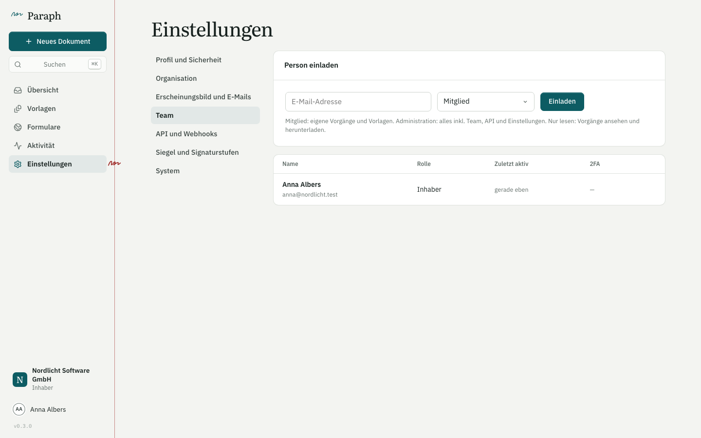
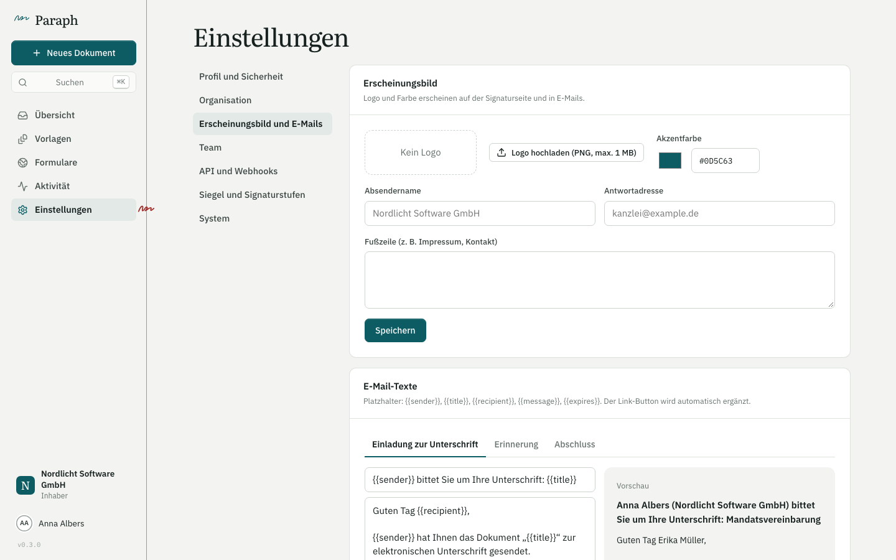
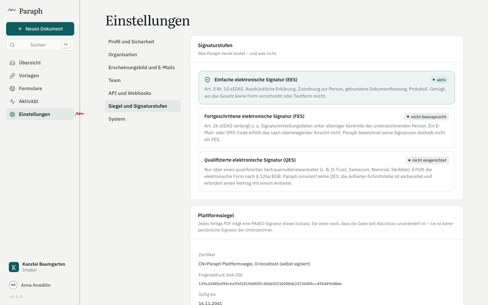
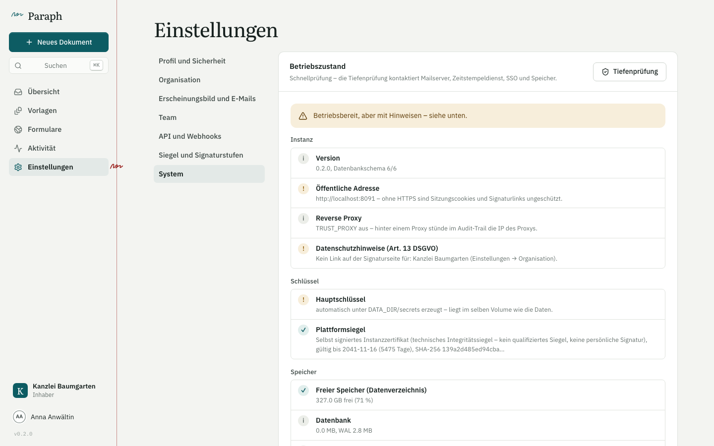

# 8. Kanzlei, Team und Erscheinungsbild einrichten

Dieses Kapitel richtet sich an Inhaberinnen, Inhaber und die Kanzlei-Administration. Es beschreibt, wie Sie Paraph nach der Installation in Betrieb nehmen, das Team einladen, Rollen vergeben und Paraph auf Ihre Kanzlei einstellen: Logo, Farbe, E-Mail-Texte, Standardwerte, Aufbewahrung und Siegel. Am Ende folgt die Seite „System“ für Instanz-Administratoren.

Alle Einstellungen liegen unter **Einstellungen**. Welche Seiten Sie dort sehen, hängt von Ihrer Rolle ab:

| Seite | sichtbar für |
|---|---|
| Profil und Sicherheit | alle (siehe [Kapitel 9](09-anmeldung-und-sso.md)) |
| Organisation | Inhaber, Administration |
| Erscheinungsbild und E-Mails | Inhaber, Administration |
| Team | alle; verwalten nur Inhaber und Administration |
| API und Webhooks | Inhaber, Administration (siehe [Kapitel 10](10-anbindung-api-webhooks.md)) |
| Siegel und Signaturstufen | Inhaber, Administration |
| System | nur Instanz-Administratoren |

## Paraph erstmals einrichten

Nach der Installation hat Paraph noch kein Konto. Wer die Adresse der Instanz aufruft, landet auf der Seite `/setup` („Paraph einrichten“). Dort legen Sie die erste Organisation und das erste Inhaberkonto an.

1. Einrichtungscode bereithalten. Paraph schreibt ihn beim ersten Aufruf ins Server-Log, oder Sie haben ihn vorab in `SETUP_CODE` festgelegt. Im Container zeigt ihn auch:
   ```sh
   docker compose exec paraph paraph setup-code
   ```
2. `/setup` öffnen und „Einrichtungscode“ eintragen.
3. „Name der Kanzlei oder Organisation“, „Ihr Name“, „E-Mail-Adresse“ und „Passwort“ (mindestens 10 Zeichen) ausfüllen.
4. Auf „Einrichten und anmelden“ klicken.

Das so angelegte Konto ist **Inhaber** der Organisation und zugleich **Instanz-Administrator**. Der Einrichtungscode wird danach gelöscht und gilt nicht mehr. Ein falscher Code wird abgewiesen.

Wie Sie Paraph installieren und die Instanz von außen erreichbar machen, steht in [Kapitel 11](11-installation.md).

> **Gut zu wissen:** Erledigen Sie die Ersteinrichtung direkt nach der Installation. Solange kein Konto existiert, kann jede Person mit dem Einrichtungscode die Instanz übernehmen.

## Die Organisation einstellen

Einstellungen → Organisation. Eine Organisation ist in der Regel Ihre Kanzlei.



| Einstellung | Bedeutung | Standard |
|---|---|---|
| „Name“ | Name der Kanzlei. Erscheint in E-Mails und auf der Signaturseite. | bei der Einrichtung gewählt |
| „Zeitzone“ | Zeitzone für Datumsangaben, etwa das Ablaufdatum in E-Mails. Eine unbekannte Zeitzone lehnt Paraph ab. | `Europe/Berlin` |
| „Sprache für Beteiligte“ | Sprache der Signaturseite und der E-Mails an Beteiligte: Deutsch oder English. | Deutsch |
| „Mitglieder sehen“ | „nur eigene Vorgänge“ oder „alle Vorgänge der Organisation (nur lesen)“. Siehe [Sichtbarkeit der Vorgänge](#sichtbarkeit-der-vorgänge-festlegen). | nur eigene Vorgänge |
| „Standard-Gültigkeit (Tage)“ | Wie lange ein Vorgang nach dem Versand unterschrieben werden kann, 1 bis 365 Tage. | 30 |
| „Standard-Erinnerung (Tage, 0 = aus)“ | Abstand automatischer Erinnerungen, 0 bis 30 Tage. | 3 |
| „Abschlussbestätigung an das fertige PDF anhängen“ | Hängt die Abschlussbestätigung als letzte Seiten an das unterschriebene PDF. | an |
| „Fertiges PDF an die Abschluss-E-Mail anhängen (sonst nur persönlicher Link)“ | Beteiligte erhalten das PDF als Anhang statt nur als Link. | aus |
| „Datenschutzhinweise für Unterzeichner (Art. 13 DSGVO)“ | Link auf Ihre Datenschutzhinweise. Siehe [unten](#den-datenschutzhinweis-verlinken). | leer |
| „Aufbewahrung“ | Automatische Löschung von Dokumentinhalten. Siehe [unten](#die-aufbewahrung-festlegen). | „Unbegrenzt aufbewahren“ |
| „Eigene Domain für Signaturlinks (optional)“ | Siehe [unten](#eine-eigene-domain-für-signaturlinks-verwenden). | leer |

Änderungen übernehmen Sie mit „Speichern“.

Zum Anhang an die Abschluss-E-Mail zeigt die Oberfläche einen Hinweis: Wo Textform genügt (z. B. § 3a RVG, Gewerbemiete), sollte jede Partei das unterschriebene PDF dauerhaft erhalten; ein Link allein ist dafür möglicherweise nicht ausreichend. Die rechtliche Einordnung finden Sie in [Kapitel 7](07-recht.md).

### Sichtbarkeit der Vorgänge festlegen

Die Einstellung „Mitglieder sehen“ betrifft nur die Rolle **Mitglied**:

- **nur eigene Vorgänge:** Mitglieder sehen nur Vorgänge, die sie selbst angelegt haben.
- **alle Vorgänge der Organisation (nur lesen):** Mitglieder sehen alle Vorgänge, ändern aber nur ihre eigenen.

Inhaber, Administration und „Nur lesen“ sehen immer alle Vorgänge der Organisation. API-Schlüssel sehen alle Vorgänge ihrer Organisation in ihrem Modus (live oder test).

Einen Vorgang, den jemand nicht sehen darf, beantwortet Paraph mit „nicht gefunden“, nicht mit „keine Berechtigung“. So lässt sich nicht einmal erkennen, ob der Vorgang existiert.

### Den Datenschutzhinweis verlinken

Tragen Sie unter „Datenschutzhinweise für Unterzeichner (Art. 13 DSGVO)“ die Adresse Ihrer Datenschutzhinweise ein, z. B. `https://kanzlei.example/datenschutz`. Paraph verlangt eine `https://`-Adresse.

Die Signaturseite verlinkt die Hinweise neben der abschließenden Erklärung („Hinweise zum Datenschutz“). Beim Abschluss vermerkt Paraph die Adresse zusammen mit der Erklärung im Audit-Trail. Den Text der Hinweise stellt Paraph nicht bereit. Fehlt der Link, meldet die Betriebsdiagnose einen Hinweis. Zum Inhalt siehe [Kapitel 7](07-recht.md).

### Die Aufbewahrung festlegen

Unter „Aufbewahrung“ wählen Sie „Unbegrenzt aufbewahren“ (Standard) oder eine Frist: 90, 180, 365, 730, 2190 oder 3650 Tage. Über die API sind beliebige Werte von 30 bis 36 500 Tagen möglich.

Ein Hintergrundauftrag läuft alle 12 Stunden. Er erfasst beendete Vorgänge (abgeschlossen, abgelehnt, widerrufen, abgelaufen), deren Ende länger als die Frist zurückliegt, und löscht:

- Original- und PDF-Dateien, das unterschriebene PDF, die Abschlussbestätigung und das Nachweispaket,
- Unterschriftsbilder und Anhänge der Beteiligten,
- alle Feldwerte.

Außerdem leert er den Textauszug der Dokumente, die Nachricht an die Beteiligten, Ablehnungsgründe und Mobilnummern und löscht die E-Mail-Datensätze des Vorgangs.

Erhalten bleiben der Datensatz des Vorgangs (Titel, Beteiligte mit Name und E-Mail-Adresse, Zeitpunkte, Hashwerte) und der vollständige Audit-Trail. Die Löschung selbst steht als Ereignis `envelope.content_purged` im Audit-Trail. Dateien, die noch eine Vorlage oder ein anderer Vorgang nutzt, bleiben bestehen.

Unabhängig von dieser Einstellung räumt Paraph immer auf: E-Mail-Datensätze nach 90 Tagen, Webhook-Zustellungen nach 30 Tagen, abgelaufene Sitzungen und Codes laufend.

> **Wichtig:** Prüfen Sie die Frist anhand Ihrer gesetzlichen Aufbewahrungspflichten, etwa § 50 BRAO für Handakten (die Oberfläche nennt dafür 6 Jahre). Gelöschte Inhalte lassen sich nur aus einer älteren Sicherung zurückholen.

### Eine eigene Domain für Signaturlinks verwenden

Unter „Eigene Domain für Signaturlinks (optional)“ tragen Sie einen Hostnamen ein, z. B. `sign.kanzlei.de`. Links in E-Mails an Beteiligte verwenden dann diese Domain statt der Adresse aus `APP_URL`, mit demselben Protokoll. Jede Domain kann nur eine Organisation verwenden.

Die Domain muss per DNS und Reverse Proxy auf diese Instanz zeigen und per HTTPS erreichbar sein. Das richtet die IT ein, siehe [Kapitel 11](11-installation.md).

### Weitere Organisationen anlegen

Nur Instanz-Administratoren sehen unter Einstellungen → Organisation den Abschnitt „Weitere Organisation anlegen“. Name eingeben, „Anlegen“ klicken. Sie werden Inhaber der neuen Organisation.

Organisationen sind strikt getrennt. Jede hat eigene Vorgänge, Vorlagen, Kontakte, API-Schlüssel, Webhooks, Einstellungen und ein eigenes Aktivitätsprotokoll. Eine Person kann mehreren Organisationen angehören. Gewechselt wird über den Organisationsnamen unten links in der Seitenleiste.

## Das Team einladen und verwalten

Einstellungen → Team zeigt alle Mitglieder mit Rolle, letzter Aktivität und ob Zwei-Faktor aktiv ist. Offene Einladungen stehen darunter mit ihrem Ablaufdatum.



### Eine Person einladen

1. Einstellungen → Team, Abschnitt „Person einladen“.
2. E-Mail-Adresse eintragen und eine Rolle wählen.
3. Auf „Einladen“ klicken.

Paraph schickt einen Einladungslink per E-Mail. Ist kein Mailserver eingerichtet, zeigt die Oberfläche den Link an; Sie geben ihn dann selbst weiter. Die Einladung gilt 7 Tage. Mit dem Papierkorb-Symbol ziehen Sie eine offene Einladung zurück.

Die eingeladene Person öffnet den Link und sieht „Willkommen bei …“ mit ihrer Rolle:

- **Neu bei Paraph:** Sie gibt ihren Namen ein, legt ein Passwort fest (mindestens 10 Zeichen) und klickt „Konto anlegen und beitreten“.
- **Schon ein Konto mit dieser Adresse** (z. B. aus einer anderen Organisation): Sie meldet sich zuerst mit dieser Adresse an, öffnet den Link erneut und klickt „Einladung annehmen“.

Eine Person, die schon Mitglied ist, können Sie nicht erneut einladen.

### Rollen und Rechte

Jede Person hat je Organisation genau eine Rolle. Grundlage ist `src/server/domain/authz.ts`.

| Recht | Inhaber | Administration | Mitglied | Nur lesen |
|---|:-:|:-:|:-:|:-:|
| Vorgänge ansehen und herunterladen | ja | ja | ja (siehe [Sichtbarkeit](#sichtbarkeit-der-vorgänge-festlegen)) | ja |
| Vorgänge anlegen, versenden, widerrufen | ja | ja | ja, nur eigene | nein |
| Vorlagen ansehen | ja | ja | ja | ja |
| Vorlagen anlegen und bearbeiten | ja | ja | ja, nur eigene | nein |
| Kontakte nutzen | ja | ja | ja | nein |
| Organisation, Erscheinungsbild, E-Mail-Texte, Aufbewahrung, Siegel einsehen und ändern | ja | ja | nein | nein |
| Team verwalten | ja | ja | nein | nein |
| API-Schlüssel und Webhooks | ja | ja | nein | nein |
| Aktivität ansehen | ja | ja | nein | nein |
| Inhaber einladen, ernennen oder entfernen | ja | nein | nein | nein |
| Eigenes Siegelzertifikat importieren | ja | nein | nein | nein |

Die Oberfläche fasst das so zusammen: „Mitglied: eigene Vorgänge und Vorlagen. Administration: alles inkl. Team, API und Einstellungen. Nur lesen: Vorgänge ansehen und herunterladen.“

Regeln für Inhaber:

- Nur Inhaber laden weitere Inhaber ein, ernennen sie oder ändern Inhaberrechte. Wer „Administration“ hat, sieht die Rolle „Inhaber“ deshalb nicht zur Auswahl, und die Rolle eines Inhabers ist für ihn nicht änderbar.
- Eine Organisation braucht mindestens einen Inhaber. Den letzten kann niemand herabstufen oder entfernen.

### Eine Rolle ändern

In der Tabelle unter Einstellungen → Team wählen Sie in der Spalte „Rolle“ die neue Rolle. Die Änderung gilt sofort. Ihre eigene Rolle können Sie dort nicht ändern.

### Eine Person entfernen

1. In der Zeile der Person auf das Papierkorb-Symbol klicken.
2. Die Rückfrage „… entfernen?“ mit „Entfernen“ bestätigen.

Folgen:

- Die Person verliert sofort den Zugriff; ihre Sitzungen in dieser Organisation enden.
- Ihre Vorgänge bleiben erhalten.
- Ihre privaten Vorlagen werden für die Organisation sichtbar.
- Die von ihr angelegten API-Schlüssel werden widerrufen.

Das Konto selbst bleibt bestehen, etwa für andere Organisationen. Ein Konto für die ganze Instanz sperren Instanz-Administratoren unter [System](#benutzerkonten-der-instanz-verwalten).

## Das Erscheinungsbild anpassen

Einstellungen → Erscheinungsbild und E-Mails. Logo und Farbe erscheinen auf der Signaturseite und in E-Mails.



| Einstellung | Bedeutung |
|---|---|
| Logo | „Logo hochladen (PNG, max. 1 MB)“. Nur PNG. Paraph bereinigt die Datei beim Hochladen. „Logo entfernen“ setzt es zurück. |
| „Akzentfarbe“ | Farbe für Schaltflächen und Markierungen auf der Signaturseite und in E-Mails. Standard ist Petrol `#0D5C63`. |
| „Absendername“ | Name im Absender der E-Mails. Leer: Name der Organisation. |
| „Antwortadresse“ | Adresse für Antworten (`Reply-To`), z. B. das Kanzleipostfach. |
| „Fußzeile (z. B. Impressum, Kontakt)“ | Text unter jeder E-Mail, höchstens 500 Zeichen. |

Mit „Speichern“ übernehmen Sie die Angaben.

Zur Akzentfarbe: Steht bei Ihnen noch der frühere Standard `#3D5AFE` (Indigo) gespeichert, gilt automatisch Petrol. Eine selbst gewählte Farbe bleibt unverändert.

Die **Absenderadresse** selbst stellen Sie nicht hier ein. Sie kommt für alle Organisationen der Instanz aus `MAIL_FROM` (siehe [Kapitel 12](12-konfiguration.md)). Sie muss zu Ihrem Mailserver und Ihren SPF- und DKIM-Einträgen passen, sonst landen E-Mails im Spam.

### E-Mail-Texte anpassen

Im Abschnitt „E-Mail-Texte“ passen Sie Betreff und Text für drei E-Mails an. Wählen Sie oben den Reiter, bearbeiten Sie Betreff und Text und prüfen Sie das Ergebnis in der „Vorschau“ rechts. Übernehmen mit „Texte speichern“.

| Reiter | E-Mail | Schaltfläche in der E-Mail |
|---|---|---|
| „Einladung zur Unterschrift“ | Signaturanfrage (`signing_request`) | „Dokument ansehen und unterschreiben“ |
| „Erinnerung“ | Erinnerung (`reminder`) | „Dokument ansehen und unterschreiben“ |
| „Abschluss“ | Abschluss-E-Mail (`completed`) | „Dokument herunterladen“ |

Platzhalter:

| Platzhalter | Inhalt |
|---|---|
| `{{sender}}` | Name der absendenden Person und der Organisation |
| `{{title}}` | Titel des Vorgangs |
| `{{recipient}}` | Name der empfangenden Person |
| `{{message}}` | Nachricht an die Beteiligten (nur Signaturanfrage) |
| `{{expires}}` | Ablaufdatum (Signaturanfrage, Erinnerung) |

Den persönlichen Link fügt Paraph immer selbst ein. Die Abschluss-E-Mail nennt zusätzlich den SHA-256-Prüfwert des unterschriebenen Dokuments und die Adresse der Prüfstelle `/verify` (siehe [Kapitel 6](06-dokumente-pruefen.md)). Alle anderen E-Mails (Ablehnung, Widerruf, Ablauf, Einmalcodes, Einladung ins Team, Passwort, Zustellfehler, Systemalarm, Test-E-Mail) haben feste Texte.

## Siegel und Signaturstufen einsehen

Einstellungen → Siegel und Signaturstufen zeigt, was Paraph leistet und mit welchem Zertifikat es versiegelt.



**Signaturstufen.** Aktiv ist die einfache elektronische Signatur (EES). Die fortgeschrittene Signatur (FES) ist als „nicht beansprucht“ gekennzeichnet, die qualifizierte Signatur (QES) als „nicht eingerichtet“ oder, falls ein Anbieter konfiguriert ist, als „Anbieter konfiguriert, nicht verifiziert“. Was das rechtlich bedeutet, erklärt [Kapitel 7](07-recht.md).

**Plattformsiegel.** Jedes fertige PDF trägt eine PAdES-Signatur der Instanz. Sie weist nach, dass die Datei seit dem Abschluss unverändert ist; eine persönliche Signatur der Unterzeichner ist sie nicht. Angezeigt werden:

- „Zertifikat“ mit Inhaber und Herkunft („selbst signiert“ oder „eigenes Zertifikat“),
- „Fingerabdruck SHA-256“,
- „Gültig bis“,
- „Zeitstempeldienst“ oder der Hinweis, dass keiner eingerichtet ist und der Zeitpunkt aus der Serveruhr stammt.

Standard ist ein beim ersten Start erzeugtes, selbst signiertes Instanzzertifikat. Es ist ein technisches Integritätssiegel, kein qualifiziertes Siegel. Die Betriebsdiagnose warnt, wenn es in weniger als 365 Tagen abläuft. Mit „Zertifikat herunterladen“ erhalten Sie es als `paraph-siegel.pem`. Wer den Fingerabdruck in Adobe Acrobat als vertrauenswürdig hinterlegt, sieht das Siegel dort als gültig (siehe [Kapitel 6](06-dokumente-pruefen.md)).

**Optionale Dienste.** Der letzte Abschnitt zeigt, ob E-Mail-Versand (SMTP), Word/ODT-Umwandlung, SMS-Codes und Anmeldung per SSO eingerichtet sind.

### Ein eigenes Siegelzertifikat verwenden

Nur Inhaber sehen die Schaltfläche „Eigenes Zertifikat verwenden“.

1. Auf „Eigenes Zertifikat verwenden“ klicken.
2. „Privater Schlüssel (PKCS#8, „BEGIN PRIVATE KEY“)“ einfügen. Paraph unterstützt RSA-Schlüssel.
3. „Zertifikatskette (PEM, Siegelzertifikat zuerst)“ einfügen.
4. Auf „Übernehmen“ klicken.

Paraph prüft, dass Schlüssel und Zertifikat zusammenpassen, und speichert den Schlüssel verschlüsselt. Ein qualifiziertes Siegel ist damit nicht möglich, weil qualifizierte Schlüssel beim Vertrauensdiensteanbieter liegen. Der Import steht im Aktivitätsprotokoll. Technische Einzelheiten zum Siegel enthält [Kapitel 14](14-sicherheit-und-nachweis.md).

## Das Aktivitätsprotokoll lesen

Unter **Aktivität** in der Seitenleiste sehen Inhaber und Administration die letzten 200 Verwaltungsereignisse der Organisation, etwa Einladungen, Beitritte, Rollenänderungen, entfernte Mitglieder, angelegte und widerrufene API-Schlüssel, Webhooks, Downloads und SSO-Verknüpfungen. Daneben stehen die letzten 200 Ereignisse aus Vorgängen (ohne Testmodus). Gespeichert werden Zeitpunkt, handelnde Person oder API-Schlüssel, Aktion, Ziel und gegebenenfalls die IP-Adresse.

Anmeldungen, Fehlversuche sowie Passwort- und Zwei-Faktor-Änderungen protokolliert Paraph ebenfalls, aber ohne Bezug zu einer Organisation. Sie erscheinen deshalb nicht in dieser Ansicht.

Das Aktivitätsprotokoll dient der Verwaltung. Der Nachweis gegenüber Dritten ist der Audit-Trail jedes Vorgangs ([Kapitel 3](03-vorgaenge-verfolgen.md), [Kapitel 14](14-sicherheit-und-nachweis.md)).

## Die Instanz verwalten (System)

Einstellungen → System sehen nur **Instanz-Administratoren**. Instanz-Administration ist unabhängig von den Rollen in einer Organisation: Sie betrifft die ganze Installation mit allen Organisationen. Das bei der Ersteinrichtung angelegte Konto ist Instanz-Administrator; weitere ernennen Sie unter [Benutzerkonten der Instanz](#benutzerkonten-der-instanz-verwalten).



Die Seite hat fünf Abschnitte:

| Abschnitt | Zweck |
|---|---|
| „Betriebszustand“ | Beim Öffnen läuft eine Schnellprüfung. „Tiefenprüfung“ kontaktiert zusätzlich Mailserver, Zeitstempeldienst, SSO-Anbieter und Speicher und prüft alle Audit-Ketten (höchstens 6 je Minute). Ergebnis: „Alles in Ordnung.“, Hinweise oder Fehler, je Bereich einzeln. |
| „E-Mail-Versand prüfen“ | „Test-E-Mail senden“ verschickt sofort eine Test-E-Mail an Ihre oder eine eingegebene Adresse (höchstens 5 je Minute) und zeigt die Antwort des Mailservers. |
| „Sicherung“ | Zeitplan, letzte Sicherung und ob das Schlüsselmaterial enthalten ist. „Jetzt sichern“ reiht eine Sicherung ein. |
| „Hintergrundaufgaben und E-Mails“ | Endgültig fehlgeschlagene Aufgaben (bis zu 20) mit „Erneut versuchen“, nicht zugestellte E-Mails (bis zu 20), dazu Warteschlange, Wiederholungen und Überfälliges. |
| „Benutzerkonten der Instanz“ | Alle Konten verwalten, siehe unten. |

Scheitert eine Hintergrundaufgabe endgültig (nach 8 Versuchen), erhalten alle aktiven Instanz-Administratoren eine E-Mail, höchstens eine je Aufgabentyp in 24 Stunden.

Was jede einzelne Prüfung bedeutet und wie Sie Fehler beheben, steht in [Kapitel 15](15-diagnose-und-fehlersuche.md). Sicherung und Wiederherstellung beschreibt [Kapitel 13](13-sicherung-und-updates.md).

### Benutzerkonten der Instanz verwalten

Die Tabelle zeigt alle Konten der Instanz mit Organisationen und Rollen, Anmeldeart („Passwort“, „SSO“, „2FA“) und letzter Anmeldung. Gesperrte Konten tragen die Markierung „gesperrt“, Instanz-Administratoren „Instanz-Admin“. Für andere Konten als Ihr eigenes stehen bereit:

| Schaltfläche | Wirkung |
|---|---|
| „Sperren“ / „Entsperren“ | Ein gesperrtes Konto wird sofort abgemeldet und kann sich nicht mehr anmelden, auch nicht per SSO. Von der Person angelegte API-Schlüssel verlieren ihre Wirkung. |
| „2FA zurücksetzen“ | Schaltet die Zwei-Faktor-Anmeldung ab und beendet alle Sitzungen der Person. Nur nach sicherer Prüfung der Identität, z. B. bei verlorenem Telefon. |
| „Passwort-Link“ | Erzeugt einen Link zum Zurücksetzen des Passworts, 60 Minuten gültig. Paraph versendet ihn nicht; Sie geben ihn auf sicherem Weg weiter. Nur für nicht gesperrte Konten mit Passwort. |
| „Zum Admin“ / „Admin entziehen“ | Vergibt oder entzieht die Instanz-Administration. Die letzte aktive Instanz-Administration lässt sich nicht entziehen. |

Ihr eigenes Konto können Sie hier weder sperren noch herabstufen. Jede Aktion steht im Aktivitätsprotokoll. Rollen innerhalb einer Organisation verwalten Sie unter „Team“.

Für den Fall, dass niemand mehr Zugang zur Oberfläche hat, siehe [Notfallzugang](09-anmeldung-und-sso.md#notfallzugang-ohne-oberfläche).

---

← [7. Recht: Signaturstufen, Formvorschriften, Datenschutz](07-recht.md) · [Inhalt](README.md) · [9. Anmeldung und SSO](09-anmeldung-und-sso.md) →
