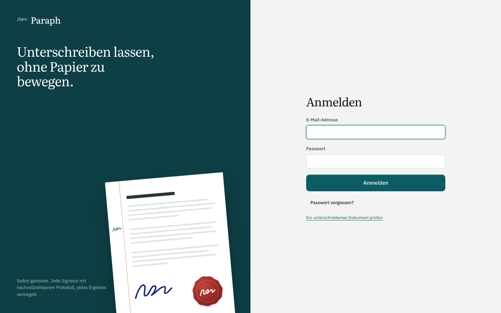
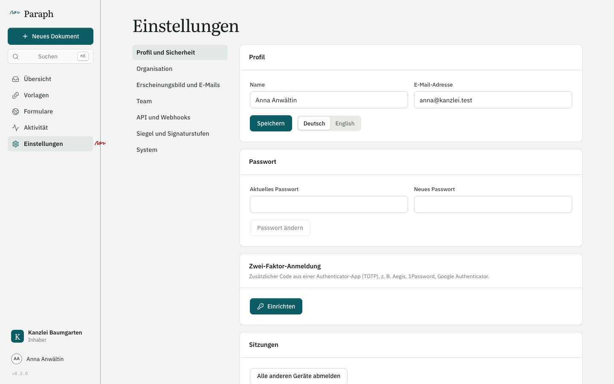

# 9. Anmeldung und SSO

Dieses Kapitel beschreibt, wie sich die Mitarbeiterinnen und Mitarbeiter Ihrer Organisation bei Paraph anmelden und wie die Administration die Anmeldung absichert: Passwort, Zwei-Faktor-Anmeldung, Sitzungen, vergessene Passwörter, Sperren und die Anmeldung über einen zentralen Anmeldedienst (OIDC/SSO, z. B. authentik). Es richtet sich an die Administration; die Abschnitte zu Passwort und Zwei-Faktor sind auch für alle anderen nützlich.

Unterzeichnende und andere Beteiligte brauchen kein Konto. Wie sie sich auf der Signaturseite ausweisen, steht in [Kapitel 2](02-dokument-unterschreiben-lassen.md) und [Kapitel 5](05-so-unterschreiben-die-beteiligten.md).

## Sich anmelden

Die Anmeldeseite liegt unter `/login`.



1. „E-Mail-Adresse“ und „Passwort“ eingeben, auf „Anmelden“ klicken.
2. Ist Zwei-Faktor eingeschaltet, folgt „Bestätigungscode“: den Code aus der Authenticator-App eingeben und „Bestätigen“ klicken.

Ist SSO eingerichtet, zeigt die Seite zusätzlich die Schaltfläche „Mit … anmelden“, z. B. „Mit authentik anmelden“. Unter dem Formular führt „Ein unterschriebenes Dokument prüfen“ zur Prüfstelle ([Kapitel 6](06-dokumente-pruefen.md)).

Gehört ein Konto noch zu keiner Organisation, erscheint nach der Anmeldung ein entsprechender Hinweis. Die Person braucht dann eine Einladung ([Kapitel 8](08-organisation-team-erscheinungsbild.md#eine-person-einladen)).

## Das Passwort ändern

Einstellungen → Profil und Sicherheit, Abschnitt „Passwort“.



1. „Aktuelles Passwort“ und „Neues Passwort“ eingeben.
2. Auf „Passwort ändern“ klicken.

Alle anderen Sitzungen werden dabei abgemeldet; die aktuelle bleibt bestehen.

Regeln für Passwörter:

- mindestens 10, höchstens 200 Zeichen,
- einfache Muster werden abgelehnt (z. B. nur ein wiederholtes Zeichen, Zahlenreihen wie `0123456789`, Anfänge wie „passwort“ oder „password“),
- Paraph speichert nur einen Argon2id-Hash.

Nach 5 falschen Passwörtern in Folge ist das Konto für 15 Minuten gesperrt.

Wer sich nur per SSO anmeldet, sieht den Hinweis „Sie melden sich per SSO an. Ein Passwort ist optional.“ Ein Passwort lässt sich dort ohne aktuelles Passwort festlegen.

Unter „Profil“ ändern Sie außerdem Ihren Namen und die Sprache der Oberfläche (Deutsch oder English). Die E-Mail-Adresse lässt sich hier nicht ändern.

## Die Zwei-Faktor-Anmeldung einschalten

Zwei-Faktor fragt bei jeder Anmeldung zusätzlich einen sechsstelligen Code aus einer Authenticator-App ab (TOTP, 30 Sekunden), z. B. Aegis, 1Password oder Google Authenticator.

1. Einstellungen → Profil und Sicherheit, Abschnitt „Zwei-Faktor-Anmeldung“.
2. Auf „Einrichten“ klicken.
3. Den QR-Code mit der App scannen oder den angezeigten Schlüssel eingeben.
4. Den aktuellen Code aus der App eintragen und „Aktivieren“ klicken.

Danach steht dort: „Aktiv. Bei jeder Anmeldung wird ein Code abgefragt.“

Gut zu wissen:

- Jeder Code ist nur einmal verwendbar. Lehnt Paraph einen richtigen Code ab, prüfen Sie die Uhrzeit des Telefons.
- Nach 5 falschen Codes wird der Anmeldevorgang verworfen; Sie beginnen neu mit dem Passwort.
- Zum Abschalten geben Sie unter „Passwort zum Deaktivieren“ Ihr Passwort ein und klicken „Deaktivieren“. Ohne Passwort, etwa bei reinen SSO-Konten, geht das nicht; dann hilft eine Instanz-Administration mit „2FA zurücksetzen“.
- Unter Einstellungen → Team zeigt die Spalte „2FA“, wer Zwei-Faktor eingeschaltet hat.

> **Wichtig:** Paraph kann Zwei-Faktor nicht organisationsweit erzwingen. Jede Person schaltet es selbst ein. Wenn Sie es verbindlich wollen, nutzen Sie SSO und erzwingen Sie die Mehrfaktor-Anmeldung im Anmeldedienst.

## Sitzungen beenden

Eine Anmeldung gilt, bis sie 12 Stunden lang nicht genutzt wurde, höchstens aber 14 Tage. Dann ist eine neue Anmeldung nötig.

Unter Einstellungen → Profil und Sicherheit → „Sitzungen“ meldet „Alle anderen Geräte abmelden“ jede Sitzung außer der aktuellen ab, etwa nach dem Verlust eines Laptops.

Sitzungen enden außerdem automatisch, wenn

- das Passwort geändert wird (alle anderen Sitzungen),
- das Passwort über einen Rücksetzlink neu gesetzt wird (alle Sitzungen),
- eine Instanz-Administration das Konto sperrt oder Zwei-Faktor zurücksetzt (alle Sitzungen),
- die Person aus einer Organisation entfernt wird (Sitzungen in dieser Organisation).

## Ein vergessenes Passwort zurücksetzen

**Selbst:** Auf der Anmeldeseite „Passwort vergessen?“ wählen, E-Mail-Adresse eingeben, „Link anfordern“ klicken. Paraph antwortet immer gleich („Falls ein Konto existiert, ist eine E-Mail mit einem Link unterwegs.“), damit niemand testen kann, welche Adressen ein Konto haben. Der Link ist 60 Minuten gültig und nur einmal verwendbar. Unter „Neues Passwort“ das neue Passwort eingeben und „Passwort speichern“ klicken.

Die E-Mail kommt nur an, wenn ein Mailserver eingerichtet ist und das Konto nicht gesperrt ist und zu mindestens einer Organisation gehört.

**Über die Administration:** Eine Instanz-Administration erzeugt unter Einstellungen → System → „Benutzerkonten der Instanz“ mit „Passwort-Link“ einen Link (60 Minuten gültig) und gibt ihn auf sicherem Weg weiter. Das ist der Weg ohne Mailserver.

Nach dem Zurücksetzen sind alle bisherigen Sitzungen abgemeldet, und eine Sperre wegen Fehlversuchen ist aufgehoben. Zwei-Faktor bleibt eingeschaltet.

## Ein Konto sperren

Instanz-Administratoren sperren Konten unter Einstellungen → System → „Benutzerkonten der Instanz“ mit „Sperren“ (siehe [Kapitel 8](08-organisation-team-erscheinungsbild.md#benutzerkonten-der-instanz-verwalten)). Ein gesperrtes Konto

- wird sofort abgemeldet,
- kann sich weder mit Passwort noch per SSO anmelden,
- erhält weder über „Passwort vergessen?“ noch über „Passwort-Link“ einen Link zum Zurücksetzen,
- macht die API-Schlüssel wirkungslos, die die Person angelegt hat.

„Entsperren“ hebt die Sperre auf. Davon zu unterscheiden ist die automatische Sperre für 15 Minuten nach 5 falschen Passwörtern.

## Notfallzugang ohne Oberfläche

Ist noch eine Instanz-Administration angemeldet, genügt Einstellungen → System → „Benutzerkonten der Instanz“ („Passwort-Link“, „2FA zurücksetzen“). Hat niemand mehr Zugang zur Oberfläche, helfen zwei Befehle im Container:

```sh
# Link zum Zurücksetzen des Passworts, 60 Minuten gültig
docker compose exec paraph paraph reset-link person@firma.example

# Einrichtungscode anzeigen (nur solange noch kein Konto existiert)
docker compose exec paraph paraph setup-code
```

Der Rücksetzlink wirkt wie oben beschrieben: Sitzungen enden, die Sperre wegen Fehlversuchen fällt, Zwei-Faktor bleibt eingeschaltet. Wer Zugriff auf den Container hat, kann damit jedes Konto übernehmen. Schützen Sie den Server-Zugang entsprechend ([Kapitel 14](14-sicherheit-und-nachweis.md)). Alle Befehle des Containers stehen in [Kapitel 15](15-diagnose-und-fehlersuche.md).

## Anmeldung per SSO (OIDC) einrichten

Paraph unterstützt die Anmeldung über einen OpenID-Connect-Anbieter. Getestet ist authentik; andere OIDC-Anbieter sollten nach demselben Muster funktionieren. Die Anmeldung läuft über den Autorisierungscode-Ablauf mit PKCE, `state` und `nonce`.

### Wie Paraph SSO-Konten zuordnet

- **Wiedererkennung:** Ein bereits verknüpftes Konto erkennt Paraph an Issuer und Subjekt (`sub`), nicht an der E-Mail-Adresse.
- **Erste Anmeldung mit vorhandenem Konto:** Gibt es ein Paraph-Konto mit derselben E-Mail-Adresse, verknüpft Paraph es nur, wenn der Anbieter `email_verified: true` meldet (oder `OIDC_TRUST_EMAIL=true` gesetzt ist). Das verhindert, dass jemand über eine unbestätigte Adresse ein fremdes Konto übernimmt. Die Verknüpfung steht als SSO-Verknüpfung im Aktivitätsprotokoll jeder Organisation der Person. Gesperrte Konten werden nie verknüpft.
- **Personen ohne Konto:** werden abgewiesen, außer `OIDC_AUTO_CREATE_USERS=true`. Dann legt Paraph ein Konto an (Name aus dem Anbieter, sonst die E-Mail-Adresse).
- **Organisation für neue Konten:** Mit `OIDC_DEFAULT_ROLE=member` oder `viewer` tritt das neue Konto automatisch der ältesten Organisation der Instanz bei. Ohne diese Variable bleibt es ohne Organisation; die Person sieht den Hinweis, sich einladen zu lassen, und ein Einladungslink funktioniert danach direkt. Verwaltungsrechte vergibt Paraph per SSO bewusst nie; `admin` oder `owner` als Standardrolle verhindern den Start.
- **Gruppen:** Mit `OIDC_ALLOWED_GROUPS` dürfen sich nur Personen anmelden, deren Claim `groups` mindestens eine der Gruppen enthält. Fehlen E-Mail oder Gruppen im ID-Token, fragt Paraph den UserInfo-Endpunkt des Anbieters ab.
- **Zwei-Faktor:** Hat eine Person in Paraph Zwei-Faktor eingeschaltet, fragt Paraph den Code auch nach der SSO-Anmeldung ab. Empfohlen bleibt, die Mehrfaktor-Anmeldung im Anbieter zu erzwingen; Personen ohne eigenes TOTP sind sonst nur so gut geschützt wie ihr Konto beim Anbieter.
- **Sitzung:** Eine vorher im Browser vorhandene Sitzung wird verworfen; die neue Sitzung erhält ein frisches Token.

### Die Variablen

| Variable | Standard | Zweck |
|---|---|---|
| `OIDC_ISSUER` | – | Issuer-URL des Anbieters. Schaltet SSO ein. Immer `https://`; `http://` nur für `localhost`/`127.0.0.1` oder mit `DEV_MODE=true`. |
| `OIDC_CLIENT_ID` | leer | Client-ID. |
| `OIDC_CLIENT_SECRET` | leer | Client-Secret, auch als `OIDC_CLIENT_SECRET_FILE`. |
| `OIDC_NAME` | `SSO` (`.env.example`: `authentik`) | Beschriftung der Schaltfläche „Mit … anmelden“. |
| `OIDC_SCOPES` | `openid email profile` | Angeforderte Scopes. Bei authentik enthält `profile` bereits den Claim `groups`. |
| `OIDC_ALLOWED_GROUPS` | leer | Kommagetrennte Gruppennamen. Leer: keine Einschränkung. |
| `OIDC_AUTO_CREATE_USERS` | `false` | Unbekannte Personen erhalten bei der ersten SSO-Anmeldung ein Konto. |
| `OIDC_DEFAULT_ROLE` | leer | Nur mit `OIDC_AUTO_CREATE_USERS=true`: neue Konten treten der ältesten Organisation mit dieser Rolle bei. Erlaubt: `member`, `viewer`. |
| `OIDC_TRUST_EMAIL` | `false` | Konten auch ohne `email_verified: true` per E-Mail-Adresse verknüpfen. Nur setzen, wenn ausschließlich die Verwaltung E-Mail-Adressen im Anbieter pflegt. |

Die vollständige Liste aller Variablen steht in [Kapitel 12](12-konfiguration.md).

### authentik einrichten

Getestet mit authentik 2026.8.5. Die Bezeichnungen der authentik-Oberfläche sind englisch.

1. **Signaturschlüssel:** *System → Certificates*. Das mitgelieferte „authentik Self-signed Certificate“ genügt; alternativ ein eigenes Schlüsselpaar erzeugen. Ohne Signing Key signiert authentik mit dem Client-Secret (HS256). Wählen Sie einen Schlüssel (RS256).
2. **Gruppe** (optional, für `OIDC_ALLOWED_GROUPS`): *Directory → Groups → Create*, z. B. `paraph-nutzer`, und die berechtigten Personen hinzufügen.
3. **E-Mail-Bestätigung:** Das Standard-Mapping „authentik default OAuth Mapping: OpenID 'email'“ meldet `email_verified` **immer als `false`**. Damit Paraph vorhandene Konten verknüpft, legen Sie unter *Customization → Property Mappings → Create → Scope Mapping* ein eigenes Mapping an:
   - Name: `Paraph: email (bestätigt)`, Scope name: `email`
   - Expression (Beispiel: bestätigt, wenn das Benutzerattribut `email_verified` gesetzt ist):
     ```python
     return {
         "email": request.user.email,
         "email_verified": bool(request.user.attributes.get("email_verified", False)),
     }
     ```
   - Pflegt ausschließlich die Verwaltung die E-Mail-Adressen (keine Selbstregistrierung, keine Änderung durch die Nutzer), kann die Expression auch `"email_verified": True` liefern, oder Sie setzen in Paraph `OIDC_TRUST_EMAIL=true`.
   - Ohne bestätigte E-Mail funktionieren nur bereits verknüpfte und automatisch angelegte Konten.
4. **Provider:** *Applications → Providers → Create → OAuth2/OpenID Provider*
   - Name: `Paraph`
   - Authorization flow: `default-provider-authorization-implicit-consent` (oder `explicit-consent`, wenn eine Zustimmungsseite gewünscht ist)
   - Client type: **Confidential**; Client ID und Client Secret notieren
   - Redirect URIs: Modus *Strict*, `${APP_URL}/api/auth/oidc/callback`, z. B. `https://sign.firma.example/api/auth/oidc/callback` (genau wie `APP_URL`, ohne Schrägstrich am Ende)
   - Grant types: **authorization_code** muss aktiviert sein, sonst antwortet authentik mit `invalid_request`
   - Signing Key: der Schlüssel aus Schritt 1
   - Advanced protocol settings → Scopes: `openid`, `profile` und das eigene E-Mail-Mapping aus Schritt 3 (statt des Standard-Mappings `email`)
   - Subject mode: Standard (*Based on the User's hashed ID*) beibehalten. Ein Wechsel ändert `sub`; bestehende Verknüpfungen greifen dann nicht mehr.
5. **Application:** *Applications → Applications → Create*, Name `Paraph`, Slug `paraph`, Provider aus Schritt 4. Unter *Policy / Group / User Bindings* können Sie den Zugriff zusätzlich in authentik beschränken (z. B. Gruppe `paraph-nutzer` binden). Abgewiesene Personen sehen dann die Meldung von authentik („Permission denied“) und kommen gar nicht erst zu Paraph zurück.
6. **Mehrfaktor:** Im Authentication-Flow von authentik eine Authenticator-Validation-Stage erzwingen (empfohlen).
7. **Paraph konfigurieren** (`.env`) und neu starten:
   ```ini
   OIDC_ISSUER=https://auth.firma.example/application/o/paraph/
   OIDC_CLIENT_ID=…
   OIDC_CLIENT_SECRET_FILE=/run/secrets/oidc_client_secret
   OIDC_NAME=authentik
   OIDC_ALLOWED_GROUPS=paraph-nutzer
   OIDC_AUTO_CREATE_USERS=false
   ```
   Die Issuer-URL zeigt authentik beim Provider als „OpenID Configuration Issuer“ an (mit Schrägstrich am Ende).
8. **Prüfen:** Abmelden, auf der Anmeldeseite „Mit authentik anmelden“ wählen. Ob SSO eingerichtet ist, zeigt auch Einstellungen → Siegel und Signaturstufen unter „Optionale Dienste“. Die Tiefenprüfung unter Einstellungen → System fragt die Discovery des Anbieters ab.

### Fehlermeldungen bei der SSO-Anmeldung

Fehler führen immer zurück zur Anmeldeseite mit einer verständlichen Meldung. Technische Einzelheiten stehen nur im Server-Log (`OIDC-Anmeldung fehlgeschlagen`), abrufbar mit `docker compose logs paraph | grep OIDC`.

| Code in der Adresse (`/login?error=…`) | Meldung | Ursache und Abhilfe |
|---|---|---|
| `sso_denied` | „Die Anmeldung wurde beim Anmeldedienst abgebrochen oder abgelehnt.“ | Abbruch oder Ablehnung beim Anbieter. |
| `sso_expired` | „Der Anmeldevorgang ist abgelaufen. Bitte erneut versuchen.“ | Anmeldung dauerte länger als 10 Minuten, oder ein alter Browser-Tab wurde verwendet. |
| `sso_unavailable` | „Der Anmeldedienst ist gerade nicht erreichbar. …“ | Anbieter oder Discovery nicht erreichbar; `OIDC_ISSUER` prüfen. |
| `sso_failed` | „Die Anmeldung über den Anmeldedienst ist fehlgeschlagen. …“ | Tokenaustausch gescheitert oder sonstiger Anbieterfehler, z. B. falsche Redirect-URI oder fehlender Grant type. Server-Log prüfen. |
| `sso_disabled` | „Anmeldung per SSO ist nicht eingerichtet.“ | `OIDC_ISSUER` fehlt. |
| `sso_no_account` | „Für dieses SSO-Konto gibt es noch keinen Zugang. Bitte lassen Sie sich einladen.“ | Kein passendes Konto und keine automatische Anlage, oder das Paraph-Konto ist schon mit einem anderen SSO-Subjekt verknüpft. |
| `sso_email_unverified` | „Ihre E-Mail-Adresse ist beim Anmeldedienst nicht bestätigt. …“ | Anbieter liefert kein `email_verified: true`; Mapping aus Schritt 3 einrichten. |
| `sso_group` | „Ihr Konto ist für diese Anwendung nicht freigeschaltet. …“ | Person ist in keiner Gruppe aus `OIDC_ALLOWED_GROUPS`. |
| `sso_disabled_user` | „Ihr Zugang ist gesperrt. …“ | Konto in Paraph gesperrt. |
| `sso_no_org` | „Ihr Konto gehört noch zu keiner Organisation. Bitte lassen Sie sich einladen.“ | Konto angelegt, aber kein `OIDC_DEFAULT_ROLE`; Person einladen. |

---

← [8. Organisation, Team und Erscheinungsbild einrichten](08-organisation-team-erscheinungsbild.md) · [Inhalt](README.md) · [10. Anbindung: API und Webhooks](10-anbindung-api-webhooks.md) →
