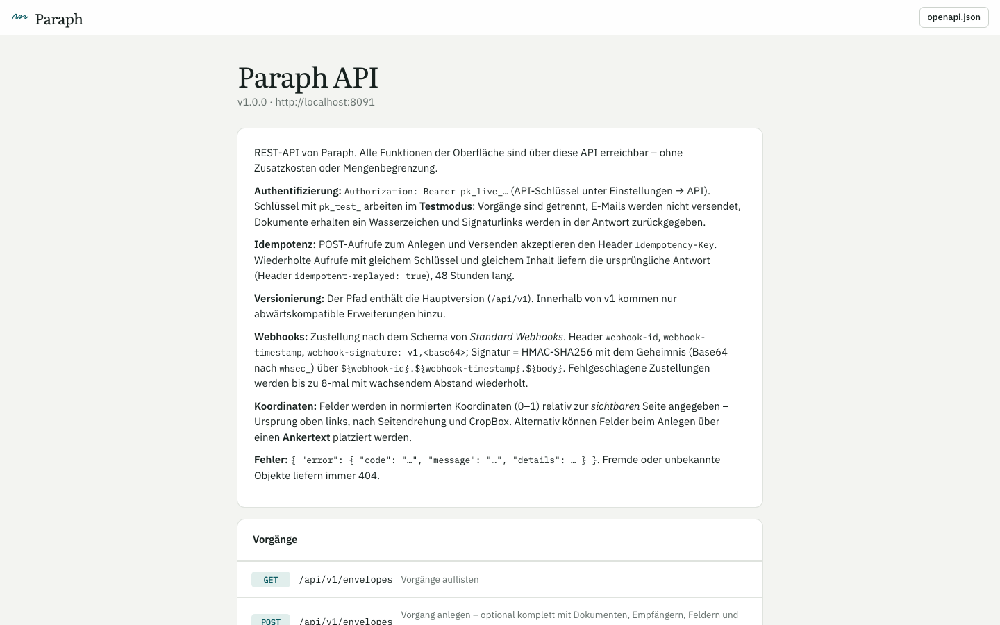
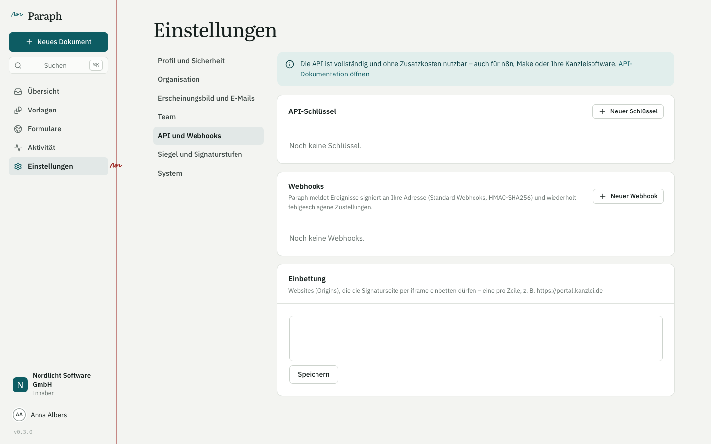

# 10. Anbindung: API und Webhooks

Dieses Kapitel richtet sich an alle, die Paraph mit anderen Systemen verbinden: Kanzleisoftware wie j-lawyer, Automationswerkzeuge wie n8n oder Make und eigene Anwendungen. Es erklärt API-Schlüssel, Testmodus, typische Aufrufe, Webhooks und die Einbettung der Signaturseite. Grundkenntnisse in HTTP und JSON setzt es voraus.

Die API ist vollständig und ohne Zusatzkosten nutzbar. Die Oberfläche von Paraph verwendet dieselben Endpunkte.

## Welcher Weg passt?

| Ziel | Weg | Abschnitt |
|---|---|---|
| Vorgang aus der Kanzleisoftware anlegen, Link dort selbst an Mandanten übergeben | API mit `notify: false` und `external_ref` | [Links selbst übergeben](#links-aus-der-kanzleisoftware-selbst-übergeben) |
| Automatisch reagieren, wenn unterschrieben wurde (PDF ablegen, Akte aktualisieren) | Webhook `envelope.completed`, dann PDF per API laden | [Webhooks](#webhooks-empfangen) |
| Standarddokumente mit festen Rollen versenden | Vorlage per API verwenden | [Vorlage verwenden](#einen-vorgang-aus-einer-vorlage-anlegen) |
| Unterschrift im eigenen Mandantenportal | Einbettung per `iframe` | [Einbettung](#die-signaturseite-einbetten) |
| Werkzeuge wie n8n oder Make | HTTP-Knoten mit API-Schlüssel, Webhook-Knoten | [Beispiele](#beispiele-für-n8n-und-make) |

## Die API-Dokumentation öffnen

Jede Instanz beschreibt ihre API selbst:

- **`/docs/api`** – lesbare Dokumentation in der Oberfläche, auch erreichbar über Einstellungen → API und Webhooks → „API-Dokumentation öffnen“,
- **`/api/v1/openapi.json`** – OpenAPI-Dokument (Version 3.1) für Werkzeuge wie Postman, n8n, Make oder Codegeneratoren.



Die API liegt unter `/api/v1`. Innerhalb von v1 kommen nur abwärtskompatible Erweiterungen hinzu. Dieses Kapitel erklärt die Konzepte und typische Abläufe; alle Parameter nennt die Dokumentation der Instanz.

## Einen API-Schlüssel anlegen

Inhaber und Administration legen Schlüssel unter Einstellungen → API und Webhooks an.



1. Bei „API-Schlüssel“ auf „Neuer Schlüssel“ klicken.
2. Einen „Name“ vergeben, z. B. `j-lawyer` oder `n8n`.
3. „Live“ oder „Testmodus“ wählen.
4. Die Berechtigungen ankreuzen. Vorausgewählt sind `envelopes:read`, `envelopes:write` und `templates:read`.
5. Auf „Erstellen“ klicken und den Schlüssel sofort sichern. Er wird nur dieses eine Mal angezeigt.

Jede Anfrage trägt den Schlüssel im Header:

```http
Authorization: Bearer pk_live_…
```

- `pk_live_…` arbeitet mit echten Daten, `pk_test_…` im [Testmodus](#im-testmodus-ausprobieren).
- Paraph speichert nur einen SHA-256-Hash und die ersten 14 Zeichen zur Wiedererkennung. Die Liste zeigt diese Zeichen, die Berechtigungen und „Zuletzt genutzt“.
- „Widerrufen“ macht einen Schlüssel sofort unwirksam. Widerrufene und abgelaufene Schlüssel beantwortet Paraph mit HTTP 401 `invalid_api_key`. Ein Ablaufdatum bietet die Oberfläche beim Anlegen nicht an.
- Ein Schlüssel gehört zu einer Organisation und zu der Person, die ihn angelegt hat. Wird diese Person gesperrt oder aus der Organisation entfernt, wirkt der Schlüssel nicht mehr; beim Entfernen widerruft Paraph ihn ausdrücklich. Legen Sie Schlüssel für dauerhafte Anbindungen deshalb mit einem Konto an, das bestehen bleibt.

### Berechtigungen (Scopes)

| Scope | Beschriftung in der Oberfläche | erlaubt |
|---|---|---|
| `envelopes:read` | „Vorgänge lesen und herunterladen“ | Vorgänge, Audit-Trail und Dateien lesen; Live-Ereignisse |
| `envelopes:write` | „Vorgänge anlegen, versenden, widerrufen“ | zusätzlich anlegen, ändern, versenden, widerrufen, erinnern, neue Links, Einbettungslinks, Kontakte löschen |
| `templates:read` | „Vorlagen lesen“ | Vorlagen, Ordner und öffentliche Formulare lesen |
| `templates:write` | „Vorlagen bearbeiten“ | zusätzlich Vorlagen, Ordner und öffentliche Formulare bearbeiten und veröffentlichen |
| `webhooks:manage` | „Webhooks verwalten“ | Webhooks anlegen, ändern, löschen, testen |
| `contacts:read` | „Kontakte lesen“ | gespeicherte Kontakte lesen |

Einen Vorgang aus einer Vorlage anzulegen erfordert `envelopes:write` und `templates:read`. Fehlt eine Berechtigung, antwortet Paraph mit HTTP 403 `forbidden`. Private Vorlagen einzelner Personen sieht ein API-Schlüssel nicht.

### Was nur in der Oberfläche geht

Team verwalten, Organisationseinstellungen, Erscheinungsbild, API-Schlüssel, Siegelzertifikat, Aktivitätsprotokoll, System und die Vor-Ort-Signatur sind nur mit Anmeldung in der Oberfläche erreichbar. Ein API-Schlüssel erhält dort HTTP 403 `forbidden`, teils mit der Meldung „Diese Funktion ist nur in der Oberfläche verfügbar.“

## Im Testmodus ausprobieren

Ein Schlüssel im Modus „Testmodus“ (`pk_test_…`) arbeitet in einem abgetrennten Bereich. Damit angelegte Vorgänge

- sind von echten Vorgängen getrennt: Ein Live-Schlüssel sieht sie nicht und umgekehrt (Antwort 404),
- versenden keine E-Mails; die Signaturlinks stehen stattdessen in der Antwort (`signing_links`), bei einer Erinnerung in `signing_url`,
- liefern beim Anfordern eines Einmalcodes den Code auf der Signaturseite mit („Testmodus: Der Code lautet …“),
- tragen im Ergebnis das Wasserzeichen „TEST“,
- lösen nur Webhooks aus, die im Modus `test` angelegt sind,
- werden nicht in Kontakte übernommen und nicht automatisch erinnert.

Ein Test-Schlüssel sieht und ändert nur Webhooks im Modus `test` und erhält über `/api/v1/events` nur Ereignisse des Testmodus. Für Live-Schlüssel gilt das umgekehrt. Wie der Testmodus in der Oberfläche aussieht, zeigt [Kapitel 3](03-vorgaenge-verfolgen.md).

## Auf Fehler reagieren

Alle Fehler haben dieselbe Form:

```json
{ "error": { "code": "not_ready", "message": "Max Muster hat noch kein Unterschriftsfeld.", "details": { "problems": ["…"] } } }
```

`message` ist für Menschen gedacht (deutsch), `code` für Programme.

| HTTP | `code` (Beispiele) | Bedeutung |
|---|---|---|
| 400 | `invalid_request`, `anchor_not_found`, `field_recipient`, `prefill_unknown`, `recipient_missing`, `origin_not_allowed`, `webhook_url` | Eingabe ungültig. Bei `invalid_request` nennt `details` je Feld Pfad (`path`) und Meldung (`message`). |
| 401 | `invalid_api_key`, `unauthorized` | Schlüssel ungültig, abgelaufen, widerrufen, oder nicht angemeldet |
| 403 | `forbidden` | Berechtigung (Scope oder Rolle) reicht nicht |
| 404 | `not_found` | Nicht vorhanden **oder** nicht sichtbar (andere Organisation, anderer Modus, private Vorlage) |
| 409 | `not_draft`, `already_sent`, `not_active`, `not_pending`, `not_completed` | Zustand passt nicht, z. B. Vorgang schon versendet, nicht mehr aktiv, Person nicht an der Reihe, Ergebnis noch nicht fertig |
| 413 | `file_too_large` | Datei oder Anfrage zu groß |
| 422 | `not_ready`, `form_ack_required`, `idempotency_mismatch`, `conversion_failed` | Fachlich nicht ausführbar |
| 429 | `rate_limited` | Zu viele Anfragen |
| 500 | `internal` | Serverfehler; Einzelheiten nur im Server-Log |

**Grenzen der Anfragerate:** 600 Anfragen pro Minute und IP-Adresse für alles unter `/api/`. Einzelne Endpunkte haben engere Grenzen, z. B. Erinnern mit 20 je Minute.

## Anfragen sicher wiederholen (Idempotency-Key)

Bei Netzfehlern wissen Sie oft nicht, ob ein Vorgang schon angelegt wurde. Dafür akzeptieren `POST /api/v1/envelopes`, `POST /api/v1/envelopes/{id}/send` und `POST /api/v1/templates/{id}/envelopes` den Header `Idempotency-Key` (bis 200 Zeichen).

- Gleicher Schlüssel und gleiche Anfrage (Methode, Pfad, Body): Paraph führt nichts erneut aus und liefert die gespeicherte Antwort mit dem Header `idempotent-replayed: true`.
- Gleicher Schlüssel, andere Anfrage: HTTP 422 `idempotency_mismatch`.
- Gespeichert werden nur Antworten mit Status unter 500, je API-Schlüssel bzw. Benutzer, für 48 Stunden, verschlüsselt (sie können Signaturlinks enthalten).

Verwenden Sie eine eindeutige Kennung aus Ihrem System, z. B. `akte-123-vollmacht-2026-10-22`.

## Einen Vorgang in einem Aufruf anlegen und versenden

`POST /api/v1/envelopes` legt Entwurf, Dokumente, Beteiligte und Felder an und versendet auf Wunsch sofort (`"send": true`). Schlägt ein Teil fehl, löscht Paraph den halben Entwurf wieder.

```sh
curl -X POST https://sign.kanzlei.example/api/v1/envelopes \
  -H "Authorization: Bearer $PARAPH_KEY" \
  -H "Content-Type: application/json" \
  -H "Idempotency-Key: akte-123-vollmacht" \
  -d @- <<EOF
{
  "title": "Vollmacht Müller ./. Schmidt",
  "message": "Bitte unterschreiben Sie die Vollmacht.",
  "external_ref": "123/26",
  "expires_in_days": 14,
  "documents": [
    { "name": "Vollmacht.pdf", "file_base64": "$(base64 < Vollmacht.pdf | tr -d '\n')" }
  ],
  "recipients": [
    { "ref": "mandant", "kind": "signer", "name": "Max Müller", "email": "max@example.org", "auth_method": "email_otp" }
  ],
  "fields": [
    { "type": "signature", "recipient": "mandant", "anchor": { "text": "Unterschrift Mandant", "offset_y": 4 } },
    { "type": "signed_date", "recipient": "mandant", "anchor": { "text": "Datum", "offset_y": 4, "width": 100, "height": 20 } }
  ],
  "send": true
}
EOF
```

Die Antwort (HTTP 201) enthält den Vorgang mit `id`, Status, Beteiligten und Feldern.

**Beteiligte.** `kind` ist `signer` (Standard), `approver`, `filler`, `viewer` oder `witness`; `auth_method` ist `none` (Standard), `email_otp`, `sms_otp` (mit `phone`) oder `access_code` (mit `access_code`, mindestens 6 Zeichen). `routing_order` legt bei `"signing_order": "sequential"` die Reihenfolge fest. Was die Rollen und Zugangsarten bedeuten, erklärt [Kapitel 2](02-dokument-unterschreiben-lassen.md).

**Felder.** `type` ist einer der zwölf Feldtypen: `signature`, `initials`, `name`, `email`, `text`, `number`, `date`, `signed_date`, `checkbox`, `select`, `formula`, `attachment`. `recipient` verweist auf `ref`, auf die Rolle (`role`) oder auf die E-Mail-Adresse einer beteiligten Person.

**Felder per Ankertext platzieren.** Statt Koordinaten geben Sie einen Text aus dem Dokument an. Paraph sucht ihn und setzt das Feld unter die Fundstelle.

| Angabe in `anchor` | Bedeutung | Standard |
|---|---|---|
| `text` | Gesuchter Text, 2 bis 200 Zeichen | – |
| `occurrence` | Welches Vorkommen (ab 1) | 1 |
| `offset_x`, `offset_y` | Verschiebung in Punkt (1 pt = 1/72 Zoll) | 0 |
| `width`, `height` | Feldgröße in Punkt | 160 × 40 |

Optional begrenzt `document` (Index oder ID) die Suche auf ein Dokument. Wird der Text nicht gefunden: HTTP 400 `anchor_not_found`.

**Felder per Koordinaten.** Ohne `anchor` geben Sie `document` (Index ab 0 oder ID), `page` (ab 0) sowie `x`, `y`, `w`, `h` an, normiert von 0 bis 1 relativ zur sichtbaren Seite, Ursprung oben links.

**Grenzen:** 20 Dokumente, 30 Beteiligte, 1000 Felder je Vorgang; 60 MB je Anfrage; je Datei die Obergrenze aus `MAX_UPLOAD_MB` ([Kapitel 12](12-konfiguration.md)).

Schritt für Schritt geht es auch: `POST /api/v1/envelopes` (nur Titel), dann `POST …/documents`, `PUT …/recipients`, `PUT …/fields`, `GET …/send-check` zur Vorabprüfung und `POST …/send`. Fehlt etwas, lehnt der Versand mit HTTP 422 `not_ready` ab; `details.problems` nennt, was fehlt.

### Formhinweise im API-Aufruf

Hat der Vorgang Formklassen (`form_classes`), die eine strengere Form als die einfache elektronische Signatur verlangen, lehnt der Versand mit HTTP 422 `form_ack_required` ab. `details.rules` nennt die betroffenen Regeln. Nach Prüfung senden Sie erneut mit `"acknowledge_form_risk": true`. Paraph vermerkt die Bestätigung mit dem API-Schlüssel im Audit-Trail. Den Katalog liefert `GET /api/v1/form-rules`; die rechtliche Einordnung steht in [Kapitel 7](07-recht.md).

## Einen Vorgang aus einer Vorlage anlegen

```sh
curl -X POST https://sign.kanzlei.example/api/v1/templates/tpl_…/envelopes \
  -H "Authorization: Bearer $PARAPH_KEY" \
  -H "Content-Type: application/json" \
  -d '{
    "recipients": { "mandant": { "name": "Max Müller", "email": "max@example.org" } },
    "prefill": { "aktenzeichen": "123/26", "gegenstand": "Kündigungsschutzklage" },
    "title": "Vollmacht {{mandant.name}} – {{aktenzeichen}}",
    "external_ref": "123/26"
  }'
```

- `recipients` nach Rollenschlüssel oder Rollenname. Rollen mit festen Angaben in der Vorlage können entfallen; fehlen Name oder E-Mail für eine Rolle: HTTP 400 `recipient_missing`.
- `prefill` belegt Felder nach Feldschlüssel vor. Vorbelegte Felder sind standardmäßig schreibgeschützt. Unbekannte Feldschlüssel: HTTP 400 `prefill_unknown`.
- `title` und `message` dürfen Platzhalter enthalten: `{{Rolle.name}}`, `{{Rolle.email}}` (Rolle als Schlüssel oder Name) und `{{feldschluessel}}` aus `prefill`.
- `send` ist hier standardmäßig `true`. Mit `"send": false` entsteht nur ein Entwurf.
- Verwendet wird die aktuell veröffentlichte Version; `version` wählt eine bestimmte.
- Außerdem möglich: `notify`, `expires_in_days`, `metadata`, `acknowledge_form_risk`.

Vorlagen, Rollen und Massenversand erklärt [Kapitel 4](04-vorlagen-serien-formulare.md).

## Links aus der Kanzleisoftware selbst übergeben

Soll Paraph keine E-Mail versenden, weil Ihre Kanzleisoftware (z. B. j-lawyer) den Link selbst übermittelt, versenden Sie mit `"notify": false`. Die Antwort enthält dann die Links:

```json
"signing_links": [
  { "recipient_id": "rcp_…", "email": "max@example.org", "url": "https://sign.kanzlei.example/s/…" }
]
```

Ein typischer Ablauf:

1. Vorgang mit `"send": true`, `"notify": false` und dem Aktenzeichen in `external_ref` anlegen.
2. Die Links aus `signing_links` in der Kanzleisoftware an die Mandantin übergeben (E-Mail aus der Akte, beA, Portal).
3. Einen Webhook auf `recipient.notified` und `envelope.completed` einrichten. Ist bei Reihenfolge `sequential` die nächste Person oder nach einer Weitergabe die Vertretung an der Reihe, meldet `recipient.notified` das mit `"channel": "link_handover"`; den Link holt Ihr System mit `POST /api/v1/envelopes/{id}/recipients/{rid}/link`. Den Link selbst enthält der Webhook nicht, damit keine gültigen Links in Zustellprotokollen liegen.
4. Bei `envelope.completed` das unterschriebene PDF laden und zur Akte legen.
5. Vorgänge zu einer Akte finden Sie über `GET /api/v1/envelopes?external_ref=123/26`.

Der Audit-Trail vermerkt bei der Benachrichtigung den Kanal `link_handover`.

Was Sie wissen sollten:

- `notify: false` gilt für den ganzen Vorgang: Auch später folgende Personen und Vertretungen erhalten keine E-Mail, und automatische Erinnerungen entfallen. Gehört der Vorgang einem Kanzleimitglied (bei API-Schlüsseln: wer den Schlüssel angelegt hat), bekommt es eine E-Mail „Link übergeben: … ist an der Reihe“, sobald eine solche Person an die Reihe kommt.
- `POST …/recipients/{rid}/link` erzeugt einen neuen Link ohne E-Mail. Alle bisherigen Links der Person werden ungültig, und offene Sitzungen auf der Signaturseite enden.
- Eine ausdrücklich ausgelöste Erinnerung (`POST …/recipients/{rid}/remind`) versendet dagegen bewusst eine E-Mail mit neuem Link. Der unmittelbar vorherige Link bleibt gültig, ältere verfallen.
- Beide Aufrufe funktionieren nur, solange der Vorgang läuft und die Person an der Reihe ist (sonst HTTP 409 `not_active` bzw. `not_pending`).

## Beispiele für n8n und Make

Beide Werkzeuge rufen die API über einen HTTP-Knoten auf: Methode und Adresse wie unten, Header `Authorization: Bearer …` mit dem API-Schlüssel. Die folgenden Aufrufe zeigen die nötigen Angaben.

Vorgänge mit Status abfragen (`status` kommagetrennt: `draft`, `sent`, `completed`, `declined`, `voided`, `expired`; außerdem `search`, `external_ref`, `limit`):

```sh
curl -s "https://sign.kanzlei.example/api/v1/envelopes?status=sent,completed&limit=50" \
  -H "Authorization: Bearer $PARAPH_KEY"
```

Vorgang ansehen:

```sh
curl -s https://sign.kanzlei.example/api/v1/envelopes/env_… -H "Authorization: Bearer $PARAPH_KEY"
```

Unterschriebenes PDF herunterladen, wenn `envelope.completed` eintrifft:

```sh
curl -s -o ergebnis.pdf https://sign.kanzlei.example/api/v1/envelopes/env_…/files/final \
  -H "Authorization: Bearer $PARAPH_KEY"
```

Der Endpunkt `files/{kind}` kennt außerdem `certificate` (Abschlussbestätigung, PDF), `audit` (Audit-Trail, JSON) und `evidence` (Nachweispaket, ZIP) sowie die ID eines einzelnen Dokuments. Vor dem Abschluss antwortet er mit HTTP 409 `not_completed`. Was in diesen Dateien steht, erklärt [Kapitel 3](03-vorgaenge-verfolgen.md).

Person erinnern (neuer Link; der unmittelbar vorherige bleibt gültig):

```sh
curl -X POST https://sign.kanzlei.example/api/v1/envelopes/env_…/recipients/rcp_…/remind \
  -H "Authorization: Bearer $PARAPH_KEY"
```

Vorgang widerrufen:

```sh
curl -X POST https://sign.kanzlei.example/api/v1/envelopes/env_…/void \
  -H "Authorization: Bearer $PARAPH_KEY" -H "Content-Type: application/json" \
  -d '{ "reason": "Vertrag wird neu aufgesetzt" }'
```

Für eingehende Webhooks in n8n: Webhook-Knoten anlegen, dessen URL in Paraph als Webhook eintragen und die Signatur in einem Code-Knoten mit dem [Node.js-Beispiel](#die-signatur-prüfen) prüfen. Läuft n8n im LAN, den Host in `WEBHOOK_ALLOW_HOSTS` freigeben ([Schutz vor internen Zielen](#schutz-vor-internen-zielen)). In Make gilt dasselbe mit einem Webhook-Modul.

## Webhooks empfangen

Paraph meldet Ereignisse per HTTP-POST an Ihre Adresse. Das Format folgt der Spezifikation [Standard Webhooks](https://www.standardwebhooks.com/). So muss Ihr System nicht ständig nachfragen.

### Einen Webhook anlegen

**In der Oberfläche:** Einstellungen → API und Webhooks → „Neuer Webhook“. URL eintragen, Ereignisse ankreuzen (vorausgewählt: `envelope.completed`, `recipient.signed`, `envelope.declined`), „Anlegen“ klicken. Das Signaturgeheimnis `whsec_…` erscheint nur jetzt; sichern Sie es. In der Oberfläche angelegte Webhooks gelten für echte Vorgänge (Modus `live`).

**Per API** (Scope `webhooks:manage`):

```json
{ "url": "https://n8n.kanzlei.example/webhook/paraph", "events": ["envelope.completed", "envelope.declined"], "mode": "live" }
```

an `POST /api/v1/webhooks`. Die Antwort enthält einmalig das Geheimnis `whsec_…`. Mit einem Test-Schlüssel angelegte Webhooks sind immer im Modus `test`. `"events": ["*"]` abonniert alle Ereignisse. Paraph speichert das Geheimnis verschlüsselt.

In der Oberfläche zeigt jeder Webhook seine letzten zehn Zustellungen mit Status. Mit „Testen“ reihen Sie ein Testereignis (`webhook.test`) ein, der Schalter deaktiviert den Webhook, das Papierkorb-Symbol löscht ihn.

### Ereignisse

| Ereignis | Wann | Felder in `data` |
|---|---|---|
| `envelope.sent` | Vorgang versendet | `envelope_id`, `title` |
| `envelope.completed` | alle haben unterschrieben, Ergebnis versiegelt | `envelope_id`, `final_sha256` |
| `envelope.declined` | Vorgang durch Ablehnung beendet | `envelope_id` |
| `envelope.voided` | Vorgang widerrufen | `envelope_id`, `reason` |
| `envelope.expired` | Vorgang abgelaufen | `envelope_id` |
| `recipient.notified` | Person ist an der Reihe | `envelope_id`, `recipient_id`, `email`, `channel` (`email`, `link_handover`, `test_mode` oder `public_form`) |
| `recipient.viewed` | Person hat den Link erstmals geöffnet | `envelope_id`, `recipient_id` |
| `recipient.signed` | Person hat ihren Teil abgeschlossen | `envelope_id`, `recipient_id`, `kind` |
| `recipient.declined` | Person hat abgelehnt | `envelope_id`, `recipient_id`, `reason` |
| `recipient.delegated` | Person hat an eine Vertretung übergeben | `envelope_id`, `from`, `to` |
| `recipient.delivery_failed` | E-Mail an eine Person endgültig gescheitert | `envelope_id`, `recipient_id`, `reason` (z. B. `recipient_rejected`) |
| `template.published` | Vorlage in neuer Version veröffentlicht | `template_id`, `version`, `version_id` |
| `webhook.test` | nur über „Testen“ | `message` |

`recipient.delivery_failed` und `template.published` gehen nur an Webhooks im Modus `live`.

### Aufbau einer Zustellung

```http
POST /webhook/paraph
Content-Type: application/json
User-Agent: Paraph-Webhooks/1
webhook-id: evt_…
webhook-timestamp: 1792656000
webhook-signature: v1,K5o…=

{"id":"evt_…","type":"envelope.completed","created_at":"2026-10-22T09:00:00.000Z","test_mode":false,"data":{"envelope_id":"env_…", …}}
```

Signiert wird `webhook-id + "." + webhook-timestamp + "." + Body` mit HMAC-SHA256. Schlüssel ist der Base64-dekodierte Teil des Geheimnisses nach `whsec_`. Die Signatur steht Base64-kodiert nach `v1,`.

### Die Signatur prüfen

Node.js:

```js
import { createHmac, timingSafeEqual } from 'node:crypto';

export function verifyParaph(rawBody, headers, secret) {
  const id = headers['webhook-id'];
  const ts = headers['webhook-timestamp'];
  if (Math.abs(Date.now() / 1000 - Number(ts)) > 300) return false; // max. 5 Minuten alt
  const key = Buffer.from(secret.replace(/^whsec_/, ''), 'base64');
  const expected = createHmac('sha256', key).update(`${id}.${ts}.${rawBody}`).digest('base64');
  return headers['webhook-signature'].split(' ').some((s) => {
    const [v, sig] = s.split(',');
    return v === 'v1' && sig.length === expected.length && timingSafeEqual(Buffer.from(sig), Buffer.from(expected));
  });
}
```

Python:

```python
import base64, hashlib, hmac, time

def verify_paraph(raw_body: bytes, headers: dict, secret: str) -> bool:
    msg_id = headers["webhook-id"]
    ts = headers["webhook-timestamp"]
    if abs(time.time() - int(ts)) > 300:
        return False
    key = base64.b64decode(secret.removeprefix("whsec_"))
    signed = f"{msg_id}.{ts}.".encode() + raw_body
    expected = base64.b64encode(hmac.new(key, signed, hashlib.sha256).digest()).decode()
    return any(
        part.split(",", 1)[0] == "v1" and hmac.compare_digest(part.split(",", 1)[1], expected)
        for part in headers["webhook-signature"].split(" ")
    )
```

> **Wichtig:** Prüfen Sie immer gegen den **unveränderten** Body, nicht gegen ein neu serialisiertes JSON. Alternativ funktionieren die offiziellen Standard-Webhooks-Bibliotheken.

### Zustellung und Wiederholung

- Erfolg ist jede Antwort mit Status 200 bis 299 innerhalb von 15 Sekunden. Weiterleitungen (3xx) folgt Paraph nicht; sie gelten als Fehler.
- Bei Fehlern wiederholt Paraph mit wachsendem Abstand (10 s, 20 s, 40 s, … höchstens 1 Stunde), **insgesamt bis zu 8 Versuche**. Danach gilt die Zustellung als fehlgeschlagen.
- Fehlgeschlagene Zustellungen lösen Sie in der Oberfläche erneut aus (Symbol „Erneut zustellen“) oder per `POST /api/v1/webhooks/deliveries/{id}/retry`. Ein Testereignis sendet `POST /api/v1/webhooks/{id}/test`.
- Dieselbe `webhook-id` kann bei Wiederholungen mehrfach ankommen. Verarbeiten Sie Ereignisse idempotent.
- Zustellungen an einen deaktivierten Webhook unterbleiben. Zustellprotokolle löscht Paraph nach 30 Tagen.

### Schutz vor internen Zielen

Paraph sendet Webhooks nicht an interne Adressen (Schutz vor SSRF). Gesperrt sind u. a. `127.0.0.0/8`, `10.0.0.0/8`, `172.16.0.0/12`, `192.168.0.0/16`, `169.254.0.0/16`, `100.64.0.0/10`, Multicast, reservierte Bereiche und die entsprechenden IPv6-Bereiche. Ohne Freigabe ist nur `https://` erlaubt; Zugangsdaten in der URL sind verboten. Paraph löst den Hostnamen einmal auf, prüft die IP und verbindet sich genau mit dieser IP (kein DNS-Rebinding). Schon beim Anlegen prüft Paraph das Ziel und lehnt unzulässige oder nicht auflösbare Adressen mit HTTP 400 `webhook_url` ab. Gesperrte Ziele werden bei der Zustellung ohne Wiederholung als fehlgeschlagen markiert.

Für interne Ziele wie n8n im LAN tragen Sie den Host in `WEBHOOK_ALLOW_HOSTS` ein, z. B. `WEBHOOK_ALLOW_HOSTS=n8n.lan,192.168.1.20`. Für diese Hosts ist dann auch `http://` erlaubt. `WEBHOOK_ALLOW_PRIVATE_NETWORKS=true` schaltet den Schutz ganz ab und ist nicht empfohlen ([Kapitel 12](12-konfiguration.md)).

### Live-Ereignisse ohne Webhook

`GET /api/v1/events` liefert dieselben Ereignisse als Server-Sent Events (`text/event-stream`), solange die Verbindung offen ist. Die Oberfläche nutzt das für die Live-Aktualisierung. Erforderlich ist `envelopes:read`. Für die Anbindung an andere Systeme sind Webhooks robuster, weil Paraph sie bei Fehlern wiederholt.

## Die Signaturseite einbetten

Die Signaturseite lässt sich per `<iframe>` in eine eigene Anwendung einbetten, etwa in ein Mandantenportal. Nur sie ist einbettbar; alle übrigen Seiten von Paraph verbieten die Darstellung in fremden Rahmen.

1. Erlaubte Herkünfte eintragen: Einstellungen → API und Webhooks → „Einbettung“, eine pro Zeile, z. B. `https://portal.kanzlei.example`, dann „Speichern“. Höchstens 20 Einträge.
2. Pro Aufruf einen Einbettungslink holen (Scope `envelopes:write`):
   ```sh
   curl -X POST https://sign.kanzlei.example/api/v1/envelopes/env_…/recipients/rcp_…/embed \
     -H "Authorization: Bearer $PARAPH_KEY" -H "Content-Type: application/json" \
     -d '{ "origin": "https://portal.kanzlei.example" }'
   # → { "url": "https://sign.kanzlei.example/embed/s/…", "expires_in": 600 }
   ```
   Der Link ist 10 Minuten gültig und nur einmal verwendbar. Die Person muss gerade an der Reihe sein.
3. Den Link im `iframe` laden. Paraph setzt `Content-Security-Policy: frame-ancestors` auf die angegebene Herkunft.
4. Auf Nachrichten hören:
   ```js
   window.addEventListener('message', (e) => {
     if (e.origin !== 'https://sign.kanzlei.example') return;
     if (e.data?.type === 'paraph:completed') { /* e.data.envelope_id */ }
     if (e.data?.type === 'paraph:declined')  { /* … */ }
     if (e.data?.type === 'paraph:delegated') { /* an Vertretung weitergegeben, Vorgang läuft weiter */ }
   });
   ```

`origin` ist beim Anlegen des Einbettungslinks Pflicht und muss unter „Einbettung“ freigegeben sein, sonst antwortet Paraph mit HTTP 400 `origin_not_allowed`. Die Nachrichten `paraph:completed`, `paraph:declined` und `paraph:delegated` gehen nur an genau diese Herkunft. Verlassen Sie sich für den Abschluss nicht allein auf `postMessage`, sondern prüfen Sie den Status per API oder Webhook.

## Die wichtigsten Endpunkte

Eine Übersicht; vollständig und mit allen Parametern unter `/docs/api`.

| Methode und Pfad | Zweck | Scope |
|---|---|---|
| `GET /api/v1/envelopes` | Vorgänge auflisten und filtern | `envelopes:read` |
| `POST /api/v1/envelopes` | Vorgang anlegen, optional komplett und versendet | `envelopes:write` |
| `GET /api/v1/envelopes/{id}` | Vorgang mit Beteiligten, Feldern und Ergebnis | `envelopes:read` |
| `PATCH`, `DELETE /api/v1/envelopes/{id}` | Entwurf ändern oder löschen | `envelopes:write` |
| `POST /api/v1/envelopes/{id}/documents` | Dokument hochladen (Multipart oder Base64) | `envelopes:write` |
| `PUT /api/v1/envelopes/{id}/recipients`, `…/fields` | Beteiligte bzw. Felder setzen | `envelopes:write` |
| `GET /api/v1/envelopes/{id}/send-check` | Prüfen, ob versendet werden kann | `envelopes:read` |
| `POST /api/v1/envelopes/{id}/send` | Versenden (`notify`, `acknowledge_form_risk`) | `envelopes:write` |
| `POST /api/v1/envelopes/{id}/void` | Widerrufen | `envelopes:write` |
| `POST /api/v1/envelopes/{id}/duplicate` | Als neuen Entwurf kopieren | `envelopes:write` |
| `POST …/recipients/{rid}/remind`, `…/link`, `…/embed` | Erinnern, neuer Link, Einbettungslink | `envelopes:write` |
| `GET /api/v1/envelopes/{id}/audit` | Audit-Trail mit Prüfergebnis der Kette | `envelopes:read` |
| `GET /api/v1/envelopes/{id}/files/{kind}` | Ergebnisdateien | `envelopes:read` |
| `GET /api/v1/templates`, `GET /api/v1/templates/{id}` | Vorlagen lesen | `templates:read` |
| `POST /api/v1/templates/{id}/envelopes` | Vorgang aus Vorlage | `envelopes:write` + `templates:read` |
| `POST /api/v1/templates/{id}/bulk` | Massenversand aus CSV/XLSX; ohne `?dry_run=false` nur Probelauf | `envelopes:write` + `templates:read` |
| `GET`, `POST`, `PATCH`, `DELETE /api/v1/webhooks…` | Webhooks verwalten | `webhooks:manage` |
| `GET /api/v1/contacts` | Kontakte lesen | `contacts:read` |
| `GET /api/v1/form-rules` | Katalog der Formhinweise | jeder gültige Schlüssel |
| `GET /api/v1/me` | Eigener Schlüssel, Organisation, Berechtigungen | jeder gültige Schlüssel |

---

← [9. Anmeldung und SSO](09-anmeldung-und-sso.md) · [Inhalt](README.md) · [11. Installation](11-installation.md) →
