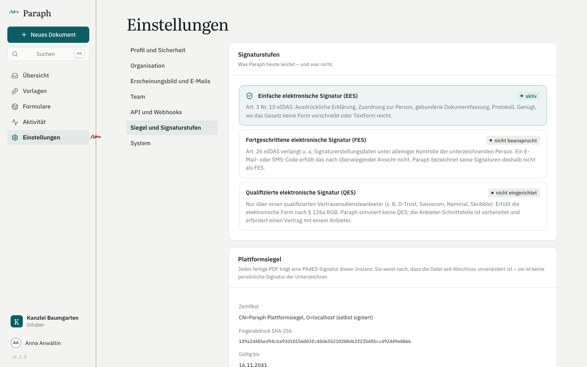

# 14. Sicherheit und Nachweis

Dieses Kapitel erklärt, wovor Paraph schützt, mit welchen Mitteln, und wo die Grenzen liegen. Es richtet sich an IT und Betrieb, aber auch an die Leitung der Organisation, die wissen will, was ein versiegeltes PDF und ein Nachweispaket im Streitfall belegen. Alle Angaben beziehen sich auf Version 0.3.1.

Kurz gesagt: Paraph verschlüsselt alle Dokumente, führt je Vorgang einen fälschungserkennenden Audit-Trail, verankert diesen regelmäßig bei einem unabhängigen Zeitstempeldienst und versiegelt jedes fertige PDF. Gegen jemanden mit Root-Zugriff auf den Server kann Paraph Änderungen nicht verhindern, aber weitgehend sichtbar machen – vorausgesetzt, ein Zeitstempeldienst mit Vertrauensanker ist eingerichtet.

## Verstehen, was geschützt wird

| Gut | Warum es zählt |
|---|---|
| Dokumentinhalte (Verträge, Vollmachten, personenbezogene Daten) | DSGVO, Geschäfts- und Berufsgeheimnisse (für Kanzleien: Mandatsgeheimnis) |
| Unterschriftsbilder und Feldwerte | Missbrauch, Identitätsdiebstahl |
| Integrität der unterzeichneten Fassung | Beweiswert |
| Audit-Trail | Nachweis, wer wann was getan hat |
| Signaturlinks und Sitzungen | Zugang zum Unterschreiben im Namen Dritter |
| Konten, API-Schlüssel, Webhook-Geheimnisse | Zugang zur gesamten Organisation |
| Hauptschlüssel, Siegelschlüssel | Entschlüsselung aller Daten, Fälschung von Siegeln |

Paraph rechnet mit diesen Angreifern:

1. Außenstehende im Internet ohne Zugang: raten Links, greifen Anmeldung und Upload an, versuchen über Webhooks interne Adressen zu erreichen (SSRF).
2. Empfänger eines Signaturlinks: versuchen fremde Felder zu setzen, Dokumente zu tauschen oder Abläufe zu umgehen.
3. Mitarbeitende einer anderen Organisation auf derselben Instanz: versuchen fremde Vorgänge zu lesen.
4. Mitglieder mit eingeschränkter Rolle: versuchen ihre Rechte auszuweiten.
5. Dritte mit Zugriff auf eine weitergeleitete E-Mail: nutzen einen alten Link.
6. Schädliche Dateien: PDFs mit Skripten, präparierte Office-Dateien.
7. Wer Sicherungen oder den S3-Bucket erbeutet, aber nicht den Server.
8. Wer Root-Zugriff auf den Server hat: Administrator, Hoster oder erfolgreicher Angreifer.

## Angriffswege und Gegenmaßnahmen nachschlagen

| Angriffsweg | Gegenmaßnahme |
|---|---|
| Link erraten | 256-Bit-Zufallstoken, gespeichert nur als Hash |
| Weitergeleitete E-Mail | je Person höchstens zwei gültige Links (aktueller und unmittelbar vorheriger); „Link selbst weitergeben“ entwertet alle bisherigen Links und beendet offene Sitzungen; optional Einmalcode oder Zugangscode |
| Code auf der Signaturseite raten | Zugangscode mindestens 6 Zeichen; Sperre je Person nach 5 Fehlversuchen in 15 Minuten, unabhängig von der IP; jeder Fehlversuch im Audit-Trail |
| Mitlesen auf dem Weg zum Mailserver | STARTTLS erzwungen, Zertifikatsprüfung |
| Passwort raten | Argon2id, Kontosperre nach 5 Fehlversuchen für 15 Minuten, Rate-Limit, Zwei-Faktor |
| Fremde Daten über die API abrufen | jede Abfrage an die Organisation gebunden, Antwort 404 statt 403 |
| CSRF aus einer fremden Website | CSRF-Token im Header, Origin-Prüfung, `SameSite`-Cookie |
| Fremde Felder setzen, Dokument tauschen | serverseitige Prüfung jedes Feldes; Abschluss nur mit passenden Dokument-Hashes |
| Doppelte oder parallele Abschlüsse | Abschlussschlüssel und Transaktion; genau ein Abschluss |
| Schädliches PDF | Bereinigung aktiver Inhalte, Neuschreiben |
| Schädliche Office-Datei | Umwandlung in isoliertem Container ohne Netz und ohne Datenzugriff |
| SSRF über Webhooks | Sperrliste, IP-Pinning, keine Weiterleitungen |
| Diebstahl von Sicherung oder S3-Bucket | Sicherung vollständig verschlüsselt; Hauptschlüssel darin nur mit Passphrase verpackt; Objekte im Bucket mit AES-256-GCM verschlüsselt |
| Nachträgliche Änderung des Audit-Trails | Hash-Kette (Erkennung), Datenbank-Trigger (Verhinderung im Normalbetrieb), externe Verankerung mit Zeitstempel, Siegel ab Abschluss |
| Änderung von Feldwerten oder Unterschriftsbildern nach der Unterschrift | Abschluss prüft gegen die Audit-Kette und bricht bei Abweichung ab |
| Gefälschte Client-IP per `X-Forwarded-For` | `TRUST_PROXY=true` vertraut genau einem Proxy-Hop |

## Anmeldung, Sitzungen und Links absichern

### Passwörter und Codes

- Passwörter und Zugangscodes speichert Paraph mit **Argon2id** (19 MiB Speicher, 2 Durchläufe, Parallelität 1), Unicode-normalisiert.
- Bei unbekannter E-Mail-Adresse rechnet Paraph trotzdem einen Hash, damit die Antwortzeit nichts verrät. „Passwort vergessen“ antwortet immer gleich.
- Nach 5 Fehlversuchen ist das Konto 15 Minuten gesperrt.
- TOTP-Codes sind nur einmal verwendbar; nach 5 falschen Codes wird die Anmeldung verworfen. Das TOTP-Geheimnis liegt verschlüsselt in der Datenbank.

### Sitzungen, CSRF und Herkunft

- Sitzungscookie `paraph_session`: `HttpOnly`, `SameSite=Lax`, `Secure` bei einer `https://`-`APP_URL`. In der Datenbank steht nur ein Hash des Tokens.
- Eine Sitzung endet nach 12 Stunden Inaktivität, spätestens nach 14 Tagen. Passwortwechsel und Zurücksetzen beenden andere Sitzungen.
- Jede ändernde Anfrage (POST, PUT, PATCH, DELETE) mit Sitzung braucht den Header `x-csrf-token`, der zum Sitzungstoken passt. Ein vorhandener `Origin`-Header wird gegen `APP_URL` und die eigenen Domains der Organisationen geprüft.
- API-Schlüssel kommen nur im `Authorization`-Header und sind damit nicht für CSRF anfällig.

### Signaturlinks und Unterzeichner-Sitzungen

- Linktoken: 256 Bit aus dem Zufallsgenerator des Betriebssystems. Gespeichert wird nur `SHA-256("paraph-token:" + token)`. Dasselbe gilt für Einladungen, Passwort-Rücksetzung, Sitzungen, Einbettungslinks und API-Schlüssel.
- Beim Öffnen tauscht der Browser das Linktoken gegen eine **Unterzeichner-Sitzung** von 8 Stunden. Sie wird im Header `x-signer-session` gesendet, nicht als Cookie, und im `sessionStorage` des Tabs gehalten. Fremde Websites können sie deshalb nicht mitsenden.
- Eine **Erinnerung** erzeugt einen neuen Link. Der unmittelbar vorherige bleibt gültig, damit die erste E-Mail weiter funktioniert; ältere verfallen.
- **„Link selbst weitergeben“** ersetzt das Token, entwertet alle bisherigen Links und beendet geöffnete Sitzungen dieser Person.
- Widerruf, Ablehnung, Vertretung und Ablauf entwerten Links und beenden offene Sitzungen.
- Einbettungslinks gelten 10 Minuten und nur einmal.

### Einmalcodes und Zugangscodes

- E-Mail- und SMS-Code: 6 Ziffern, 10 Minuten gültig, gespeichert nur als Hash. Höchstens 5 Codes pro Stunde und Person, höchstens 5 Eingabeversuche je Code.
- Zugangscode: mindestens 6 Zeichen.
- Gemeinsame Sperre für alle Verfahren: nach 5 Fehlversuchen in 15 Minuten keine weitere Prüfung. Gezählt wird je Empfänger, nicht je IP-Adresse.
- Jeder Fehlversuch steht als `recipient.auth_failed` (mit IP und Zahl der Fehlversuche) im Audit-Trail, die Sperre als `recipient.auth_locked`. Zähler und Eintrag werden festgeschrieben, bevor der Fehler gemeldet wird.
- Der SMS-Text nennt die Organisation, nicht den Titel des Dokuments. Im Audit-Trail stehen Adresse und Telefonnummer des Codeversands nur maskiert.
- Öffentliche Formulare: höchstens 3 offene Codes je Adresse, 5 Versuche je Code.

### Anfragen begrenzen

| Bereich | Grenze je Minute und IP |
|---|---|
| alle `/api/`-Pfade zusammen | 600 |
| Anmeldung, Einrichtung, Passwort, Zwei-Faktor, Einladung | 10 |
| Signaturseite | Öffnen 30, Code anfordern 10, Code prüfen 20, Abschluss 20, Ablehnung 10, Vertretung 10 |
| Öffentliche Formulare | Start 5, Bestätigung 10 |
| Prüfstelle | Hash-Prüfung 30, Signaturprüfung 10 |
| Erinnerung über die API | 20 |
| Administration | Tiefenprüfung 6, Test-E-Mail 5 |

Statische Dateien der Oberfläche, `/metrics` und die Gesundheitsendpunkte (`/api/health`, `/api/health/ready`) sind ausgenommen. Ohne `TRUST_PROXY` hinter einem Proxy teilen sich alle Nutzer die IP des Proxys und damit die Grenzen (siehe [Kapitel 15](15-diagnose-und-fehlersuche.md#proxy-und-ip-adressen)).

## Daten verschlüsseln und datensparsam verarbeiten

### Gespeicherte Dateien

Jede Datei (Original, PDF, Unterschriftsbild, Anhang, Ergebnis) wird vor dem Speichern mit **AES-256-GCM** verschlüsselt (`src/server/lib/crypto.ts`). Den Schlüssel je Datei leitet Paraph per **HKDF-SHA256** aus dem Hauptschlüssel ab. Die Datei-ID ist als zusätzliche authentisierte Angabe gebunden; vertauschte Dateien scheitern bei der Entschlüsselung.

### Geheimnisse in der Datenbank

TOTP-Geheimnisse, Webhook-Geheimnisse, der private Siegelschlüssel und E-Mail-Inhalte in der Warteschlange liegen mit einem eigenen, ebenfalls per HKDF abgeleiteten Teilschlüssel verschlüsselt in der Datenbank. Gespeicherte Antworten zu Idempotency-Keys (sie können Signaturlinks enthalten) ebenfalls. Den Textauszug der Dokumente für die Formhinweise löscht Paraph beim Versand.

**Nicht verschlüsselt** in der Datenbank: Namen, E-Mail-Adressen, Titel, Feldwerte und der Audit-Trail. Schützen Sie das Datenvolume deshalb mit einer Festplattenverschlüsselung des Servers. Sicherungen verschlüsseln die Datenbank vollständig ([Kapitel 13](13-sicherung-und-updates.md)).

### E-Mail-Ausgang

E-Mails liegen in einer Warteschlange; Text- und HTML-Inhalt mit dem Link sind verschlüsselt. Nach erfolgreichem Versand löscht Paraph den Inhalt, es bleiben Empfänger, Betreff und Status. Vorübergehende Fehler werden bis zu 8-mal wiederholt, dauerhafte nicht. Nach einem endgültigen Fehler wird der Inhalt ebenfalls gelöscht. Die Datensätze verschwinden nach 90 Tagen.

Bei `smtp://` erzwingt Paraph STARTTLS; ein Server ohne STARTTLS erhält keine E-Mail. Ausnahmen gelten nur für lokale Testserver und mit `SMTP_ALLOW_INSECURE=true` ([Kapitel 12](12-konfiguration.md)).

### Protokolle

- Keine Query-Strings und keine Anfrageinhalte im Zugriffsprotokoll.
- Token in Pfaden (`/s/`, `/embed/s/`, `/invite/`, `/reset/`, `/f/`) werden durch `…` ersetzt.
- `Authorization`, Cookies sowie Felder namens `password`, `token` und `code` werden aus Logeinträgen entfernt.
- Interne Fehler gehen mit Details ins Log, an den Client nur „Interner Fehler“.
- Der mitgelieferte Caddy kürzt dieselben Pfade und entfernt `Cookie` und `Authorization`.

Ausnahme: `DEV_MODE=true` schreibt ohne SMTP Signaturlinks ins Log. Nie produktiv einschalten; die Diagnose meldet es als Fehler.

## Hochgeladene Dateien entschärfen

### PDF-Bereinigung

Beim Hochladen (`src/server/pdf/inspect.ts`):

- verschlüsselte PDFs werden abgelehnt;
- automatische Aktionen (`OpenAction`, `AA`) im Dokument, auf Seiten und an Annotationen werden entfernt;
- `JavaScript`, `EmbeddedFiles` und `XFA` werden entfernt;
- Link-Aktionen der Typen JavaScript, Launch, SubmitForm, ImportData, GoToR, GoToE und RichMediaExecute werden entfernt;
- vorhandene Formularfelder werden in den Seiteninhalt übernommen oder, wenn das scheitert, entfernt;
- bereits enthaltene digitale Signaturen werden durch die Verarbeitung ungültig; Paraph weist darauf hin.

Jede Bereinigung erscheint als Warnung am Dokument und im Audit-Trail.

### Unterschriftsbilder

Vor dem Dekodieren liest Paraph die Abmessungen aus dem PNG-Kopf und weist Bilder außerhalb von 20 × 10 bis 2400 × 1200 Pixel ab (Schutz vor Dekompressionsbomben); höchstens 1,5 MB. Danach wird das Bild dekodiert, auf Mindestdeckung geprüft und neu kodiert. Eingebettete Metadaten gehen dabei verloren.

### Office-Umwandlung

Word-, DOC-, ODT- und RTF-Dateien wandelt der Container `gotenberg` um. Er hängt nur im Docker-Netz `convert`, das als `internal` markiert ist: kein Internetzugang, kein Zugriff auf das Paraph-Volume, JavaScript in Chromium abgeschaltet. Paraph prüft vorher die Dateisignatur passend zur Endung und nachher, dass ein PDF zurückkommt. Das Ergebnis durchläuft die PDF-Bereinigung.

## Webhooks gegen SSRF schützen

Für Webhooks gilt (`src/server/lib/ssrf.ts`): nur `http(s)`, keine Zugangsdaten in der URL, ohne Freigabe nur HTTPS. Paraph löst den Hostnamen auf, prüft jede Adresse gegen eine Sperrliste privater, lokaler und reservierter IPv4- und IPv6-Netze und legt die Verbindung genau auf die geprüfte IP fest. Ein zweites DNS-Lookup findet nicht statt; DNS-Rebinding greift damit nicht. Weiterleitungen werden nicht verfolgt. Zeitlimit 15 Sekunden. Die Auflösung wird schon beim Anlegen des Webhooks geprüft. Ausnahmen für interne Ziele: `WEBHOOK_ALLOW_HOSTS` (einzelne Hosts) und `WEBHOOK_ALLOW_PRIVATE_NETWORKS` ([Kapitel 12](12-konfiguration.md)).

## Organisationen voneinander trennen

Jede Abfrage ist an die Organisation des Anfragenden gebunden. Vorgänge, Vorlagen, Dateien, Felder und Webhooks anderer Organisationen, des anderen Modus (live/test) oder ohne Sichtbarkeit beantwortet Paraph mit **404**. So lässt sich nicht einmal die Existenz fremder Objekte ermitteln. Ein Test-API-Schlüssel sieht und ändert keine Live-Webhooks und erhält über `/api/v1/events` keine Live-Ereignisse, und umgekehrt.

Unterzeichner setzen ausschließlich die Felder, die ihnen zugeordnet sind. Feldwerte, Unterschriften und Anhänge prüft der Server gegen Vorgang, Person und Status.

## HTTP-Sicherheitsheader kennen

| Header | Wert |
|---|---|
| `Content-Security-Policy` | `default-src 'self'; script-src 'self'; style-src 'self' 'unsafe-inline'; img-src 'self' data: blob:; font-src 'self' data:; worker-src 'self' blob:; connect-src 'self'; object-src 'none'; base-uri 'none'; form-action 'self'; frame-ancestors 'none'` – bei freigegebener Einbettung nennt `frame-ancestors` die erlaubte Herkunft |
| `X-Frame-Options` | `DENY` (außer bei freigegebener Einbettung) |
| `Strict-Transport-Security` | `max-age=31536000; includeSubDomains`, nur bei HTTPS |
| `X-Content-Type-Options` | `nosniff` |
| `Referrer-Policy` | `no-referrer` |
| `Cross-Origin-Opener-Policy` / `-Resource-Policy` | `same-origin` |
| `Permissions-Policy` | `camera=(), microphone=(), geolocation=(), payment=()` |
| `Cache-Control` | `no-store` für die API und Downloads |

## Den Container härten

`Dockerfile` und `docker-compose.yml` setzen:

- Benutzer `node` (UID 1000), nicht root;
- schreibgeschütztes Root-Dateisystem; schreibbar nur `/data`, `/backups` und `/tmp` (tmpfs, 256 MB);
- alle Linux-Capabilities entzogen, `no-new-privileges`;
- Speicherlimit 1 GB (`PARAPH_MEM_LIMIT`) und höchstens 256 Prozesse;
- npm, npx und corepack aus dem Laufzeit-Image entfernt;
- Port standardmäßig nur an `127.0.0.1` gebunden;
- Hauptschlüssel, Wiederherstellungs-Passphrase und Vertrauensanker des Zeitstempeldienstes als Docker-Secrets, nicht als Umgebungsvariablen; `install.sh` setzt die Schlüsseldateien auf 0400 mit Eigentümer UID 1000 und `.env` auf 0600;
- Gotenberg (`9.6.0`) und Caddy (`2.11.9-alpine`) mit fester Version;
- Caddy (Profil `caddy`): schreibgeschützt, nur `NET_BIND_SERVICE`, `no-new-privileges`.

Die Container-Härtung prüfen der Docker-Gesamttest (H1–H5) und der Rauchtest in der CI ([Kapitel 16](16-tests-und-nachweise.md)).

## Manipulation erkennen statt nur verhindern

Paraph unterscheidet bewusst zwischen **Verhinderung** (eine Änderung gelingt nicht) und **Erkennung** (eine Änderung gelingt, fällt aber auf). Verhindern lässt sich nur, was über die Anwendung läuft. Wer die Datenbankdatei direkt bearbeitet, kann alles ändern. Deshalb ruht der Nachweis auf Erkennung.

| Mittel | Wirkt gegen | Wirkt nicht gegen |
|---|---|---|
| Datenbank-Trigger | Fehler und Angriffe über die Anwendung | direkten Schreibzugriff auf die Datenbankdatei |
| Hash-Kette je Vorgang | Änderung einzelner Einträge | Neuberechnung der ganzen Kette |
| Externe Verankerung ohne Zeitstempel | wie Hash-Kette, zusätzlich vorgangsübergreifend | Neuberechnung durch Root |
| Verankerung mit Zeitstempel und Vertrauensanker | Neuberechnung durch Root (wird sichtbar) | Änderung vor der ersten Verankerung |
| Plattformsiegel und Abschlussbestätigung | jede Änderung am fertigen PDF | Änderungen vor dem Abschluss |
| Prüfwert in der Abschlussmail | Austausch des fertigen PDFs auf dem Server | – |

### Der Audit-Trail als Hash-Kette

Jedes Ereignis eines Vorgangs erhält eine fortlaufende Nummer und den Hash seines Vorgängers (`src/server/domain/audit.ts`). Sein eigener Hash ist SHA-256 über kanonisches JSON aus Vorgangs-ID, Nummer, Zeit, Typ, Akteur, Daten und Vorgänger-Hash. Der erste Eintrag verweist auf 64 Nullen. Wer einen Eintrag ändert, einfügt oder löscht, bricht die Kette ab dieser Stelle. Die Prüfung nennt die Stelle und den Grund: „Lücke in der Reihenfolge“, „Verkettung unterbrochen“ oder „Eintrag verändert“.

Prüfen lässt sich die Kette

- in der Oberfläche: Die Vorgangsseite zeigt im Abschnitt „Verlauf“ „Kette intakt“ oder „Kette beschädigt“, im Abschnitt „Integrität“ Zahl der Einträge und Kettenkopf;
- auf dem Server: `paraph verify-audit` prüft alle Vorgänge ([Kapitel 15](15-diagnose-und-fehlersuche.md#befehle-im-container));
- ohne Paraph: `python3 pruefen/verify-audit.py 03_audit-trail.json` im Nachweispaket ([Kapitel 6](06-dokumente-pruefen.md)).

### Der Abschluss prüft gegen die Kette

Beim Unterschreiben schreibt Paraph in den Audit-Trail die Hashes der Dokumentfassung, einen Hash über die eigenen Feldwerte der Person und den Hash jedes Unterschriftsbilds (`src/server/domain/signing.ts`). Vor dem Einbrennen in das finale PDF prüft der Abschluss (`src/server/domain/finalize.ts`):

1. die ganze Audit-Kette – ist sie beschädigt, bricht der Abschluss ab;
2. jede Dokumentfassung gegen die unterschriebene Fassung;
3. die Feldwerte jeder Person gegen den Hash ihres Abschlusses;
4. jedes Unterschriftsbild gegen seinen Hash;
5. jede maßgebliche Fassung gegen ihren gespeicherten Hash.

Weicht etwas ab, etwa ein nach der Unterschrift direkt in der Datenbank geänderter Wert oder ein ausgetauschtes Unterschriftsbild, bricht der Abschluss mit „Integritätsfehler“ ab. Die Änderung gelangt nicht in das versiegelte Dokument. Formelfelder einer Person, die bereits abgeschlossen hat, ändern sich durch spätere Eingaben anderer nicht mehr.

### Hashes aller Ergebnisse im Register

Original, maßgebliche Fassung, finales PDF (gesamt und je Dokument), Abschlussbestätigung, Audit-Export und Nachweispaket werden mit SHA-256 in einem Register geführt. Die Prüfstelle `/verify` vergleicht eine vorgelegte Datei mit diesem Register ([Kapitel 6](06-dokumente-pruefen.md)). Zusätzlich erhält jede beteiligte Person beim Abschluss den SHA-256-Prüfwert des unterschriebenen Dokuments per E-Mail. Damit liegt ein Zeuge außerhalb des Servers.

## Audit-Ketten extern verankern

Die Hash-Kette allein schützt nicht gegen jemanden, der die ganze Kette neu berechnet. Deshalb fasst Paraph die aktuellen Kettenköpfe in festen Abständen zusammen und lässt das Ergebnis von außen bestätigen (`src/server/domain/anchor.ts`).

### So funktioniert die Verankerung

1. Alle `ANCHOR_INTERVAL_MINUTES` (Standard 60, mindestens 5) und zusätzlich zeitnah nach jedem Abschluss sammelt Paraph die Kettenköpfe aller versandten Vorgänge, deren Kette sich seit dem letzten Anker verändert hat. Entwürfe werden nicht verankert.
2. Die Kettenköpfe werden die Blätter eines **Merkle-Baums nach RFC 6962**: Blatt = SHA-256(0x00 ‖ `vorgang:nummer:kettenkopf`), Knoten = SHA-256(0x01 ‖ links ‖ rechts).
3. Der **Anker** enthält Nummer, Zeit, Merkle-Wurzel, Zahl der Blätter und den Hash des vorherigen Ankers. Die Anker bilden so ihrerseits eine Kette.
4. Mit `TSA_URL` lässt Paraph den Ankerhash von einem unabhängigen Zeitstempeldienst bestätigen. An den Dienst geht nur dieser Hash. Ist der Dienst nicht erreichbar, holt der nächste Lauf den Zeitstempel nach (älteste zuerst).

Datenbank-Trigger verhindern, dass Anker gelöscht oder nach dem Zeitstempel geändert werden.

### So wird die Verankerung geprüft

`paraph verify-audit` und die Tiefenprüfung (Einstellungen → System) prüfen

- die Ankerkette (Lücken, Verkettung, veränderte Ankerdaten),
- jede Merkle-Wurzel gegen die gespeicherten Blätter,
- jeden Zeitstempel einschließlich Vertrauenskette,
- jeden verankerten Kettenkopf gegen den heutigen Stand des Vorgangs: Weicht er ab, meldet Paraph „weicht vom verankerten Stand ab (nachträglich verändert)“.

Hinweise ohne Fehler erscheinen, wenn ein Zeitstempel mehr als 15 Minuten nach der Ankererstellung liegt („nachgeholt?“) oder wenn sich das Zertifikat des Zeitstempeldienstes zwischen zwei Ankern ändert.

### Rückdatierung erkennen

Für jeden Vorgang bestimmt Paraph, wie lange es höchstens dauerte, bis ein Ereignis zum ersten Mal extern mit Zeitstempel bestätigt war. Ein großer Abstand deutet auf eine Rückdatierung hin: Wer die Kette nachträglich fälscht und neue Zeitstempel holt, bekommt Zeitstempel mit dem Datum der Fälschung. `paraph verify-audit` meldet Vorgänge, deren Abstand über dem Doppelten des Verankerungsabstands plus 24 Stunden liegt (bei 60 Minuten also über 26 Stunden). In der Oberfläche erscheint dieser Wert nicht. Von außen lässt er sich aus `03_audit-trail.json` und `08_verankerung.json` ablesen: Zeitpunkt des Ereignisses gegen `genTime` des ersten Zeitstempels.

### Verankerung im Nachweispaket

Das Nachweispaket enthält `08_verankerung.json` mit allen Ankern, in denen der Vorgang bis zum Abschluss vorkommt, samt Merkle-Prüfpfad und Zeitstempel. `pruefen/verify-audit.py` prüft Prüfpfad und Ankerhash ohne Paraph, legt die Zeitstempel als `anker-N.tsr` ab und nennt den passenden Befehl `openssl ts -verify`.

> **Gut zu wissen:** Der Abschluss selbst wird erst nach der Erstellung des Pakets verankert. Das Paket enthält deshalb nur Anker aus der Zeit davor. Wurde ein Vorgang vor seiner ersten Verankerung abgeschlossen, fehlt `08_verankerung.json`; das Prüfskript meldet das als Hinweis. Ab dem Abschluss schützen dann Siegel, Abschlussbestätigung und Prüfwert.

## Zeitstempel richtig einrichten

### Was Paraph an einem Zeitstempel prüft

Ein RFC-3161-Zeitstempel zählt nur, wenn alle Prüfungen gelingen (`src/server/pdf/timestamp.ts`):

1. Die Antwort enthält einen Zeitstempel (Status „gewährt“).
2. Der Hashwert im Zeitstempel (Imprint, SHA-256) ist genau der gestempelte Wert.
3. Bei eigener Anfrage stimmt die Nonce. Eine fremde, wiederverwendete Antwort fällt so auf.
4. Das unterzeichnende Zertifikat wird über die Signer-ID bestimmt, nicht über die Reihenfolge der Zertifikate.
5. Die ESS-Bindung (`signingCertificate` oder `signingCertificateV2`) bindet dieses Zertifikat an die Signatur.
6. Die Signatur des Dienstes ist gültig.
7. Das Zertifikat ist für Zeitstempel bestimmt (Verwendungszweck „timeStamping“, falls angegeben).
8. Mit Vertrauensanker: Die Zertifikatskette führt zum Anker, geprüft zum Zeitpunkt des Zeitstempels. Ein Dienst außerhalb der Anker wird beim Stempeln abgelehnt.

### Der Vertrauensanker

Ohne Vertrauensanker belegt ein Zeitstempel nur, **dass** irgendein Dienst gestempelt hat, nicht **welcher**. Wer Root-Zugriff hat, könnte mit einem selbst erzeugten Zeitstempel-Zertifikat Zeitstempel beliebiger Zeit erzeugen. Deshalb gilt:

- `TSA_URL` ohne `TSA_CA_FILE` ist ein **Fehler**: Die Diagnose meldet „Vertrauensanker des Zeitstempeldienstes“ als Fehler, `paraph verify-audit` endet mit Exit-Code 3.
- Als extern bestätigt zählen nur Anker, deren Zeitstempel eine geprüfte Kette haben.
- `TSA_CA_FILE` ist in Docker das Secret `secrets/tsa_ca.pem` (PEM, Wurzel- und gegebenenfalls Zwischenzertifikate des Anbieters). Eine leere Datei bedeutet „kein Anker“.

### FreeTSA als Vorgabe

`install.sh` schlägt FreeTSA vor (Antwort „freetsa“): Es trägt `TSA_URL=https://freetsa.org/tsr` ein und kopiert das mitgelieferte Wurzelzertifikat `docker/tsa/freetsa-root-ca.pem` nach `secrets/tsa_ca.pem`. Vorher prüft das Skript dessen SHA-256-Fingerabdruck gegen einen fest hinterlegten Wert (`a6379e7c…1d18aabc`) und bricht bei Abweichung ab. „keiner“ schaltet den Zeitstempeldienst ab ([Kapitel 11](11-installation.md)).

FreeTSA ist kostenlos, wird von einer Privatperson betrieben, hat keine Verfügbarkeitszusage und ist **kein qualifizierter Zeitstempeldienst**. Die rechtliche Vermutung für qualifizierte Zeitstempel greift deshalb nicht ([Kapitel 7](07-recht.md)). Fällt der Dienst aus, siegelt Paraph ohne Zeitstempel (PAdES-B-B) und holt Zeitstempel für die Anker beim nächsten Lauf nach. Erledigt ist die Einrichtung, wenn `paraph doctor` den Zeitstempeldienst mit „Kette vertrauenswürdig“ meldet.

### Zu einem qualifizierten Anbieter wechseln

1. Vertrag mit einem Vertrauensdiensteanbieter abschließen, URL des Zeitstempeldienstes und dessen Zertifikate (PEM) beschaffen. Auftragsverarbeitung klären: An den Dienst gehen nur Hashwerte.
2. `TSA_URL` in `.env` ändern und `secrets/tsa_ca.pem` durch die Zertifikate des Anbieters ersetzen (Rechte wie zuvor).
3. Paraph neu starten (`docker compose up -d`).
4. `docker compose exec paraph paraph doctor` ausführen und „Kette vertrauenswürdig“ prüfen.

Alte Anker behalten ihre alten Zeitstempel. Nach dem Wechsel weist `paraph verify-audit` beim ersten neuen Anker auf das andere Zertifikat hin; das ist erwartet. Die alten Zertifikate werden für die Prüfung alter Anker weiter gebraucht.

> **Wichtig:** Entfernen Sie beim Wechsel nicht einfach das alte Wurzelzertifikat. Ohne es gelten Zeitstempel alter Anker als „nicht vertrauenswürdig“ und `paraph verify-audit` meldet Abweichungen. Hängen Sie die Zertifikate des neuen Anbieters an das bestehende PEM-Bündel an.

## Das Plattformsiegel verstehen

Jedes fertige PDF, die Abschlussbestätigung und das Manifest des Nachweispakets tragen eine Signatur der Paraph-Instanz (`src/server/pdf/seal.ts`).

| Eigenschaft | Wert |
|---|---|
| Format | PAdES, SubFilter `ETSI.CAdES.detached`, unsichtbare Signatur, das ganze Dokument abgedeckt |
| Stufe | **PAdES-B-T** mit geprüftem Zeitstempel, sonst **PAdES-B-B** |
| Zeitstempel | gestempelt wird der Signaturwert (Signaturzeitstempel) |
| Schlüssel | RSA 3072, SHA-256 |
| Zertifikat | Standard: beim ersten Start erzeugtes, selbst signiertes Instanzzertifikat „Paraph Plattformsiegel“, 15 Jahre gültig; je Organisation kann ein eigenes Zertifikat importiert werden |
| Ablage des Schlüssels | mit dem Hauptschlüssel verschlüsselt in der Datenbank; kein HSM |

Welche Stufe ein Vorgang erhalten hat, zeigt die Vorgangsseite unter „Integrität“ → „Siegel“, etwa „PAdES-B-T · mit Zeitstempel“. Schlug der Zeitstempel beim Abschluss fehl, steht dort nur „PAdES-B-B“; der Grund steht in der API-Antwort des Vorgangs unter `result.seal.timestamp_error`.

**Was das Siegel belegt:** dass die Datei seit dem Abschluss unverändert ist und von dieser Instanz stammt. Jede spätere Änderung macht die Signatur ungültig; das zeigt jeder PDF-Prüfer an. Die Abschlussbestätigung nennt zusätzlich Zahl und Kopf der Audit-Kette zum Zeitpunkt des Siegels.

**Was das Siegel nicht belegt:** die Identität eines Ausstellers gegenüber Dritten. Mit dem selbst signierten Zertifikat zeigen PDF-Programme „Aussteller unbekannt“. Das Siegel ist ein technisches Integritätssiegel, **kein qualifiziertes Siegel und keine persönliche Signatur der Unterzeichner**. Die Unterschriften selbst sind einfache elektronische Signaturen (EES).

Die Prüfstelle bestimmt das Zertifikat einer Signatur über die Signer-ID und prüft die ESS-Bindung. Eine fremde Signatur mit vorangestelltem Instanzzertifikat wird deshalb nicht als Siegel dieser Instanz anerkannt (`src/server/pdf/verify.ts`). Außerdem prüft sie, dass die Signatur die ganze Datei abdeckt und die Lücke für den Signaturwert nur Hex-Zeichen enthält.

## Die Grenzen bei Root-Zugriff kennen

Wer Root auf dem Server hat, kann den Hauptschlüssel lesen, die Datenbank direkt ändern, Trigger entfernen und laufende Prozesse beobachten. Paraph kann das nicht verhindern. Was es erkennt, hängt von der Einrichtung ab:

| Einrichtung | Was Root unbemerkt kann | Was auffällt |
|---|---|---|
| ohne Zeitstempeldienst | Audit-Ketten und Ankerkette vollständig neu berechnen | nur Abweichungen zu Sicherungen außerhalb des Servers, zu herausgegebenen Nachweispaketen und zu versandten Prüfwerten |
| Zeitstempeldienst ohne Vertrauensanker | Zeitstempel mit einem selbst erzeugten Zertifikat fälschen | wie oben; Diagnose und `verify-audit` melden den fehlenden Anker als Fehler |
| Zeitstempeldienst mit Vertrauensanker | Ereignisse eines Vorgangs **vor seiner ersten Verankerung** ändern | geänderte verankerte Einträge; gelöschte oder neu berechnete Anker (Ankerkette oder Zeitstempel brechen); eine komplett neu aufgebaute Ankerkette an den späten Zeitstempeln (Rückdatierungsverzug) und am Vergleich mit früheren Nachweispaketen |
| zusätzlich nach Abschluss | – | jede Änderung am fertigen PDF (Siegel) |

Weitere Grenzen der Verhinderung:

- Die Datenbank-Trigger weisen `UPDATE` und `DELETE` auf Audit-Ereignissen, Ankern, Ergebnissen und finalen Dokumenten sowie `UPDATE` auf Vorlagenversionen ab. Wer direkten Schreibzugriff auf die Datenbankdatei hat, kann sie entfernen.
- Für das Löschen von Entwürfen gibt es eine interne Freigabe über die Tabelle `meta`, die auch von außen gesetzt werden könnte.
- Ereignisse zwischen zwei Verankerungen sind bis zur nächsten Verankerung nur intern geschützt.

## Restrisiken einordnen

- **Kompromittiertes E-Mail-Postfach** einer unterzeichnenden Person: Bei Zugang nur per Link oder per E-Mail-Code kann der Angreifer unterschreiben. Abhilfe: SMS-Code oder Zugangscode auf einem zweiten Weg.
- **Kompromittierter Browser** der unterzeichnenden Person: nicht abwehrbar.
- **OIDC-Anbieter:** Paraph verknüpft bestehende Konten nur, wenn der Anbieter die E-Mail-Adresse als bestätigt meldet (`email_verified: true`) oder `OIDC_TRUST_EMAIL=true` gesetzt ist. Wer im Anbieter E-Mail-Adressen als bestätigt markieren kann, kann sich als die betreffende Person anmelden. Diese Rechte eng halten und Mehrfaktor im Anbieter erzwingen; Paraph fragt nach SSO einen eigenen zweiten Faktor nur bei Personen mit aktiviertem TOTP ab ([Kapitel 9](09-anmeldung-und-sso.md)).
- **SMTP-Strecke:** Paraph verschlüsselt bis zu Ihrem Mailserver. Den weiteren Weg, die Zustellung und SPF/DKIM/DMARC verantwortet Ihr Mailanbieter.
- **Datenbank im Klartext** auf dem Volume (Dokumente sind verschlüsselt): nur durch Festplatten- oder Volume-Verschlüsselung des Servers zu schützen.
- **Hauptschlüssel:** Geht er verloren und gibt es keine Sicherung mit Passphrase, sind alle Dokumente unwiederbringlich verloren.

## Prüfungen dieser Fassung

Am 22.10.2026 haben unabhängige Prüfer (separate Agenten ohne Kenntnis der Entwicklungsentscheidungen) die laufende Testinstanz angegriffen und den Code gelesen.

- **Erste Prüfung:** keine kritische und keine hohe Schwachstelle im praktischen Angriff. Bestätigt wurde unter anderem: Zugriff auf fremde Organisationen scheitert (404), CSRF ohne Token oder mit fremder Origin scheitert (403), fremde Felder und Signatur-IDs werden abgewiesen (403), falsche Dokument-Hashes ebenfalls (409), Webhook an `169.254.169.254` gesperrt, Trigger wirksam. Behandelte Hinweise: interne Webhook-Ziele werden jetzt schon beim Anlegen abgewiesen; das Rate-Limit gilt nur noch für `/api`.
- **Sicherheitsprüfung 1** vor den Änderungen für 0.2.0: 2 hohe und 7 mittlere Befunde, alle behoben und mit Regressionstests belegt (`tests/hardening.test.ts`, `tests/integrity.test.ts`).
- **Abnahmeprüfung 2:** 3 hohe Befunde (Prüfstelle akzeptierte ein vorangestelltes Instanzzertifikat; Zeitstempel ohne geprüfte Kette galten als bestätigt; SMTP-TLS-Erzwingung durch falsche Optionsübergabe wirkungslos) und 4 mittlere (Rückstufung auf unverschlüsseltes Sicherungsformat, Rotation bei unvollständiger Sicherung, offene Weiterleitung nach SSO, Rückweg ohne Rückfrage). Alle behoben und getestet, ebenso die bei der Nachprüfung gefundenen Punkte (Umgehung der Weiterleitung über `/..//`, fehlende Pflicht zum Vertrauensanker).

Wesentliche Befunde und ihre Behebung:

| Befund | Behebung |
|---|---|
| Fehlversuche bei Zugangscodes wurden mit dem Fehler zurückgerollt und nicht gezählt | Zähler und Audit-Eintrag werden vor der Fehlermeldung festgeschrieben |
| Zugangscodes ab 4 Zeichen | mindestens 6 Zeichen |
| `TRUST_PROXY=true` vertraute jedem Eintrag in `X-Forwarded-For` | genau ein Proxy-Hop |
| Test-API-Schlüssel konnten Live-Webhooks lesen und ändern | strikt nach Modus getrennt |
| Formelfelder änderten sich nach der eigenen Unterschrift | eingefroren |
| Textauszug der Dokumente blieb nach dem Versand im Klartext | beim Versand gelöscht |
| Unterschriftsbild als PNG-Dekompressionsbombe | Abmessungen vor dem Dekodieren geprüft |
| Idempotenz-Antworten (mit Signaturlinks) im Klartext | verschlüsselt |
| „Neuer Link“ ließ geöffnete Sitzungen bestehen | beendet sie |
| API-Schlüssel entfernter oder gesperrter Personen wirkten weiter | ungültig |

## Checkliste für den Betrieb

- [ ] `APP_URL` mit `https://`, Reverse Proxy mit gültigem Zertifikat, `TRUST_PROXY` passend zum Proxy.
- [ ] `DEV_MODE` aus.
- [ ] Hauptschlüssel als Docker-Secret (`MASTER_KEY_FILE`), Datei nicht für andere lesbar.
- [ ] Wiederherstellungs-Passphrase eingerichtet, getrennt vom Server aufbewahrt.
- [ ] Zeitstempeldienst mit Vertrauensanker; `paraph doctor` meldet „Kette vertrauenswürdig“.
- [ ] Festplattenverschlüsselung des Servers.
- [ ] SSH nur mit Schlüssel, wenige Personen mit Root.
- [ ] Server- und Docker-Updates zeitnah, Paraph-Updates mit `update.sh` ([Kapitel 13](13-sicherung-und-updates.md)).
- [ ] Zwei-Faktor für alle Konten mit Rolle „Inhaber“ oder „Administration“.
- [ ] Bei sensiblen Vorgängen SMS-Code oder Zugangscode statt reinem Link.
- [ ] Sicherungen außer Haus; Passphrase und Hauptschlüssel getrennt davon.
- [ ] Einstellungen → System regelmäßig ansehen, Tiefenprüfung nach jeder Änderung; Alarm-E-Mails an die Instanz-Administration nicht ausfiltern.
- [ ] `paraph verify-audit` regelmäßig ausführen, zum Beispiel wöchentlich per Cron auf dem Host.

---

← [13. Sicherung und Updates](13-sicherung-und-updates.md) · [Inhalt](README.md) · [15. Diagnose und Fehlersuche](15-diagnose-und-fehlersuche.md) →
