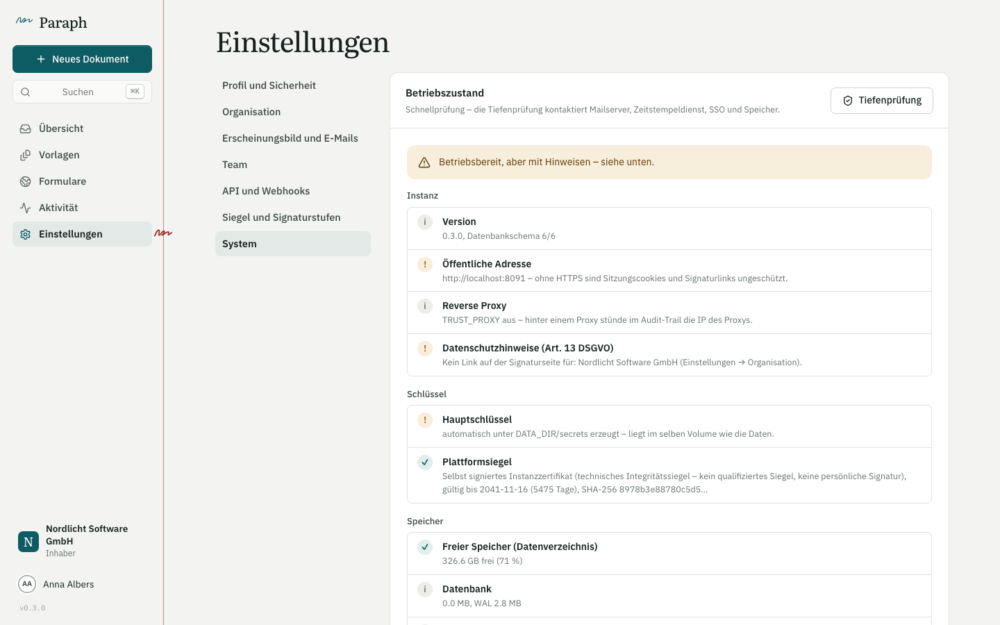

# 15. Diagnose und Fehlersuche

Dieses Kapitel zeigt, wie Sie den Zustand einer Paraph-Instanz prüfen und typische Störungen beheben. Es richtet sich an IT und Betrieb sowie an Instanz-Administratoren. Sie finden hier alle Prüfungen der Betriebsdiagnose mit Bedeutung und Abhilfe, die Metriken, die Protokolle, die Befehle im Container und eine Liste häufiger Probleme.

Die Befehle in diesem Kapitel setzen voraus, dass Sie im Installationsverzeichnis (z. B. `/opt/paraph`) stehen und Paraph mit Docker Compose betreiben.

## Den Betriebszustand prüfen

Paraph hat einen gemeinsamen Prüfkern (`src/server/domain/diagnostics.ts`), den Sie auf zwei Wegen aufrufen:

- **In der Oberfläche:** Einstellungen → System, Abschnitt „Betriebszustand“. Nur für Instanz-Administratoren sichtbar.
- **Auf der Kommandozeile:** `paraph doctor` im Container.



Es gibt zwei Tiefen:

| Prüfung | Auslöser | Was zusätzlich passiert |
|---|---|---|
| **Schnellprüfung** | Öffnen von Einstellungen → System; `paraph doctor --quick` | nur Konfiguration und Datenbankstand, keine Verbindungen nach außen |
| **Tiefenprüfung** | Schaltfläche „Tiefenprüfung“ (höchstens 6 je Minute); `paraph doctor` | Mailserver (Verbindung und Anmeldung, ohne Versand), Zeitstempeldienst (Probestempel mit voller Prüfung), SSO-Anbieter, Dateiablage bzw. S3 (schreiben, lesen, löschen), Gotenberg; Datenbank-Integrität; alle Audit-Ketten und ihr Abgleich mit der Verankerung |

Jede Prüfung hat einen von vier Zuständen:

| Zustand | In `paraph doctor` | Bedeutung |
|---|---|---|
| in Ordnung | `[OK  ]` | nichts zu tun |
| Hinweis | `[WARN]` | betriebsbereit, aber etwas sollte geändert werden |
| Fehler | `[FEHL]` | vor dem Produktivbetrieb beheben |
| Information | `[INFO]` | reine Angabe, keine Bewertung |

Der Gesamtstatus ist „Fehler“, sobald eine Prüfung „Fehler“ meldet, sonst „Hinweis“, sobald eine Prüfung „Hinweis“ meldet. Die Oberfläche zeigt dann „Alles in Ordnung.“, „Betriebsbereit, aber mit Hinweisen – siehe unten.“ oder „Es gibt Fehler, die vor dem Produktivbetrieb behoben werden müssen.“

```sh
sudo docker compose exec paraph paraph doctor --quick   # Schnellprüfung
sudo docker compose exec paraph paraph doctor           # Tiefenprüfung
```

`paraph doctor` gibt die Prüfungen nach Bereichen gruppiert aus und endet mit `Gesamt: in Ordnung`, `Gesamt: mit Hinweisen` oder `Gesamt: FEHLER – siehe oben`. Der Exit-Code ist 1, wenn mindestens eine Prüfung „Fehler“ meldet, sonst 0. Damit eignet sich der Befehl für Überwachungsskripte.

## Alle Prüfungen nachschlagen

Die Spalte „Tiefe“ nennt, ob eine Prüfung immer läuft (schnell) oder nur bei der Tiefenprüfung (tief). Manche Prüfungen erscheinen nur, wenn die Bedingung zutrifft oder der Dienst eingerichtet ist.

### Instanz

| Prüfung | Tiefe | Zustände und Bedeutung | Abhilfe |
|---|---|---|---|
| Version | schnell | Info: Programmversion und Datenbankschema „aktuell/höchstes bekanntes“ | – |
| Entwicklungsmodus | schnell, nur wenn aktiv | Fehler: `DEV_MODE` ist an; Signaturlinks landen im Log | `DEV_MODE` aus `.env` entfernen, neu starten |
| Öffentliche Adresse | schnell | OK bei `https://`; Hinweis bei `http://localhost`; Fehler bei `http://` mit anderer Adresse – Sitzungscookies und Signaturlinks sind dann ungeschützt | `APP_URL` auf die HTTPS-Adresse setzen, Reverse Proxy einrichten ([Kapitel 11](11-installation.md)) |
| Reverse Proxy | schnell | OK: `TRUST_PROXY` gesetzt, mit Angabe der vertrauten Hops oder Adressen; Hinweis: aus, obwohl `APP_URL` HTTPS ist; Info: aus bei HTTP | Hinter einem Proxy `TRUST_PROXY=true` setzen (siehe [Proxy und IP-Adressen](#proxy-und-ip-adressen)) |
| Datenschutzhinweise (Art. 13 DSGVO) | schnell, nur wenn betroffen | Hinweis: Für die genannten Organisationen ist kein Link auf der Signaturseite hinterlegt | Einstellungen → Organisation, Link zu den Datenschutzhinweisen eintragen ([Kapitel 8](08-organisation-team-erscheinungsbild.md)) |
| Ersteinrichtung | schnell, nur wenn offen | Hinweis: noch kein Konto; `/setup` ist offen | Ersteinrichtung abschließen; Einrichtungscode mit `paraph setup-code` |

### Schlüssel

| Prüfung | Tiefe | Zustände und Bedeutung | Abhilfe |
|---|---|---|---|
| Hauptschlüssel | schnell | OK: aus Datei (Docker-Secret) oder aus Umgebungsvariable (dann mit Empfehlung `MASTER_KEY_FILE`); Hinweis: automatisch unter `DATA_DIR/secrets` erzeugt, liegt also im selben Volume wie die Daten | `MASTER_KEY_FILE` als Docker-Secret verwenden ([Kapitel 12](12-konfiguration.md)); Schlüssel getrennt sichern |
| Rechte der Schlüsseldatei | schnell, nur wenn betroffen | Fehler: die Datei aus `MASTER_KEY_FILE` ist für alle lesbar | `chmod 0400 secrets/master.key`, Eigentümer UID 1000 |
| Plattformsiegel | schnell | OK: Zertifikat der Instanz mit Ablaufdatum und Fingerabdruck; Hinweis: läuft in weniger als 365 Tagen ab; Fehler: Schlüssel nicht ladbar | Bei Ablauf ein neues Zertifikat einplanen; bei Fehler Protokoll prüfen (meist Hauptschlüssel falsch) |

Die Prüfung „Plattformsiegel“ betrifft das Instanzzertifikat. Eigene Zertifikate einzelner Organisationen prüft die Diagnose nicht.

### Speicher

| Prüfung | Tiefe | Zustände und Bedeutung | Abhilfe |
|---|---|---|---|
| Freier Speicher (Datenverzeichnis) | schnell | Fehler unter 1 GB oder unter 5 %; Hinweis unter 5 GB oder unter 15 % | Platz schaffen oder Volume vergrößern (siehe [Speicher läuft voll](#speicher-läuft-voll)) |
| Datenbank | schnell | Info: Größe von Datenbank und Write-Ahead-Log; Hinweis, wenn das WAL größer als 512 MB ist | Ein großes WAL schrumpft, wenn Paraph sauber beendet wird; bei Dauerzustand Neustart in ruhiger Zeit |
| Dateiablage | schnell | Info: „lokal (Volume)“ oder „S3 (Bucket)“ | – |
| Datenbank-Integrität | tief | OK oder Fehler mit dem Ergebnis von SQLite `quick_check` | Paraph stoppen, letzte Sicherung prüfen und wiederherstellen ([Kapitel 13](13-sicherung-und-updates.md)) |
| Dateiablage bzw. S3-Ablage | tief | OK: Probeobjekt geschrieben, gelesen und gelöscht (mit Dauer); Fehler mit Meldung | Rechte des Volumes bzw. S3-Zugangsdaten, Bucket und Policy prüfen ([Kapitel 12](12-konfiguration.md)) |

### Sicherung

| Prüfung | Tiefe | Zustände und Bedeutung | Abhilfe |
|---|---|---|---|
| Automatische Sicherung | schnell, nur wenn aus | Hinweis: `BACKUP_INTERVAL_HOURS=0` | Intervall setzen oder eine eigene Sicherung nachweisen |
| Letzte Sicherung | schnell | OK mit Zeitpunkt, Alter und Dateizahl; Fehler, wenn keine Sicherung vorliegt, die letzte älter als das Doppelte des Intervalls plus eine Stunde ist oder Dateien fehlten („UNVOLLSTÄNDIG“) | Einstellungen → System → „Jetzt sichern“ oder `paraph backup`; bei „UNVOLLSTÄNDIG“ die fehlenden Dateien klären (siehe [Sicherung veraltet oder unvollständig](#sicherung-veraltet-oder-unvollständig)) |
| Schlüsselmaterial in der Sicherung | schnell | OK: Sicherungen enthalten den Hauptschlüssel, geschützt durch die Wiederherstellungs-Passphrase; Hinweis: keine Passphrase, Sicherungen sind nur mit dem getrennt aufbewahrten Hauptschlüssel lesbar | `BACKUP_PASSPHRASE_FILE` einrichten ([Kapitel 13](13-sicherung-und-updates.md)) |

### Hintergrund

| Prüfung | Tiefe | Zustände und Bedeutung | Abhilfe |
|---|---|---|---|
| Aufgaben | schnell | Zahlen zu wartenden, wiederholten, endgültig fehlgeschlagenen und überfälligen Aufgaben, Startzeit des Workers. Fehler bei endgültig fehlgeschlagenen Aufgaben; Hinweis bei überfälligen (mehr als 10 Minuten über der Zeit) oder hängenden Aufgaben | Fehlermeldung unter „Hintergrundaufgaben und E-Mails“ lesen, Ursache beheben, dann „Erneut versuchen“. Überfällige Aufgaben deuten auf einen blockierten oder gestoppten Dienst hin: Protokoll prüfen, Container neu starten |

Eine endgültig fehlgeschlagene Aufgabe bleibt so lange als Fehler stehen, bis sie erneut versucht wurde und gelingt.

### E-Mail

| Prüfung | Tiefe | Zustände und Bedeutung | Abhilfe |
|---|---|---|---|
| Zustellung (7 Tage) | schnell | Hinweis, wenn in den letzten 7 Tagen E-Mails nicht zugestellt wurden oder E-Mails länger als 15 Minuten warten | siehe [E-Mail kommt nicht an](#e-mail-kommt-nicht-an) |
| Mailserver | schnell / tief | Fehler: `SMTP_URL` fehlt. Schnell: Info mit dem Hostnamen. Tief: OK „erreichbar, Anmeldung erfolgreich“ mit Verfahren („STARTTLS (erzwungen)“, „TLS (implizit)“ oder „unverschlüsselt (nur lokal zulässig)“), sonst Fehler mit verständlicher Ursache | `SMTP_URL` und `MAIL_FROM` setzen; Fehlermeldung nach der Tabelle unten beheben |

### Nachweis

| Prüfung | Tiefe | Zustände und Bedeutung | Abhilfe |
|---|---|---|---|
| Zeitstempeldienst | schnell / tief | Hinweis: kein `TSA_URL` – Siegel nur PAdES-B-B, Verankerung schützt nicht gegen Serverzugriff. Schnell: Info mit Hostname. Tief: Probestempel; OK mit Aussteller und „Kette vertrauenswürdig“; Hinweis bei mehr als 120 Sekunden Uhrabweichung; Fehler, wenn der Dienst nicht antwortet oder die Antwort die Prüfung nicht besteht | Zeitstempeldienst einrichten ([Kapitel 14](14-sicherheit-und-nachweis.md#zeitstempel-richtig-einrichten)); bei Uhrabweichung die Uhrzeit des Hosts (NTP) prüfen |
| Vertrauensanker des Zeitstempeldienstes | schnell, nur wenn betroffen | Fehler: `TSA_URL` ist gesetzt, `TSA_CA_FILE` fehlt oder ist leer | Zertifikat des Anbieters nach `secrets/tsa_ca.pem`, neu starten |
| Verankerung der Audit-Ketten | schnell | Info: noch keine Anker (entsteht nach dem ersten Versand); OK mit Zahl und Zeit des letzten Ankers; Hinweis, wenn bei eingerichtetem Zeitstempeldienst Anker ohne Zeitstempel warten | Warten bis zum nächsten Lauf; bleibt die Zahl, Erreichbarkeit des Zeitstempeldienstes prüfen (Protokoll: „Zeitstempel für Anker fehlgeschlagen“) |
| Audit-Ketten | tief | OK: alle Vorgänge intakt; Fehler mit Zahl und den ersten Vorgangs-IDs mit beschädigter Kette | siehe [Audit-Kette beschädigt oder Abweichung bei der Verankerung](#audit-kette-beschädigt-oder-abweichung-bei-der-verankerung) |
| Abgleich mit Verankerung | tief | OK mit Zahl der Anker, davon mit geprüftem Zeitstempel und Vertrauenskette; Hinweis bei Ankern ohne geprüfte Kette, nachgeholten Zeitstempeln oder Zertifikatswechsel des Dienstes; Fehler bei Abweichungen | wie oben |

### Anmeldung und Dienste

| Prüfung | Tiefe | Zustände und Bedeutung | Abhilfe |
|---|---|---|---|
| SSO (Name) | schnell / tief, nur mit OIDC | Schnell: Info mit Aussteller. Tief: OK „Discovery erreichbar“; Fehler, wenn `.well-known/openid-configuration` nicht abrufbar ist | `OIDC_ISSUER` prüfen (genau die Aussteller-URL des Anbieters), Erreichbarkeit vom Container aus ([Kapitel 9](09-anmeldung-und-sso.md)) |
| Office-Umwandlung (Gotenberg) | tief, nur mit `GOTENBERG_URL` | OK: erreichbar; Hinweis bei Fehler oder Zeitüberschreitung | `sudo docker compose ps gotenberg`, `sudo docker compose logs gotenberg` |
| SMS-Gateway | schnell, nur wenn eingerichtet | Info: wird nicht automatisch geprüft, weil ein Testversand Kosten verursacht | Einmal einen Vorgang mit SMS-Code an sich selbst senden |
| Qualifizierte Signatur (QES) | schnell | Info: nicht angebunden, bzw. Anbieter konfiguriert, aber nicht produktiv freigegeben | – ([Kapitel 17](17-grenzen.md)) |

## Weitere Werkzeuge auf der Systemseite

Unter dem Betriebszustand bietet Einstellungen → System:

- **„E-Mail-Versand prüfen“:** „Test-E-Mail senden“ verschickt sofort, ohne Warteschlange, eine Test-E-Mail an die eigene oder eine eingegebene Adresse (höchstens 5 je Minute). Angezeigt wird die Antwort des Mailservers („Test-E-Mail angenommen …“) oder eine verständliche Fehlermeldung. Der Versuch steht im Aktivitätsprotokoll.
- **„Sicherung“:** Intervall, letzte Sicherung, Schlüsselmaterial; „Jetzt sichern“.
- **„Hintergrundaufgaben und E-Mails“:** bis zu 20 endgültig fehlgeschlagene Aufgaben mit Fehlermeldung und „Erneut versuchen“, bis zu 20 nicht zugestellte E-Mails, darunter Warteschlange, Wiederholungen und Überfälliges.
- **„Benutzerkonten der Instanz“:** Konten sperren, Zwei-Faktor zurücksetzen, Passwort-Link erzeugen, Instanz-Administration vergeben ([Kapitel 8](08-organisation-team-erscheinungsbild.md)).

**Alarm per E-Mail:** Scheitert eine Hintergrundaufgabe endgültig (nach 8 Versuchen mit wachsendem Abstand), erhalten alle aktiven Instanz-Administratoren eine E-Mail mit Aufgabe, Fehler und Link auf die Systemseite. Höchstens eine E-Mail je Aufgabentyp in 24 Stunden. Betroffen sind E-Mail-unabhängige Aufgaben wie Abschluss eines Vorgangs, automatische Sicherung, Verankerung, Webhook-Zustellung und Löschung nach Aufbewahrungsfrist. Der E-Mail-Versand selbst löst keinen Alarm aus.

## Bereitschaft und Metriken abfragen

### Gesundheitsendpunkte

| Endpunkt | Antwort | Zweck |
|---|---|---|
| `GET /api/health` | `{"status":"ok","version":"…"}` | Lebenszeichen, Version |
| `GET /api/health/ready` | 200 mit `status: "ready"` oder 503 mit `status: "degraded"`; dazu `checks.database`, `checks.storage`, Schema und Zahl fehlgeschlagener Aufgaben | Bereitschaft für Load Balancer und Monitoring |

Beide Endpunkte sind öffentlich und vom Rate-Limit ausgenommen. Der Docker-Healthcheck ruft alle 30 Sekunden `paraph health` auf, das wiederum `/api/health/ready` abfragt.

### Prometheus-Metriken

Mit `METRICS_TOKEN` stellt Paraph Zählwerte unter `/metrics` bereit. Ohne Token oder mit falschem Token antwortet Paraph mit 404.

```sh
curl -H "Authorization: Bearer $METRICS_TOKEN" https://sign.firma.example/metrics
```

| Metrik | Inhalt |
|---|---|
| `paraph_up` | 1, solange die Instanz läuft |
| `paraph_schema_version` | Datenbankschema |
| `paraph_jobs{state=…}` | Hintergrundaufgaben: `queued`, `failed`, `overdue`, `retrying` |
| `paraph_emails{state=…}` | E-Mails der letzten 7 Tage: `queued`, `sent`, `failed` |
| `paraph_envelopes{state=…}` | Vorgänge nach Status ohne Testmodus: `draft`, `sent`, `completed`, `declined`, `voided`, `expired` |
| `paraph_backup_age_seconds` | Alter der letzten Sicherung, −1 ohne Sicherung |
| `paraph_anchors_unstamped` | Anker ohne externen Zeitstempel |
| `paraph_disk_free_bytes` | freier Speicher im Datenverzeichnis |

Die Metriken enthalten keine personenbezogenen Daten. Sinnvolle Alarme: `paraph_jobs{state="failed"} > 0`, `paraph_backup_age_seconds` über dem doppelten Sicherungsintervall, steigendes `paraph_anchors_unstamped`, `paraph_emails{state="failed"}` steigt.

## Protokolle lesen

Paraph schreibt strukturierte JSON-Zeilen (pino) auf die Standardausgabe; Docker hält davon bis zu 5 Dateien à 10 MB.

```sh
sudo docker compose logs --tail 200 paraph      # letzte Einträge
sudo docker compose logs -f paraph              # laufend mitlesen
sudo docker compose logs caddy                  # Zugriffsprotokoll des mitgelieferten Caddy
```

Die Ausführlichkeit steuert `LOG_LEVEL` (Standard `info`). Protokolle enthalten keine Query-Strings, keine Anfrageinhalte und keine Token ([Kapitel 14](14-sicherheit-und-nachweis.md#protokolle)).

Häufige Meldungen:

| Meldung | Bedeutung |
|---|---|
| `Paraph gestartet` | Start abgeschlossen, mit Adresse, Port und Version |
| `Ersteinrichtung offen. Einrichtungscode: …` | noch kein Konto; Code unter `/setup` eingeben |
| `MASTER_KEY ist nicht gesetzt – …` | Hauptschlüssel automatisch erzeugt; für den Betrieb `MASTER_KEY_FILE` setzen |
| `Job fehlgeschlagen` | Hintergrundaufgabe gescheitert, wird mit Abstand wiederholt |
| `Job endgültig fehlgeschlagen` | nach 8 Versuchen aufgegeben; Alarm an die Instanz-Administration |
| `Zeitstempel für Anker fehlgeschlagen` | Zeitstempeldienst nicht erreichbar oder Antwort ungültig; wird beim nächsten Lauf nachgeholt |
| `Unerwarteter Fehler` | interner Fehler mit Details; der Client sah nur „Interner Fehler“ |

## Befehle im Container

Das Image enthält den Befehl `paraph` (`docker/paraph`, Quelltext `src/server/cli.ts`). Aufruf immer über den laufenden Container:

```sh
sudo docker compose exec paraph paraph <befehl>
```

| Befehl | Zweck | Exit-Code |
|---|---|---|
| `version` | Programmversion und Datenbankschema | 0 |
| `health` | Bereitschaft prüfen (für den Healthcheck); gibt `ok` oder `nicht bereit` aus | 1, wenn nicht bereit |
| `doctor [--quick]` | Betriebsdiagnose wie unter Einstellungen → System; ohne `--quick` die Tiefenprüfung | 1 bei mindestens einem Fehler |
| `verify-audit` | alle Audit-Ketten, die Ankerkette, Merkle-Wurzeln und Zeitstempel prüfen; meldet auffälligen Verankerungsverzug | 2 bei beschädigter Kette oder Abweichung; 3, wenn `TSA_URL` ohne Vertrauensanker gesetzt ist |
| `backup [--out DIR]` | Sicherung erstellen | 1 bei Fehler |
| `verify-backup DATEI` | Sicherung vollständig prüfen: entschlüsseln, Blöcke, Hashes, Schema, Schlüssel | 2 bei Problemen |
| `restore-key DATEI --out PFAD` | Hauptschlüssel aus einer Sicherung mit Passphrase schreiben (neuer Server) | 1 bei Fehler |
| `restore DATEI [--force]` | Sicherung wiederherstellen; Dienst vorher stoppen | 1 bei Fehler |
| `setup-code` | Einrichtungscode anzeigen, solange kein Konto existiert | 0 |
| `reset-link E-MAIL` | Link zum Zurücksetzen eines Passworts erzeugen, 60 Minuten gültig (Notfallzugang) | 1, wenn das Konto fehlt |

Sicherung und Wiederherstellung beschreibt [Kapitel 13](13-sicherung-und-updates.md) ausführlich. Für die Wiederherstellung verwenden Sie in der Regel `scripts/restore.sh`, nicht `paraph restore` direkt.

> **Wichtig:** `reset-link` erzeugt einen gültigen Anmeldeweg für jedes Konto. Wer Zugriff auf den Container hat, kann damit jedes Konto übernehmen. Zwei-Faktor bleibt dabei eingeschaltet.

Ausgabe von `paraph verify-audit` lesen:

```text
124 Vorgänge geprüft, 0 mit beschädigter Kette.
37 Anker (37 mit geprüftem Zeitstempel und Vertrauenskette, 0 ohne geprüfte Kette, 0 ohne Zeitstempel), 124 Vorgänge verankert, 0 Abweichungen.
```

Die Zahlen sind ein Beispiel. Zeilen mit `Verankerung:` sind Abweichungen, Zeilen mit `Hinweis:` sind Auffälligkeiten ohne Fehler, etwa ein nachgeholter Zeitstempel oder ein großer Verankerungsverzug.

## Typische Probleme lösen

### E-Mail kommt nicht an

1. Ist der Vorgang im **Testmodus**? Dann versendet Paraph bewusst keine E-Mails.
2. Wurde der Vorgang mit **Linkübergabe** (`notify: false`) angelegt? Dann gehen keine Einladungen raus; Ihre Fachsoftware, etwa Kanzlei-, Personal- oder CRM-Software, übergibt die Links selbst ([Kapitel 10](10-anbindung-api-webhooks.md#links-aus-der-fachsoftware-selbst-übergeben)).
3. Einstellungen → System → „Tiefenprüfung“: Meldet „Mailserver“ einen Fehler?
4. „Test-E-Mail senden“ an ein externes Postfach. Kommt sie nicht an, obwohl der Server sie angenommen hat, liegt das Problem hinter Paraph: Spam-Filter, SPF, DKIM, DMARC der Absenderdomain.
5. Vorgangsseite ansehen: Dauerhaft abgelehnte Adressen erscheinen dort und im Audit-Trail; die Eigentümerin des Vorgangs wird benachrichtigt.
6. Einstellungen → System → „Hintergrundaufgaben und E-Mails“ zeigt nicht zugestellte E-Mails mit Fehler.

Fehlermeldungen des Mailversands:

| Meldung (gekürzt) | Ursache | Abhilfe |
|---|---|---|
| „SMTP ist nicht eingerichtet (SMTP_URL).“ | keine Mailkonfiguration | `SMTP_URL` und `MAIL_FROM` setzen |
| „Anmeldung am Mailserver fehlgeschlagen …“ | Benutzername oder Passwort | Zugangsdaten in `SMTP_URL` prüfen (Sonderzeichen URL-kodieren) |
| „Verschlüsselte Verbindung zum Mailserver nicht möglich (TLS) …“ | Server bietet kein STARTTLS, falscher Port oder Zertifikat ungültig | Port und Protokoll prüfen: `smtp://…:587` (STARTTLS) oder `smtps://…:465` |
| „Mailserver nicht erreichbar …“ | DNS, Firewall, Zeitüberschreitung | ausgehende Verbindung vom Server zum Mailserver prüfen; Paraph wiederholt automatisch |
| „Empfängeradresse abgelehnt …“ | Adresse existiert nicht | Adresse im Vorgang korrigieren; keine Wiederholung |
| „Nachricht zu groß für das Postfach …“ | PDF im Anhang zu groß | ohne PDF-Anhang senden (Einstellung der Organisation) |
| „Als unzulässig abgewiesen … SPF/DKIM/DMARC …“ | Richtlinie des Empfängers | DNS-Einträge der Absenderdomain korrigieren |
| „Vorübergehend abgewiesen …“ | Greylisting oder Überlast | Paraph wiederholt bis zu 8-mal |

`SMTP_URL` mit `rejectUnauthorized=false` verweigert Paraph, außer mit `SMTP_ALLOW_INSECURE=true`. Verwenden Sie das nur für Tests.

### Zeitstempel fehlt oder Siegel nur PAdES-B-B

Zeigt die Vorgangsseite unter „Integrität“ → „Siegel“ nur „PAdES-B-B“ ohne „mit Zeitstempel“:

1. Ist `TSA_URL` gesetzt? Ohne Zeitstempeldienst ist B-B der Normalfall.
2. Den Grund für den einzelnen Vorgang liefert die API: `GET /api/v1/envelopes/{id}`, Feld `result.seal.timestamp_error`.
3. Tiefenprüfung ausführen: Meldet „Zeitstempeldienst“ einen Fehler, ist der Dienst nicht erreichbar oder seine Antwort besteht die Prüfung nicht. „Zeitstempeldienst nicht vertrauenswürdig (Kette passt nicht zu TSA_CA_FILE)“ heißt: Der Dienst signiert mit einem Zertifikat, das nicht zu Ihrem Vertrauensanker passt – Anbieterzertifikat aktualisieren.
4. Prüfen, ob der Server ausgehend HTTPS zum Dienst erreicht.

Ein fertiges PDF lässt sich nachträglich nicht neu stempeln, weil das Siegel unveränderlich ist. Die Audit-Kette des Vorgangs wird trotzdem verankert; fehlende Zeitstempel der Anker holt Paraph nach.

### Link abgelaufen oder ungültig

Meldungen auf der Signaturseite und ihre Ursache:

| Meldung | Ursache | Abhilfe |
|---|---|---|
| „Diese Signaturanfrage ist abgelaufen.“ | Gültigkeit des Vorgangs überschritten | Vorgang erneut verwenden und neu senden ([Kapitel 3](03-vorgaenge-verfolgen.md)) |
| „Diese Signaturanfrage wurde zurückgezogen.“ | Vorgang widerrufen | – |
| „Diese Signaturanfrage wurde abgelehnt und ist beendet.“ | eine Person hat abgelehnt | – |
| „Dieser Link ist nicht mehr gültig.“ | Person hat abgelehnt, wurde vertreten oder widerrufen | – |
| „Link ungültig oder ersetzt“ | Link aus einer älteren E-Mail; nach einer Erinnerung gilt nur noch der aktuelle und der unmittelbar vorherige Link, nach „Link selbst weitergeben“ nur noch der neue | aktuellen Link verwenden oder erinnern |
| „Sitzung abgelaufen. Bitte den Link aus der E-Mail erneut öffnen.“ | Unterzeichner-Sitzung älter als 8 Stunden | Link erneut öffnen |
| „Zu viele Fehlversuche. Bitte in 15 Minuten erneut versuchen.“ | 5 falsche Codes in 15 Minuten | 15 Minuten warten; Code auf anderem Weg nochmals mitteilen |
| „Zu viele Codes angefordert. Bitte in einer Stunde erneut versuchen.“ | mehr als 5 Codes in einer Stunde | warten |
| „Der Code ist abgelaufen. Bitte einen neuen anfordern.“ | Einmalcode älter als 10 Minuten | neuen Code anfordern |

### Proxy und IP-Adressen

Symptome: Im Audit-Trail steht bei allen Personen dieselbe IP (die des Proxys), oder viele Nutzer erhalten gleichzeitig „Zu viele Anfragen. Bitte kurz warten.“, weil sich alle das Rate-Limit einer IP teilen.

1. Hinter genau einem Reverse Proxy `TRUST_PROXY=true` setzen. Das vertraut genau einem Hop; weiter links stehende Einträge in `X-Forwarded-For` werden ignoriert.
2. Bei mehreren Proxys hintereinander die Zahl der Hops oder die Adressen der Proxys angeben ([Kapitel 12](12-konfiguration.md)).
3. Der Proxy muss `X-Forwarded-For` selbst setzen und den Wert des Clients überschreiben. Der mitgelieferte Caddy tut das.
4. Neu starten, Tiefenprüfung: „Reverse Proxy“ zeigt die vertrauten Hops.

`install.sh` setzt `TRUST_PROXY=true` bereits.

### Speicher läuft voll

1. `df -h` auf dem Host und die Prüfung „Freier Speicher (Datenverzeichnis)“ ansehen.
2. Häufige Platzfresser: Sicherungen in `./backups` (Anzahl über `BACKUP_KEEP`), Kopien vor Migrationen unter `/data/backups/migrations`, alte Docker-Images (`docker image prune`), Docker-Logs.
3. Aufbewahrung der Organisationen prüfen: Abgeschlossene Inhalte werden erst nach Ablauf der eingestellten Frist gelöscht ([Kapitel 8](08-organisation-team-erscheinungsbild.md)).
4. Löschen Sie keine Dateien unter `/data` von Hand. Datenbank und Dateiablage gehören zusammen.

### Sicherung veraltet oder unvollständig

- **Fehler „Letzte Sicherung“ ohne Zusatz:** Die automatische Sicherung ist überfällig. „Hintergrundaufgaben und E-Mails“ zeigt, ob `backup_auto` gescheitert ist. Häufig: kein Platz im Sicherungsverzeichnis oder fehlende Schreibrechte für UID 1000 auf `./backups`.
- **„UNVOLLSTÄNDIG: n Datei(en) fehlen im Speicher“:** Dateien, die laut Datenbank existieren, fehlen in der Dateiablage oder im S3-Bucket. Paraph rotiert in diesem Fall keine älteren Sicherungen weg, damit vollständige erhalten bleiben. Ursache klären (S3-Lebenszyklusregeln, manuelles Löschen), dann aus einer älteren Sicherung wiederherstellen oder die Lücke dokumentieren.

### Container startet nicht oder wird nicht bereit

1. `sudo docker compose ps` und `sudo docker compose logs --tail 100 paraph`.
2. Häufige Ursachen beim Start:

| Meldung | Abhilfe |
|---|---|
| „… `_FILE` zeigt auf eine nicht lesbare Datei“ | Secret-Datei fehlt oder ist für UID 1000 nicht lesbar |
| „MASTER_KEY muss 32 Byte (Base64) lang sein …“ | Schlüsseldatei beschädigt; richtigen Schlüssel einsetzen |
| „Die Datenbank stammt aus einer neueren Paraph-Version …“ | Nach einem Rückweg läuft eine ältere Version gegen eine neuere Datenbank. Neuere Version starten oder passende Sicherung wiederherstellen ([Kapitel 13](13-sicherung-und-updates.md)) |
| „… muss eine Zahl sein“ | Tippfehler in einer Zahl-Variablen in `.env` |
| „OIDC_DEFAULT_ROLE darf nur „member“ oder „viewer“ sein“ | Wert korrigieren |

3. `curl -s http://127.0.0.1:8080/api/health/ready` auf dem Host: `checks.storage: false` heißt, das Datenverzeichnis ist nicht beschreibbar.

### Word- oder ODT-Datei wird nicht angenommen

Ohne Gotenberg nimmt Paraph nur PDF an. Prüfen Sie `sudo docker compose ps gotenberg` und die Tiefenprüfung („Office-Umwandlung (Gotenberg)“). Paraph prüft außerdem, dass die Dateisignatur zur Endung passt; eine umbenannte Datei wird abgewiesen. Die Obergrenze für Uploads setzt `MAX_UPLOAD_MB` (Standard 25).

### Anmeldung nicht möglich

- „Zu viele Fehlversuche. Das Konto ist vorübergehend gesperrt (15 Minuten).“: warten oder einen Rücksetzlink erzeugen; der Rücksetzlink hebt die Sperre auf.
- Passwort vergessen und keine Mail: Instanz-Administration erzeugt unter „Benutzerkonten der Instanz“ einen Passwort-Link, ohne Zugang zur Oberfläche `paraph reset-link E-MAIL`.
- Zwei-Faktor-Gerät verloren: Instanz-Administration → „2FA zurücksetzen“.
- SSO-Fehler: [Kapitel 9](09-anmeldung-und-sso.md).

### Audit-Kette beschädigt oder Abweichung bei der Verankerung

Das ist kein Bedienfehler, sondern ein Hinweis auf eine Änderung an der Datenbank außerhalb der Anwendung, einen Speicherfehler oder eine fehlerhafte Wiederherstellung.

1. Nichts reparieren und nichts löschen. Den Zustand sichern: `paraph backup --out …` und eine Kopie des Volumes.
2. Ausgabe von `paraph verify-audit` vollständig aufbewahren.
3. Gegen eine ältere Sicherung und gegen herausgegebene Nachweispakete abgleichen ([Kapitel 6](06-dokumente-pruefen.md)).
4. Zugriffe auf den Server prüfen (Host-Protokolle, SSH-Anmeldungen).
5. Schlägt der Abschluss eines Vorgangs mit „Integritätsfehler … – Abschluss abgebrochen“ fehl, erscheint die Aufgabe `finalize_envelope` als fehlgeschlagen. Versuchen Sie sie nicht erneut, bevor die Ursache geklärt ist.

Was eine Abweichung bedeutet, erklärt [Kapitel 14](14-sicherheit-und-nachweis.md#manipulation-erkennen-statt-nur-verhindern).

---

← [14. Sicherheit und Nachweis](14-sicherheit-und-nachweis.md) · [Inhalt](README.md) · [16. Tests und Nachweise](16-tests-und-nachweise.md) →
